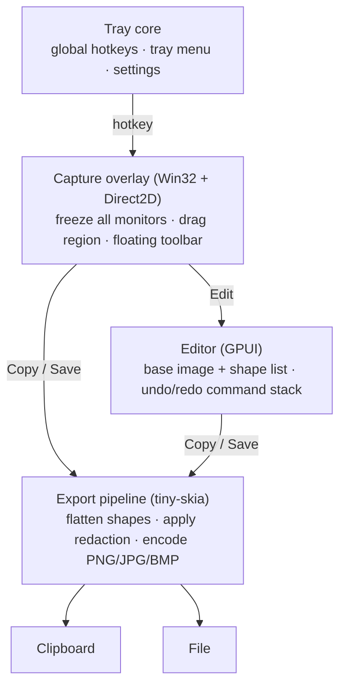
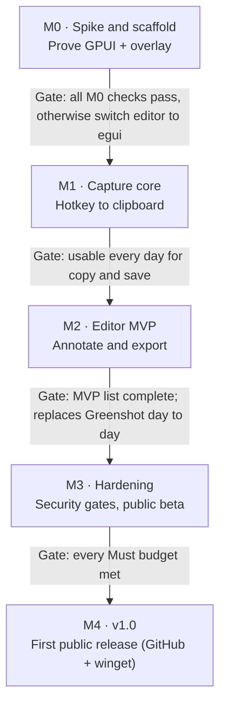

# Cleanshot — Charter & Build Spec

_Last updated: 2026-10-30_

## 0. How to use this file (agents read first)

This file is the source of truth for building Cleanshot. `CLAUDE.md` at the repo root points here; read this file before starting any task.

- **Precedence:** Hard constraints (C-xx) > Feature acceptance criteria (F-xx) > Conventions > everything else. If a task conflicts with a C-rule, stop and ask; never work around it.
- **IDs are stable.** Cite them in commit messages, PR titles, test names and code comments (`// F-21: never overwrite`). Never renumber; retire an ID by marking it *Removed*.
- **Work one milestone at a time** (section 10). One task = one small PR that passes the Definition of Done (section 7).
- **When the spec is silent:** choose the simplest option that satisfies the North Star, implement it, and add a one-line entry to the Decisions log (section 11) with `Status: assumed`. A human confirms or reverts it.
- **When the spec is ambiguous and the choice is hard to reverse** (new dependency, file format, public setting name, anything touching C-rules): ask before building.
- **Never** add a dependency outside the allow-list (section 6), add network or process-launching code, or upgrade the pinned GPUI revision unless the task says so.

## 1. North Star

**Fast, simple, secure: press a key, drag a box, get a clean, annotated image where you need it in under two seconds, from one small file that a corporate security team can approve without exceptions.**

Cleanshot is a Windows 11 screenshot-and-markup tool, a focused, memory-safe replacement for Greenshot's core loop. **Capture** a region, window or screen. **Annotate** it in a small editor. **Deliver** it to the clipboard or a file. That is the whole product.

It exists because Greenshot's extras (upload plugins, external commands, IPC) are where its 2025–26 CVEs lived, and they make it hard to approve in corporate environments. Cleanshot never writes that code.

**The test for every change:** does it make capture → annotate → deliver faster or clearer *without adding attack surface*? If not, it does not ship.

## 2. Hard constraints

These are invariants. Code that violates one is a bug, whatever the task said. Each one marked **[CI]** is enforced automatically (section 7).

### Platform and packaging

| ID | Rule |
| --- | --- |
| C-01 | Windows 11 22H2 (build 22621) or later only. No Windows 10, Linux or macOS code paths, shims or `cfg` branches. |
| C-02 | Ship **one file**: `cleanshot.exe`. Static CRT, all assets embedded. No side-by-side DLLs, no installer, no runtime prerequisites. **[CI]** |
| C-03 | Runs as a standard user. Manifest declares `asInvoker`; never writes `HKLM`, `Program Files` or other machine-wide locations. |
| C-04 | Per-Monitor v2 DPI aware. All capture geometry is in physical pixels. |
| C-05 | Settings live in `cleanshot.toml` next to the exe if one exists (portable mode), otherwise `%APPDATA%\Cleanshot\cleanshot.toml`. Nothing else is persisted by Cleanshot; Windows' Save As dialog keeps its own Recent items and per-user dialog history, as any program's does (D-84). |
| C-06 | Targets `x86_64-pc-windows-msvc`. Keep `aarch64-pc-windows-msvc` building in CI. **[CI]** |

### Security (from Greenshot's CVE history)

| ID | Rule | Why |
| --- | --- | --- |
| C-10 | **No network code.** No HTTP/socket/update clients; no network crates in the tree; binary must not import `ws2_32`, `winhttp`, `wininet`. **[CI]** | Attack surface; privacy |
| C-11 | **No process launching.** No `std::process::Command`, `ShellExecute*`, `CreateProcess*`, `WinExec`. "Show in folder" uses `SHOpenFolderAndSelectItems`. **[CI]** | [CVE-2026-22035](https://vuln.today/cve/CVE-2026-22035), [CVE-2026-25792](https://www.cvelogic.com/cve/CVE-2026-25792) |
| C-12 | **DLLs load from System32 only.** First line of `main`: `SetDefaultDllDirectories(LOAD_LIBRARY_SEARCH_SYSTEM32)`. Every imported DLL that is not a KnownDLL is delay-loaded, so it loads after that line. **[CI]** | DLL planting in Downloads |
| C-13 | **No untrusted deserialisation.** Only input formats are our TOML settings (typed struct, 64 KB cap) and, later, images the user pastes or drops (decoded with size limits). No project file format. | [CVE-2025-59050](https://www.sentinelone.com/vulnerability-database/cve-2025-59050/) |
| C-14 | **No IPC payloads.** Single instance via named mutex; a second launch sends a fixed, payload-free signal ("capture region") only within the same user session. | CVE-2025-59050 (WM_COPYDATA) |
| C-15 | **Safe file names.** Templates use only `{date}`, `{time}`, `{n}`. Reject `..`, reserved names (`CON`, `NUL`, `COM1`…), `:` streams and paths outside the target folder. Never overwrite, except a name the user confirmed replacing in the Save As dialog (F-22); otherwise append `-2`, `-3`… | CVE-2026-22035 |
| C-16 | `#![forbid(unsafe_code)]` in every crate except `cleanshot-win`. Every `unsafe` there carries a `// SAFETY:` comment. **[CI]** | Memory safety |
| C-17 | Release builds enable ASLR, DEP and Control Flow Guard. **[CI]** | Exploit mitigation |

### Privacy

| ID | Rule |
| --- | --- |
| C-20 | No telemetry, analytics, crash upload or update checks. |
| C-21 | No temp files and no capture history kept by Cleanshot. Pixels stay in memory until the user copies or saves them. A copy enters Windows' clipboard history like any program's copy (D-84). |
| C-22 | Redaction is destructive in every output: covered pixels are replaced, not overlaid, at every strength from 8 px up. Below 16 px, the strength text was proved unreadable at, the editor warns that text may stay readable (D-132). |
| C-23 | Logging is off by default; `--log` writes to the settings folder, never logs pixel data or clipboard contents. |

### Scope (never build)

| ID | Out of scope |
| --- | --- |
| C-30 | Uploading or sharing of any kind (Imgur, Jira, Confluence, email, Office, printers, cloud). |
| C-31 | Plugins, scripting, external commands. |
| C-32 | Screen recording, GIFs, OCR, scrolling capture. |
| C-33 | Layers panel or general-purpose image filters. |
| C-34 | Installer, auto-updater, `.greenshot` file import. |

## 3. Feature spec: capture

The capture UI follows macOS Sequoia's Screenshot tool: a dimmed freeze-frame, a floating pill toolbar and a post-capture thumbnail. It uses Cleanshot's own design language (section 4, "Visual design language"), not Windows 11 Fluent styling.

```text
┌──────────────────────────────────────────────────────────────────────┐
│░░░░░░░░░░░░░░░░░░░ frozen screen, dimmed ~40% ░░░░░░░░░░░░░░░░░░░░░░│
│░░░░░░░░░(1)■━━━━━━━━━━━━━━━■━━━━━━━━━━━━━━━■░░░░░░░░░░░░░░░░░░░░░░░░│
│░░░░░░░░░░░░┃                               ┃░░░░░░░░░░░░░░░░░░░░░░░░│
│░░░░░░░░░░░░■     selection: full bright     ■░░░░░░░░░░░░░░░░░░░░░░░│
│░░░░░░░░░░░░┃     accent border, 8 handles  ┃░░░░░░░░░░░░░░░░░░░░░░░░│
│░░░░░░░░░░░░■━━━━━━━━━━━━━━━■━━━━━━━━━━━━━━━■░░░░░░░░░░░░░░░░░░░░░░░░│
│░░░░░░░░░░░░░░░░░░░░░░░░░░░░░░░░░░( W × H px )░░░░░░░░░░░░░░░░░░(3)░│
│░░░(2)╭─────────────────────────────────────────────────────╮ ┌─────┐│
│░░░░░░│ [Region] Window Screen │ Options▾       │ [Copy] Save Edit × │ │thumb││
│░░░░░░╰─────────────────────────────────────────────────────╯ └─────┘│
└──────────────────────────────────────────────────────────────────────┘
(1) Frozen screen dimmed; the selection stays bright, with resize handles and a live size pill
(2) Floating toolbar on the active monitor: mode, options, then Copy · Save · Edit (the timer is on the capture panel, F-11)
(3) After capture, a thumbnail floats bottom-right: click to edit, drag into any app, or let it slide away
```

**Flow:** hotkey → grab all monitors into memory *first* → show overlay over the frozen image → select → Copy / Save / Edit. The overlay can never appear in the capture.

| ID | Feature | Milestone | Acceptance criteria |
| --- | --- | --- | --- |
| F-01 | Region capture | M1 | Hotkey shows the overlay on every monitor in < 100 ms (p95). Drag selects. Output pixels equal the screen at physical resolution on mixed-DPI setups (golden test). Esc cancels and writes nothing. |
| F-02 | Freeze-frame overlay | M1 | Screen dimmed ~40%; selection undimmed with a 1.5 px accent border and 8 handles; live `W × H` pill in physical px. A click that does not move past Windows' drag distance picks the window under it as the selection, and a drag selects a region (D-122). One topmost, no-activate window per monitor, drawn with Direct2D; Esc is a hotkey while it is up (D-23). |
| F-03 | Adjust selection | M1 | Handles resize, dragging inside moves, arrows nudge 1 px (Shift: 10 px), Enter commits. |
| F-04 | Loupe | M1 | Shown only while dragging: 8× zoom, pixel grid, cursor coordinates, hex colour under cursor. |
| F-05 | Floating toolbar | M1 | Frosted-glass pill (its background is the frozen capture, blurred and tinted by us; no DWM backdrop needed), centred near the bottom of the cursor's monitor, flips to the top so it never covers the selection. Groups: Region / Window / Screen · Options · **Copy** (Enter, default) / Save (Ctrl+S) / Edit (E) / × (Esc). Fully keyboard-navigable; every control has an accessible name. |
| F-06 | Last region | M1 | Shift+PrtSc captures the previous rectangle with no overlay and runs the default action. |
| F-07 | Full screen | M1 | Ctrl+PrtSc captures the monitor under the cursor. |
| F-08 | Window capture | M4 | Hover highlights the window under the cursor using DWM extended frame bounds (no shadow); click captures. The region overlay does the same until something is selected: hover highlights, and a click picks the window as the selection (D-122). |
| F-09 | Post-capture thumbnail | M4 | After Copy/Save, a preview slides in bottom-right for `thumbnail_ms` milliseconds, 1000 to 60000, default 5000 (D-165). Click opens the editor; drag-out delivers a PNG via OLE drag-and-drop; hover shows Save / Dismiss. A no-activate tool window that never steals focus. Can be disabled. |
| F-10 | Timer | M4 | Off / 3 / 5 / 10 s countdown before the freeze. |
| F-11 | Capture panel hotkey | M4 | Ctrl+Shift+5 shows the toolbar before selection (mode, timer, options). |
| F-12 | Options menu | M4 | Save folder, format, show pointer, show thumbnail, remember last selection. Changes persist to settings. |
| F-13 | Motion and contrast | M1 | Fades of 120–150 ms, none when Windows "Animation effects" is off; high-contrast themes use system colours. |

## 4. Feature spec: outputs, editor, app

### Outputs

| ID | Feature | Milestone | Acceptance criteria |
| --- | --- | --- | --- |
| F-20 | Copy | M1 | Clipboard gets `CF_DIBV5` and a registered `PNG` format. Pastes correctly into Outlook, Teams, Word, Paint and Edge (manual checklist). |
| F-21 | Save | M1 | Writes to the configured folder (default: Pictures\Screenshots) using template `Screenshot {date} {time}`. PNG by default; JPG (quality 90) and BMP optional. Obeys C-15. Write is atomic (temp name in the same folder, then rename). |
| F-22 | Save As | M1 | Ctrl+Shift+S opens the native save dialog. Choosing an existing file asks before replacing it; on yes the file is replaced atomically. |
| F-23 | Edit | M2 | Opens the editor with the capture, sized round it at 100% where it fits (D-110). The overlay closes first. It opens in front, with the keyboard (D-124). |
| F-24 | Identical output | M2 | Copy/Save from the overlay and from the editor run the same export code; a golden test proves byte-identical PNG for the same document. |

### Editor

One surface: the editor's own 48 px caption row in place of a title bar, holding the tools, the property strip for the selected tool, Copy and "..." right after it (D-162), empty space that moves the window, and the caption buttons; below it the image on a card with 10 px corners and a soft shadow, the window showing 12 px round it on the left, right and bottom. No title bar band, status bar, side panel or bottom bar (D-141). Nothing in the row is ever clipped: the strip's groups that do not fit go, from the right, behind a "More properties" chevron that opens them in a panel under it; the tools, Copy, "..." and the caption buttons never do, and the window cannot be made narrower than they and the chevron need (D-161). The tools sit in six buttons: Select (V); Shapes: Arrow (A), Line (L), Rectangle (R), Ellipse (O), Pen (P); Text: Text (T), Speech bubble (B), Numbered step (N); Attention: Highlighter (H), Spotlight (S); Redact (X); Crop (C). A button with more than one tool shows the one last picked from it, by its menu or its key, with a small chevron; a click, Enter, Space or Alt+Down opens its menu, each row the tool's icon, name and key, worked with Up, Down, Enter and Esc. Every key still picks its tool at once (D-143). Copy is the one primary button, a pill, after the strip rather than at the window's right edge, so the empty space sits beside the caption buttons as a title bar's does (D-162); "..." opens a menu of Save, Save As, Undo, Redo, Fit to window, Actual size and Settings, each row showing its shortcut, and every shortcut works without the menu (D-144). Fitted, the image fills its card; zoomed out, the card shrinks to the image, and the window's glass, or its solid fill, shows round it (D-158). A colour picked on the strip is the colour that tool draws in next; the other tools keep their own (D-156). A colour setting (Colour, Border colour) is one button showing the colour; it opens a palette of 11 colours and a rainbow swatch, which opens the picker: a shade square, a hue bar, a hex box taking `RRGGBB` or `RGB`, "From image", which takes the colour of the next pixel pressed on the screenshot (Esc cancels), and the colours picked this session. A palette colour closes the popup; the picker sets its colour when the press on the square or bar comes up, or on Enter in the hex box, and stays open (D-147). A press or a drag anywhere on the hue bar or the shade square moves it; both are sliders a screen reader names with their values, and Left and Right step the hue by 5 degrees or the saturation by 5%, Up and Down the brightness, each step setting the colour (D-154). Shapes stay editable objects until export.

| ID | Tool / feature | Key | Milestone | Acceptance criteria |
| --- | --- | --- | --- | --- |
| F-30 | Select, move, resize, delete | V, Del | M2 | Click selects topmost shape; handles resize; Shift constrains. Esc returns to Select with nothing selected (D-111). Each drawing tool also selects, moves and resizes the shapes it draws (D-118). |
| F-31 | Arrow, line | A, L | M2 | Default red, 3 px; Shift snaps to 45°. |
| F-32 | Rectangle, ellipse | R, O | M2 | Outline by default; optional fill. |
| F-33 | Pen (freehand) | P | M2 | Smoothed polyline. |
| F-34 | Text | T | M2 | Multi-line, IME works, Ctrl+A/Backspace behave like a text box. A double-click with any tool reopens a text (D-126). Lines align left, centre or right, picked on the strip and stored on the shape (D-129). Text size is a preset or a value from 8 to 200 pixels typed on the strip (D-130). |
| F-35 | Highlighter | H | M2 | Translucent yellow, multiply blend. Strength on the strip: Light, Medium or Strong (D-123). The editor shows it as the export multiplies it (D-125). |
| F-36 | Redact | X | M2 | Pixelate (default) or blur; destructive on export (C-22); a test asserts that original pixels are absent from the output. Strength on the property strip sets the cell side, which is also the blur radius: 16 (default), 24, 32 or 48 pixels, or a value from 8 to 512 typed beside them, for the next redaction or the selected one. From 8 to 15 the strip shows "May be readable" beside the value, with the tooltip "Smaller blocks can leave text readable" (D-123, D-130, D-132). |
| F-37 | Crop | C | M2 | Non-destructive in the document; applied on export. The editor shows only what the crop keeps, as the export does, and fits the view to it (D-113, D-127). With the Crop tool picked, the view shows the whole image and the crop can be moved and resized by its handles (D-118), and the strip shows Apply and Cancel. The crop being drawn is a draft until applied. Apply, Enter or a double-click inside the crop makes it one edit to undo; Cancel or Esc drops it and changes nothing else; either goes back to the tool picked before Crop. Picking another tool keeps the crop (D-159). |
| F-38 | Undo / redo | Ctrl+Z / Ctrl+Y | M2 | Unlimited within the session; every edit is a command. Undo and Redo are rows of the editor's "..." menu, dimmed when there is no step, otherwise naming it ("Undo arrow") (D-116, D-144). Ctrl+] and Ctrl+[ move the selected shape forward or back one step, with Shift to the front or back, each an edit to undo (D-115). Right-clicking a shape selects it and opens a menu of the same four moves, each showing its shortcut; a move that would change nothing is dimmed and skipped by the arrow keys. |
| F-39 | Zoom / pan | Ctrl+wheel, wheel, Space-drag, Ctrl+0 fit, Ctrl+1 actual size | M2 | Smooth on a 4K image. Actual size puts one image pixel on each screen pixel, about the middle of the image card (D-144). Once the view is zoomed or panned, a panel in the card's bottom-right corner shows a minimap of the capture with the part in view framed (a press or drag on it moves the view there), then minus, the zoom as a percentage (a click shows actual size), plus and Fit; thin bars on the card's right and bottom edges mark the part in view where the image runs past the card. At Fit the panel and bars are gone (D-145). The wheel pans up and down, Shift+wheel and the tilt wheel across, only along a side where the image runs past the card and never past its edges; dragging a bar pans that way, its thumb staying under the pointer (D-160). When the image fits the card at actual size, Fit and Actual size zoom to the same scale: Fit is dimmed on the panel and in the "..." menu, its tooltip says "Already fits", and Actual size returns to the fitted view (D-167). |
| F-40 | Copy / save from editor | Ctrl+C, Ctrl+S | M2 | Uses F-24's pipeline. Copy is a pill button in the editor's caption row; Save and Save As are rows of its "..." menu. Each does what its shortcut does and shows the shortcut (D-133, D-144). |
| F-41 | Numbered step | N | M4 | Auto-increments 1, 2, 3…; renumbers when one is deleted. |
| F-42 | Speech bubble | B | M4 | Text box with a draggable tail. The box's sides and corners set its width and the text wraps inside it at the same size (D-119), and set its height, never lower than the wrapped text (D-128). Dragging with the bubble tool sets the box's width and height from the start; a click opens a box that grows with the text. A double-click with any tool reopens a bubble (D-126). Its text aligns across and down the box, picked from a grid of nine on the strip (D-129). |
| F-43 | Spotlight | S | M4 | Dims everything outside the rectangle. How dark is one setting for the image, Light, Medium or Dark, on the strip while a spotlight is picked (D-123). |
| F-44 | Shape shadow and border | — | M4 | An arrow, line, rectangle, ellipse, text, numbered step or speech bubble can cast a soft shadow, toggled by Shadow on the property strip while that shape or its tool is picked (D-114), and have a border in any palette colour, 2, 4 or 6 image pixels wide, drawn under it (D-131). A highlight or spotlight can have a border too, a band just outside its rectangle (D-134). The border's colour and width show on the strip only while Border is ticked (D-135). Shadow and Border sit in the strip's Shape group while a drawing tool is picked or a shape is selected. There is no border or shadow round the whole exported image: the Image frame group was dropped on purpose (D-166). |

### App, tray and settings

| ID | Feature | Milestone | Acceptance criteria |
| --- | --- | --- | --- |
| F-50 | Tray icon | M1 | Menu: Capture region, Capture screen, Settings, Exit. Double-click = capture region. |
| F-51 | Global hotkeys | M1 | Defaults below; remappable in settings; registration failures are shown, not swallowed. |
| F-52 | PrtSc conflict | M1 | Detects Windows 11's "Use the Print screen key to open screen capture" setting at start. While it is on, a bare PrtSc region hotkey is replaced by the fallback Ctrl+Shift+4 for that run, and a tray balloon names the setting's place (Settings > Accessibility > Keyboard). Cleanshot does not open Settings itself (C-11). |
| F-53 | Single instance | M1 | Obeys C-14; a second launch triggers region capture in the first instance. |
| F-54 | Settings file | M1 | Obeys C-05 and C-13; unknown keys ignored; invalid values fall back to defaults with one warning. A `save_folder` over 10,581 UTF-8 bytes is an invalid value, so a file written back from what was read stays under the C-13 cap. A `save_folder` starting with two slashes of either kind or with `\??\` (a share or a device, such as `\\server\share`) is an invalid value (C-10, D-83). A `thumbnail_ms` that is not a whole number from 1000 to 60000 is an invalid value (D-165). |
| F-55 | Settings window | M4 | Hotkeys, save folder, format, after-capture default, thumbnail and how long it stays (a second shorter or longer per press of - or +, D-157), start with Windows. It opens in front, and asking for it while open brings it to the front (D-124). It has the editor's surface: no title bar band, its own caption row with the title "Settings" and the same minimise, maximise and close buttons, glass or solid by the editor's rule (D-148). |
| F-56 | Start with Windows | M4 | Per-user `HKCU\…\Run` entry, only when the user turns it on in the settings window, removed when they turn it off. The entry is the only record of the choice (D-93). Adds its row to `docs/security.md`. |
| F-57 | Admin policy | M4 | Reads `HKLM\SOFTWARE\Policies\Cleanshot` (read-only): lock save folder, disable save (clipboard only), force PNG, hide settings. Adds its row to `docs/security.md`. |
| F-58 | Themes and accessibility | M2 | Follows system light/dark; all controls keyboard-reachable and labelled. A button that opens a menu or popup tells UI Automation whether it is open, and a screen reader's expand and collapse open and close it as a click does (D-168). |
| F-59 | Remembered tool looks | M4 | What the property strip last set for each tool (colour, stroke width, fill, shadow, border and its colour and width, redaction and its strength, highlight strength, text size, alignment) is kept in the settings file's `[looks]` table as the strip changes it, and each editor opens with it, after a restart too. Only values that differ from the tool's default are written, the colour among them as `looks.<tool>.color`; a `looks.color` from an older file is the colour of each tool that names none (D-156). Each value is read on its own (F-54): one that is not a value the strip offers falls back to that value's default alone, with the F-54 warning naming its key; unknown keys and tools are ignored (D-149). |

**Default global hotkeys:** PrtSc (fallback Ctrl+Shift+4) = region · Shift+PrtSc = last region · Ctrl+PrtSc = full screen · Alt+PrtSc = window (M4) · Ctrl+Shift+5 = capture panel (M4).

### Visual design language

Cleanshot has its own clean, calm look modelled on macOS Sequoia, not on Windows 11 Fluent. Windows conventions are used only where users or the OS require them (list below).

**Principles:** content first, chrome recedes. Few surfaces, generous spacing, quiet colour, one accent. Floating panels over the content instead of docked bars wherever practical; the editor's one caption row is the exception, as it replaces the title bar (D-141).

| Token | Value |
| --- | --- |
| Materials | Frosted glass: content behind is blurred (~30 px) and tinted. Dark: `rgba(28,28,30,0.72)`; light: `rgba(246,246,248,0.72)`. Follows system light/dark. |
| Edges | 1 px hairline border (white 12% on dark, black 10% on light) plus a soft shadow (0 8 24, 25% black). No heavy outlines. |
| Corner radii | Panels and toolbars 12 px; the editor's image card 10 px; buttons, inputs and chips 7 px; capture toolbar is a full pill. |
| Spacing | 4 px grid; 8 px between related controls, 16 px between groups. |
| Typography | Inter (embedded, OFL-1.1) with Segoe UI Variable as fallback. Body 13 px, secondary 11 px, titles 15 px semibold. |
| Icons | Monochrome line icons from Lucide (ISC), 16 px at 1.5 px stroke, embedded as vector paths. |
| Colour | Neutral greys plus one blue accent for the primary action and selection. Annotation colours are separate and user-chosen. The current choice keeps its accent under the pointer: hover greys only what is not chosen (D-155). |
| Motion | 150–250 ms ease-out fades and slides; none when Windows "Animation effects" is off. |
| Tooltips | Every button shows its name on hover, then its shortcut in brackets when it has one ("Highlighter (H)"); a button that is off says why ("Nothing to undo"). Shown after the system hover delay, hidden on leave or press; panel material, hairline border, 7 px corners, 12 px text. The text comes from the same table as the button's UI Automation name and shortcut (D-117). |

**Live blur:** in the capture overlay, Cleanshot blurs the frozen capture itself, so it needs no OS support. The editor window is glass: Windows blurs the desktop behind it (GPUI's Blurred background, the acrylic blur-behind) and Cleanshot tints it, dark `rgba(30,32,40,0.42)`, light `rgba(250,251,253,0.55)`, under its caption row and round the image's opaque card. It opens solid instead (`#2C2C2E` dark, `#E5E5EA` light) when Windows' Transparency effects are off or a high-contrast theme is on, read as the window opens (D-142). Round the image card glows the capture's own average colour, a 90 px blur at 28% opacity, taken once per capture from 64 by 64 pixels spread over it (D-146). Settings and the thumbnail use a solid material colour. Never fake blur with a screenshot of the live desktop.

**Where Windows conventions win (required):**

- Caption buttons (minimise, maximise, close) top-right, with Snap layouts, Alt+F4 and Win+arrow behaviour intact. No macOS traffic lights. Where Cleanshot draws its own caption row (the editor, D-141), the buttons use Windows' Segoe Fluent Icons glyphs and close turns red under the pointer, and Windows works them and the row's empty space through hit testing, as it works a title bar: drag, double-click to maximise, snap.
- Ctrl-based shortcuts (never Cmd/⌘ glyphs); Alt opens menus where menus exist.
- Native tray icon and menu, native file dialogs, Windows notifications if any are ever used.
- High-contrast themes, visible keyboard focus, UI Automation accessibility, and system text scaling all take precedence over the visual style.

**Never ship Apple assets.** No SF Pro, SF Symbols, Apple wallpapers or copied Apple UI artwork; their licences restrict them to Apple platforms. Take the *style*, not the assets.

## 5. Architecture

Four layers, one binary. The overlay is native Win32 + Direct2D for latency and DPI control; the editor is GPUI; every output goes through one CPU export pipeline.



Copy and Save from the overlay skip the editor entirely but use the same export code, so output is identical either way.

### Cargo workspace

Crate boundaries are the main guardrail for agents: put code in the crate that owns the concern, and never add OS calls outside `cleanshot-win`.

```text
cleanshot/
├─ Cargo.toml                 # workspace, [profile.release], MIT OR Apache-2.0
├─ .cargo/config.toml         # crt-static, control-flow-guard rustflags
├─ deny.toml                  # cargo-deny: bans, licences, advisories, sources
├─ crates/
│  ├─ cleanshot-app/          # [bin] main, lifecycle, tray, hotkeys, wiring. Thin.
│  ├─ cleanshot-core/         # Document, Shape, Style, Command, undo stack, settings types.
│  │                          #   Pure Rust, no OS, no I/O. Highest test coverage.
│  ├─ cleanshot-render/       # Flatten Document -> RGBA with tiny-skia; redaction; PNG/JPG/BMP encode.
│  │                          #   Golden-image tests live here.
│  ├─ cleanshot-win/          # The ONLY crate allowed `unsafe`: capture, overlay windows (Direct2D),
│  │                          #   clipboard, DPI, DLL hardening, single instance, policy, file save.
│  ├─ cleanshot-editor/       # GPUI editor + settings window. Talks to core via Commands only.
│  └─ cleanshot-fieldtest/    # [bin] probe and field test for a Windows machine. Never shipped;
│                             #   its Win32 calls are cleanshot-win's `field-test` feature.
├─ assets/                    # icons, embedded with include_bytes!
├─ tests/golden/              # reference PNGs for render + DPI tests
├─ docs/CHARTER.md            # this file
├─ docs/decisions.md          # the Decisions log, in fold order
├─ docs/acceptance.md         # the owner's hands-on pass before v1.0.0 (D-102)
└─ docs/decisions/            # one file per decision (ADR-lite)
```

Dependency direction: `app → {editor, win, render, core}`, `fieldtest → {editor, win}`, `editor → {render, core}`, `render → core`, `win → core`. `core` depends on nothing in the workspace. Nothing depends on `fieldtest`, and `app` never turns on `win`'s `field-test` feature (`charter-gates.sh` checks).

### Core types

The types live in `crates/cleanshot-core`; read them there. All coordinates are f32 in base-image physical pixels.

- **Document**: the frozen capture, its shapes in z-order and an optional crop. Changed only through `History`.
- **Shape**: one annotation (arrow, line, rectangle, ellipse, pen, text, highlight, redact), drawn with a `Style`. Step, bubble and spotlight arrive with M4.
- **Command**: one edit (add, remove, replace or restack a shape, set the crop). Every edit is a command (F-38).
- **History**: a document with its edits, undoable and redoable without limit. It issues shape ids (D-26).
- **Settings**: what `cleanshot.toml` holds, read field by field so a bad value keeps its default (F-54, D-30).

### Runtime model

- **UI thread:** the GPUI event loop. Tray, hotkeys and overlay windows live on this thread unless the M0 spike shows they must not. In that case the overlay gets its own Win32 message-loop thread and talks to the UI thread over a channel.
- **Capture:** on hotkey, copy every monitor to memory before creating any window: DXGI Desktop Duplication, or GDI `BitBlt` when duplication is refused (D-28).
- **Worker thread:** encode and file writes, so the UI never blocks; clipboard writes happen on the UI thread (OLE requirement).
- **Export:** `render::flatten(&Document, &TextMasks) -> RgbaImage` is the single source of output pixels (F-24). Text glyph coverage comes from DirectWrite in win as plain masks (core's `TextMasks`), made by the same glyph path GPUI draws on screen; render composites them, so render stays pure Rust.

## 6. Dependency allow-list

Only these direct dependencies are allowed. Adding one means a Decisions-log entry and a `deny.toml` update in the same PR, and the reviewer must approve it explicitly. Prefer a few lines of code in `cleanshot-win` over a new crate.

| Crate | Used by | Purpose | Notes |
| --- | --- | --- | --- |
| `gpui`, `gpui_windows` (git, pinned rev) | editor | UI framework | DirectX 11 + DirectWrite on Windows. `default-features = false`. Started only through the editor's restricted platform (D-15). Fallback: `eframe`/`egui` if M0 fails. Never bump the rev without a task. |
| `futures`, `smallvec` | editor | Types named by GPUI's `Platform` trait | Same versions GPUI already uses; nothing else (D-16). |
| `raw-window-handle` | editor | Read a GPUI window's Win32 handle, for the app to bring it to the front | The version GPUI already uses; owner, 2026-11-03 (D-16, D-124). |
| `windows` | win | Win32, DWM, Direct2D, DXGI, OLE, Shell | Enable only the feature modules used. |
| `windows-core` | win | `#[implement]`, for COM objects Windows calls back (the DirectWrite text renderer) | The version `windows` uses; `deny.toml` bans it everywhere else in the workspace (D-60). |
| `tiny-skia` | render | Rasterise shapes for export | Pure Rust. |
| `image` (`png`, `jpeg`, `bmp` only) | render, editor | Encode/decode; the editor only builds the bitmap GPUI draws | `default-features = false`. The editor enables no format feature (D-18). |
| `global-hotkey` | app | System-wide hotkeys | Tauri project. Replace with direct `RegisterHotKey` if it conflicts with GPUI's loop. |
| `tray-icon` | app | Tray icon and menu | Tauri project. Same fallback rule. |
| `rfd` | win | Native Save As dialog | Or `IFileSaveDialog` directly. |
| `serde`, `toml` | core | Settings | Typed structs only (C-13). |
| `tracing`, `tracing-subscriber` | app | Opt-in logging, if it outgrows D-62; unused while D-62's hand-written line writer covers it | C-23. |
| `thiserror`, `anyhow` | all / app | Errors | `anyhow` only in `cleanshot-app`. |
| `winresource` (build-dep) | app | Embed manifest, icon, version info | |

**Banned outright** (in `deny.toml`): anything that pulls in `hyper`, `reqwest`, `ureq`, `tokio` net features, `openssl`, `native-tls`, `rustls`, and any crate whose licence is not MIT, Apache-2.0, BSD, ISC, Zlib, Unicode or MPL-2.0. Clipboard is implemented directly in `cleanshot-win` rather than through `arboard`, to control the formats written (F-20).

**Embedded assets** (not crates, so not covered by `cargo deny`): Inter font (OFL-1.1) and Lucide icons (ISC). Record every embedded asset and its licence in `THIRD_PARTY_NOTICES.md`; adding one follows the same approval rule as a crate.

## 7. Engineering conventions and Definition of Done

### Build configuration

```toml
# Cargo.toml (workspace)
[workspace.package]
edition = "2024"
license = "MIT OR Apache-2.0"

[profile.release]
lto = "fat"
codegen-units = 1
panic = "abort"
strip = true
opt-level = 3        # switch to "s" only if the size budget is missed

# .cargo/config.toml
[target.'cfg(all(windows, target_env = "msvc"))']
rustflags = ["-C", "target-feature=+crt-static", "-C", "control-flow-guard"]
```

The app manifest (`crates/cleanshot-app/cleanshot.exe.manifest`, embedded by the app's build script) declares `asInvoker`, `PerMonitorV2` DPI awareness, the `supportedOS` GUID that covers Windows 10 and 11 (Windows 11 has no GUID of its own), and Common Controls v6.

### Code rules

- `cargo fmt`; `cargo clippy --all-targets -- -D warnings` with `clippy::pedantic` warnings reviewed, not blanket-allowed.
- Invariants (D-120): an "impossible" state is designed out by its type where that is cheap; where it is not, it crashes loudly with the invariant named (`expect("<the invariant>")`, or `panic!`/`unreachable!` with a message). Bare `unwrap()` and message-less panics only in tests and `main` start-up. Nothing supervises this process, so an invariant break is never caught and carried on, and no error is swallowed: a discarded `Result` says on its line why dropping it is safe. Expected failures reach the user as a short toast. Release keeps `panic = "abort"`, behind a panic hook that shows one fixed-text crash notice ("Cleanshot hit an internal error and closed.") and, under `--log`, writes a `panic` line with the source location only (D-109).
- Public functions in `core` and `render` get doc comments and unit tests.
- Name tests after IDs where they prove a criterion: `f21_never_overwrites_existing_file`, `c15_rejects_reserved_names`.

### Tests

| Layer | How |
| --- | --- |
| `core` | Unit and property tests (undo/redo round-trips, command invertibility). |
| `render` | Golden PNGs in `tests/golden/`: each shape, redaction, crop, effects. Fails on any pixel diff; update with an explicit `--bless` flag. Export is DPI-free by construction: flatten, redaction and encode work in image pixels, and the text masks are drawn one DIP to an image pixel with no transform, so no input carries the display scaling and one set of goldens holds at every DPI. |
| `win` | Integration tests on the Windows CI runner: capture of a known window at 100/125/150/175% DPI on the runner's display and 200% synthetically (D-71), monitors left of and above the primary synthetically, clipboard round-trip, file-name rules. |
| Manual | Release checklist: paste targets (F-20), multi-monitor mixed DPI, a monitor rotated to portrait (D-28 sizes a duplicated output from its desktop bounds, which a rotated output swaps), PrtSc conflict (F-52), high contrast. |

### CI gates (every push to `main` or `ci/**`, `windows-latest`)

Gates 3 and 4 are `charter-gates.sh`. It also checks that the exe's embedded manifest declares PerMonitorV2 (D-71), and the Decisions log (`docs/decisions.md`): each id appears once and each Status is assumed, decided, or decided by the owner or the orchestrator in the form `decided (owner, YYYY-MM-DD)`, the date optional. CI runs it on the release exe it builds and uploads. The fold bar on a Mac or Linux machine also runs it, on a scan-only exe that cargo-xwin builds with the `scan-only` profile. That exe is never shipped and cannot run: off Windows, GPUI's shaders cannot be compiled into it, so it reads them from the build machine's cargo checkout.

Gates 5–8 are judged by `cleanshot-fieldtest --budgets`, the one place the section 8 budgets are held and compared. P-02 is judged from the median its test prints (gate 8). P-07 and P-08 are judged only on the reference machine, from the probe report's bench lines; P-08 by D-57, against the refresh rate of the primary monitor the bench opens on (D-41).

1. fmt, `ast-grep scan` (the rules `sgconfig.yml` names), clippy, tests (x64), build (ARM64).
2. `cargo deny check` (advisories, bans, licences, sources) and `cargo audit`.
3. **Binary scan**: fail on imports from `ws2_32`, `winhttp`, `wininet`, or on `CreateProcess*` / `ShellExecute*` / `WinExec` (C-10, C-11); fail on `SetCursorPos`, which only the UI Automation tests' drag uses, so the product never moves the pointer (D-153); fail unless it imports `SetDefaultDllDirectories`, and on any static import that is not a KnownDLL (C-12); fail if ASLR, DEP or CFG is not set (C-17); fail unless the exe is a Windows GUI exe, so no console window opens beside the tray; fail if a delay-loaded DLL is not on the script's list of Windows DLLs (C-02); fail if the release exe, started beside a decoy DLL named for any DLL it loads that is not a KnownDLL, loads the decoy (C-12); fail unless the exe's only icon group is group 1 with the app icon at 16, 20, 24, 32, 40, 48, 64, 96 and 256 px (D-91); fail if the release exe's ASCII or UTF-16 strings hold a build-host path (`/Users/`, `/home/`, `\Users\`, `\.cargo\`, `:\a\`), so nothing about the builder ships.
4. `unsafe` scan: fail if a crate root other than `cleanshot-win`'s lacks `#![forbid(unsafe_code)]`, or `unsafe` appears outside `crates/cleanshot-win` (C-16).
5. Size check of the release exe: the release-exe job fails it at 15 MB or above (P-06).
6. Idle budgets: the release exe runs with `--log` for 15 s, and the job prints its `perf` lines and fails if P-03, P-04 or P-05 is over budget or its line is missing (D-62). A hosted runner is not the reference machine, so a pass here is a floor, not the release measurement.
7. Hotkey latency: the probe job runs the release exe with `--log` and Ctrl+Shift+4 as the region hotkey, `cleanshot-fieldtest --overlays <log>` waits up to 30 s for the exe's `perf P-03 tray_ready_ms` line and then 3 s more (D-88), opens and cancels the overlay 20 times, each press waiting up to 5 s for the last overlay's `P-01` line and for its windows to close, then 500 ms more, and the job fails unless every press shows and closes in time, all 20 `P-01` lines are there, and their p95 (the 19th fastest) is at most 150 ms, 1.5 times the P-01 budget, with the 100 ms verdict reported beside it (D-62, D-75). The first overlay after start is held to the same limits, the 100 ms verdict and the 150 ms floor (D-76), less Windows' first show of its window: the exe logs `perf P-01 first_show_ms=N`, the time from ShowWindow to that window's first frame, and the runner judges the first press without it and reports N beside it, not judged (D-150). The owner's PC judges the whole first press. After the last overlay, `--overlays` waits up to 15 s for the exe's after-use `perf P-04 private_working_set_bytes=N` line, and the job fails if it is missing or 10 MB or above (D-82); the line also carries `largest_heap_block_bytes` and `largest_allocation_bytes`, and `--overlays` waits up to 35 s for the exe's later `perf P-04 late_private_working_set_bytes=N` line, taken 30 s after the last capture with the same two keys prefixed `late_`; the verdict reports both, not judged (D-163). Then `cleanshot-fieldtest --exit <log>` sends the tray window `WM_CLOSE`, which exits as the menu's Exit does, and the job fails unless the window closes within 10 s and the log holds the exe's `tray icon_removed` line, written when the shell accepts the icon's removal (F-50). A second run, with Ctrl+Shift+7 as the full-screen hotkey, runs `cleanshot-fieldtest --editor <log>`: after the tray-ready wait it presses Ctrl+Shift+7 and then E, sends the editor window `WM_CLOSE` once its `P-07` line and the exe's `perf P-04 working_set_bytes` line are logged (the idle sample, 10 s after the tray is ready, so it is taken with the editor open; `--editor` fails if it is not logged within 15 s of the first frame), and the job fails unless the exe logs `perf P-04 after_editor_private_bytes=N` within 20 s of the close; the exe takes that sample 15 s after an editor closes (5 s of `GRAPHICS_IDLE`, then 10 s), and its value is reported, not judged. 5 s after that line, 20 s after the close and so long after `GRAPHICS_IDLE` has let the capture device and Direct2D go, `--editor` presses Ctrl+Shift+7 and then Esc once more, as a user's next capture would, and the job fails unless that overlay logs its `P-01` line and closes within 5 s each; `--editor` prints its time as "P-01 after idle", reported, not judged.
8. Copy latency: the probe job runs `cargo test --release -p cleanshot-app p02_`, which copies a synthetic 3840 x 2160 capture to the clipboard five times through the same `deliver` the overlay uses and prints the median as `perf P-02 median_us=N`; `cleanshot-fieldtest --budgets --runner --copy` fails the job if it is over 225 ms, 1.5 times the P-02 budget, with the 150 ms verdict reported beside it (D-90). The budget kit judges the same line against 150 ms on the reference machine. With `--log`, every copy from the overlay or the last-region hotkey also logs `perf P-02 copied_ms=N`, timed from the press that asked for it.

### Definition of Done (every task)

- [ ] Meets the acceptance criteria of every F-ID it touches; tests prove them where automatable.
- [ ] All CI gates green; no new warnings.
- [ ] No C-rule violated; no dependency added outside section 6.
- [ ] Performance budgets in section 8 not regressed (measure if the task touches capture, overlay or export).
- [ ] Decisions log updated for any assumption; this file updated if behaviour changed.
- [ ] Commit message: `F-21: atomic save with collision suffix` (IDs first, imperative, one change).

## 8. Performance budgets

Must budgets are release gates. Measure on the reference machine: a mid-range Windows 11 laptop with integrated graphics and a 1080p + 4K monitor pair at 100% / 150% scaling. Each budget gets a `perf` log line behind `--log` so agents can measure without a profiler.

| ID | Metric | Budget | Priority |
| --- | --- | --- | --- |
| P-01 | Hotkey → overlay visible | < 100 ms p95, and on the first press after start (D-76, D-152) | Must |
| P-02 | Release → image on clipboard, 4K region | < 150 ms | Must |
| P-03 | Main entered → tray ready (D-121); the time from process start to main is logged and reported beside it, judged against nothing | < 300 ms | Must |
| P-04 | Memory, idle and after use | Idle, tray only, before any capture, holding the prewarm's capture devices (D-152): < 25 MB working set. After use, 10 s after the last capture closes: < 10 MB private working set; shared pages are not counted (D-82) | Must |
| P-05 | Idle CPU | ~0%, no polling loops or timers | Must |
| P-06 | Release exe size | < 15 MB (stretch < 10 MB) | Must |
| P-07 | Editor first frame with a 4K image | < 400 ms | Should |
| P-08 | Editor with 200 shapes on 4K | 60 fps | Should |

## 9. Release and distribution

Releases ship as a bare, signed `cleanshot.exe` on GitHub Releases. A winget **portable** manifest points at that same exe, so `winget install` needs no admin and no installer.

### Release workflow (tag `vX.Y.Z` → GitHub Actions)

1. Build x64 (and ARM64, once enabled) on `windows-latest` from the tag; never on a developer machine. A scan-only exe from the fold bar is never released.
2. Run every CI gate (section 7) against the release binary.
3. Code-sign the exe through SignPath Foundation (D-74); until the first signed release, releases are unsigned and marked pre-release. `README.md` carries the code signing policy the Foundation requires.
4. Publish to GitHub Releases: `cleanshot-X.Y.Z-x64.exe`, the F-57 Group Policy template (`Cleanshot.admx`, `Cleanshot.adml`), the winget manifest filled with the version and the exe's SHA-256 (D-98), `SHA256SUMS`, CycloneDX SBOM, and a GitHub build-provenance attestation. `.github/workflows/release.yml` does steps 1, 2 and 4 on a tag, taking the release notes from the version's `CHANGELOG.md` section; a version with a pre-release suffix (`v1.0.0-rc.1`) or an exe with no signature publishes as a pre-release, a plain version with a signed exe as a release; run by hand, it builds and checks the same files and uploads them without publishing.
5. Open or update the winget-pkgs PR with a winget releaser action, such as `winget-releaser` (Komac). These tools update an existing package, so **v1.0.0 is submitted to `microsoft/winget-pkgs` by hand once**.

### winget manifest

The manifest is the three files in `winget/`, in winget-pkgs' multi-file layout (schema 1.12.0): `Cleanshot.Cleanshot.yaml`, `.installer.yaml` and `.locale.en-US.yaml`. PackageIdentifier `Cleanshot.Cleanshot`, publisher `Cleanshot` (D-98); a portable x64 installer with the `cleanshot` command, `MinimumOSVersion` 10.0.22621.0 (C-01), the licence `Cargo.toml` names, and homepage and release notes on the GitHub repository. Only `@VERSION@` and `@SHA256@` are left for a release to fill; `charter-gates.sh` holds the rest to this section and `Cargo.toml`.

### v1.0.0 checklist

1. The M3 gate has passed (D-77): every Must budget met on the reference machine, and the release workflow signs the exe (D-74).
2. Every M4 row is ticked.
3. A release candidate: `Cargo.toml` at `1.0.0-rc.N` with its `CHANGELOG.md` section, tagged `v1.0.0-rc.N` and published as a pre-release.
4. The owner's acceptance pass (D-102): on the reference PC, the owner works through `docs/acceptance.md` with that candidate, one hands-on step per M1 to M4 feature. Only the owner can do it, and a failed step means a fix and a new candidate.
5. `Cargo.toml` is version 1.0.0 and `CHANGELOG.md` has its `[1.0.0]` section.
6. Tag `v1.0.0`; the release workflow publishes a signed release that is not a pre-release.
7. On the owner's Windows PC: `winget validate` on the filled manifest, then in Windows Sandbox a clean `winget install --manifest`, the `cleanshot` command, and an uninstall.
8. The owner opens the microsoft/winget-pkgs pull request by hand. Agents never push to or open pull requests on another repository.
9. After it merges, a releaser action for later versions is its own decision.

Notes for agents:

- winget installs portable apps per user and adds a `cleanshot` command alias. Settings still resolve per C-05 (normally `%APPDATA%`), so `winget upgrade` keeps them.
- Repo files: `LICENSE-MIT`, `LICENSE-APACHE`, `SECURITY.md` (private disclosure, 90-day policy, GitHub Security Advisories), `CHANGELOG.md` (Keep a Changelog format), `docs/security.md` (the IT reviewers' overview: what the exe does and never does, and which gate, test or review holds each row; a change to what Cleanshot reads, writes or starts updates its row in the same commit).

## 10. Milestones and backlog

Milestones end at gates, not dates. Do them in order, and do not start a milestone's tasks until the previous gate has passed, except that M3 starts during the M2 trial (D-59) and M4 starts before the M3 gate (D-77).



### M0 · Spike and scaffold

- [ ] Scaffold the workspace (section 5), licences, `deny.toml`, and CI gates 1–5 running on an empty app. (Gates 1-5 written; first CI run pending a GitHub remote.)
- [ ] Tray-only GPUI app: idle < 1% CPU, opens and closes an editor window on demand.
- [ ] Overlay prototype: frozen capture on 2 monitors at mixed DPI in < 100 ms; pick GDI `BitBlt` vs DXGI Desktop Duplication (latency, HDR correctness) and log the decision.
- [ ] GPUI canvas: 4K image + 200 shapes at 60 fps; text input and IME work in a custom element. (IME proven by `f34_an_ime_composition_stays_marked_until_it_is_committed`, `f34_every_key_belongs_to_the_input_method_during_a_composition` and `f34_a_composition_in_progress_is_committed_as_it_stands`; the bench now pans and zooms, and its p95 against P-08 is pending a probe run.)
- [x] GPUI dependency audit: the release binary passes the C-10/C-11 import scan and `cargo deny`. GPUI ships an HTTP-client abstraction, so confirm nothing network-capable is linked.
- [ ] Release size < 15 MB; pinned GPUI rev builds reproducibly in CI.
- [x] **Gate:** record "GPUI" or "egui" in the Decisions log (D-29).

### M1 · Capture core

- [x] C-12 DLL hardening and C-14 single instance in `main`.
- [ ] F-01–F-07 and F-13: capture, overlay, selection, loupe, toolbar, last region, full screen.
- [ ] F-20–F-22: copy, save, Save As.
- [ ] F-50–F-54: tray, hotkeys, PrtSc conflict, single instance, settings file.
- [ ] **Gate:** usable every day for copy and save; P-01–P-05 measured.

### M2 · Editor MVP

- [x] Core document model and command/undo stack (section 5) with unit tests. (`history::tests`, from `f38_undo_is_unlimited` to `f38_undoing_a_removal_puts_the_shape_back_at_its_stacking_position`)
- [x] Render crate: flatten, redaction, encode, golden tests. (`cleanshot-render` `tests/golden.rs`; `c22_pixelate_leaves_no_original_pixel_in_the_area`, `c22_blur_leaves_no_original_pixel_in_the_area`; `f21_png_keeps_every_pixel`)
- [ ] F-23, F-24, F-30–F-40, F-58.
- [ ] **Gate:** the maintainer replaces Greenshot for two weeks without missing an M1/M2 feature.

### M3 · Hardening and beta

- [x] Golden DPI matrix (100/150/200%, negative-coordinate monitors) in CI. (100, 125, 150 and 175% for real in the `dpi` job, and `charter-gates.sh` fails an exe without PerMonitorV2 (D-71); 200% in `d71_a_region_across_a_200_percent_monitor_and_a_100_percent_one_keeps_physical_pixels` and `f05_a_monitor_too_small_for_the_toolbar_shows_none`; monitors left of and above the primary in `f03_a_drag_on_a_monitor_left_of_and_above_the_primary_selects_in_desktop_pixels` and the region, pointer, pill, toolbar and loupe tests named for them. A real monitor at a negative origin is the release checklist's multi-monitor row. Export needs none, see the `render` row of section 7's Tests table. Editor canvas: `d41_at_every_display_scaling_a_fitted_capture_has_each_pixel_on_its_own_device_pixel`.)
- [ ] All P-budgets measured on the reference machine; fixes for any Must miss. A manual run of `release.yml` uploads the `cleanshot-budget-kit` artifact: the gate-scanned exe, `cleanshot-fieldtest`, the `p02_` test binary and `budgets.bat`, which leaves only `results.txt`, each budget judged by `cleanshot-fieldtest --budgets`.
- [x] Release workflow (section 9) with SBOM, checksums, provenance; `SECURITY.md`. (v0.1.0, release run 41237644122.)
- [ ] Code signing in place.
- [ ] **Gate:** every Must budget met; public beta as a GitHub pre-release.

### M4 · v1.0

- [ ] F-08–F-12: window capture, thumbnail, timer, capture panel, options menu.
- [ ] F-41–F-44: numbered steps, speech bubble, spotlight, border/shadow.
- [ ] F-55–F-57: settings window, start with Windows, admin policy.
- [x] One-page security whitepaper for IT reviewers (what the binary does and does not do, with the CI evidence): `docs/security.md`.
- [ ] Tag v1.0.0; first winget-pkgs submission by hand.

**After v1.0 (not scheduled):** ARM64 release, rotate, paste/drop images (decoded under C-13 limits), torn-edge effect, translations.

## 11. Decisions, open questions, risks

### Decisions log

The log is [`docs/decisions.md`](decisions.md): rows are appended in fold order; ids are unique, not sequential.

### Open questions

- [x] winget `PackageIdentifier` / publisher name and the GitHub owner: `Cleanshot.Cleanshot`, publisher `Cleanshot`, on `IconRunner05/cleanshot` (D-98).
- [x] Code-signing route (signing service and who holds the certificate): SignPath Foundation (D-74).
- [x] ARM64 in the v1.0 release, or after? After: v1.0 ships x64 only (D-101).

### Known risks

- **GPUI churn or a network-capable dependency** → pinned rev, M0 audit, egui fallback. A rev bump rechecks every `Platform` method the restricted platform forwards (D-15), and the CI binary scan confirms it.
- **GPUI and tray/hotkey crates fighting over the Win32 message loop** → M0 spike; direct `RegisterHotKey` / `Shell_NotifyIcon` fallback.
- **SmartScreen and allow-lists blocking an unsigned exe** → sign before the public beta.
- **Windows 11 PrtSc owned by Snipping Tool** → F-52.
- **Licence contamination from Greenshot (GPL-3.0)** → implement from behaviour and docs only; never copy code, icons or strings.

## 12. Sources

- Greenshot: [repository](https://github.com/greenshot/greenshot), [licence and versions](https://www.versio.io/en/product-release-end-of-life-eol-greenshot-greenshot.html), [editor features](https://adminit.ucdavis.edu/node/986)
- Greenshot CVEs: [CVE-2025-59050](https://www.sentinelone.com/vulnerability-database/cve-2025-59050/), [CVE-2026-22035](https://vuln.today/cve/CVE-2026-22035), [CVE-2026-25792](https://www.cvelogic.com/cve/CVE-2026-25792), [CVE list](https://cve.imfht.com/product/greenshot?lang=en)
- GPUI: [Zed Windows renderer (DirectX 11)](https://zed.dev/blog/windows-progress-report), [renderer/memory discussion](https://github.com/zed-industries/zed/pull/46758), [gpui on docs.rs](https://docs.rs/crate/gpui/latest/source/src/elements/div.rs), [gpui-component and size comparison](https://github.com/longbridge/gpui-component), [binary-size discussion](https://github.com/longbridge/gpui-kit/discussions/1132)
- Crates: [global-hotkey](https://openapps.pro/packages/global-hotkey), [tray-icon](https://github.com/tauri-apps/tray-icon)
- winget: [portable manifest example](https://github.com/pepabo/xpoint-cli/pull/39), [winget-releaser workflow and first manual submission](https://raw.githubusercontent.com/mgpeter/spec-watcher/main/docs/publishing-winget.md)

**Prior art (reference, not dependencies):**

- [RustShot](https://github.com/CodyKoInABox/rustshot) (MIT): a native Windows Rust screenshot tool; its published overlay latency and memory figures are a good benchmark to beat.
