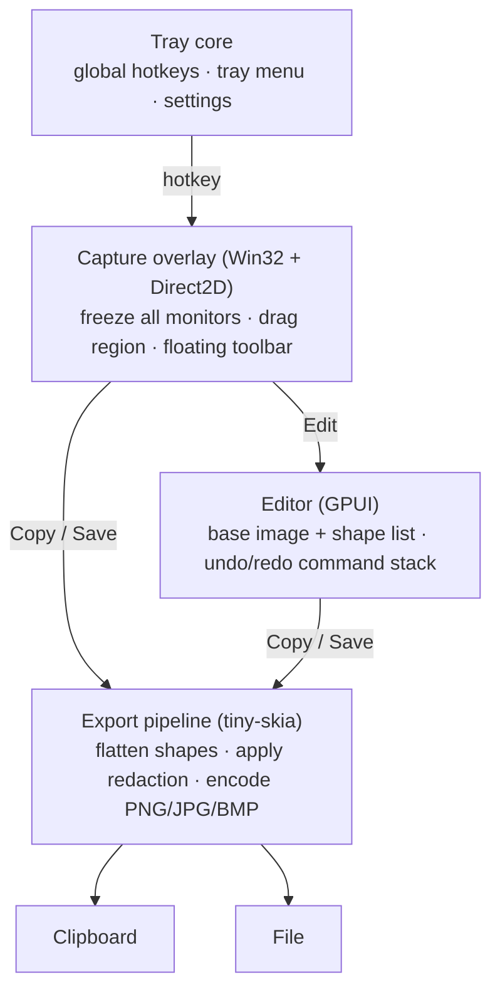
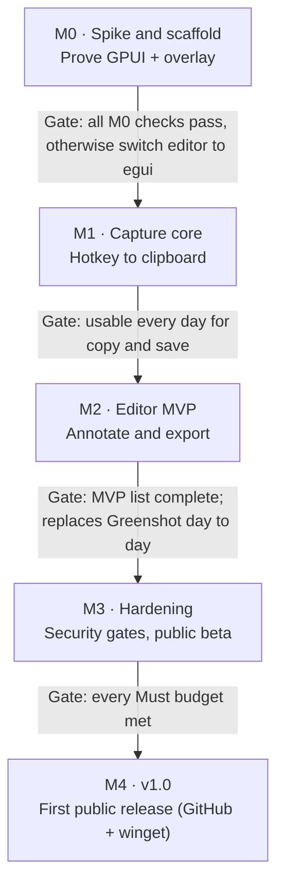

# Cleanshot — Charter & Build Spec

_Last updated: 2026-10-30_

## 0. How to use this file (agents read first)

This file is the source of truth for building Cleanshot. `CLAUDE.md` at the repo root points here; read this file before starting any task.

- **Precedence:** Hard constraints (C-xx) > Feature acceptance criteria (F-xx) > Conventions > everything else. If a task conflicts with a C-rule, stop and ask; never work around it.
- **IDs are stable.** Cite them in commit messages, PR titles, test names and code comments (`// F-21: never overwrite`). Never renumber; retire an ID by marking it *Removed*.
- **Work one milestone at a time** (section 10). One task = one small PR that passes the Definition of Done (section 7).
- **When the spec is silent:** choose the simplest option that satisfies the North Star, implement it, and add a one-line entry to the Decisions log (section 11) with `Status: assumed`. A human confirms or reverts it.
- **When the spec is ambiguous and the choice is hard to reverse** (new dependency, file format, public setting name, anything touching C-rules): ask before building.
- **Never** add a dependency outside the allow-list (section 6), add network or process-launching code, or upgrade the pinned GPUI revision unless the task says so.

## 1. North Star

**Fast, simple, secure: press a key, drag a box, get a clean, annotated image where you need it in under two seconds, from one small file that a corporate security team can approve without exceptions.**

Cleanshot is a Windows 11 screenshot-and-markup tool, a focused, memory-safe replacement for Greenshot's core loop. **Capture** a region, window or screen. **Annotate** it in a small editor. **Deliver** it to the clipboard or a file. That is the whole product.

It exists because Greenshot's extras (upload plugins, external commands, IPC) are where its 2025–26 CVEs lived, and they make it hard to approve in corporate environments. Cleanshot never writes that code.

**The test for every change:** does it make capture → annotate → deliver faster or clearer *without adding attack surface*? If not, it does not ship.

## 2. Hard constraints

These are invariants. Code that violates one is a bug, whatever the task said. Each one marked **[CI]** is enforced automatically (section 7).

### Platform and packaging

| ID | Rule |
| --- | --- |
| C-01 | Windows 11 22H2 (build 22621) or later only. No Windows 10, Linux or macOS code paths, shims or `cfg` branches. |
| C-02 | Ship **one file**: `cleanshot.exe`. Static CRT, all assets embedded. No side-by-side DLLs, no installer, no runtime prerequisites. **[CI]** |
| C-03 | Runs as a standard user. Manifest declares `asInvoker`; never writes `HKLM`, `Program Files` or other machine-wide locations. |
| C-04 | Per-Monitor v2 DPI aware. All capture geometry is in physical pixels. |
| C-05 | Settings live in `cleanshot.toml` next to the exe if one exists (portable mode), otherwise `%APPDATA%\Cleanshot\cleanshot.toml`. Nothing else is persisted by Cleanshot; Windows' Save As dialog keeps its own Recent items and per-user dialog history, as any program's does (D-84). |
| C-06 | Targets `x86_64-pc-windows-msvc`. Keep `aarch64-pc-windows-msvc` building in CI. **[CI]** |

### Security (from Greenshot's CVE history)

| ID | Rule | Why |
| --- | --- | --- |
| C-10 | **No network code.** No HTTP/socket/update clients; no network crates in the tree; binary must not import `ws2_32`, `winhttp`, `wininet`. **[CI]** | Attack surface; privacy |
| C-11 | **No process launching.** No `std::process::Command`, `ShellExecute*`, `CreateProcess*`, `WinExec`. "Show in folder" uses `SHOpenFolderAndSelectItems`. **[CI]** | [CVE-2026-22035](https://vuln.today/cve/CVE-2026-22035), [CVE-2026-25792](https://www.cvelogic.com/cve/CVE-2026-25792) |
| C-12 | **DLLs load from System32 only.** First line of `main`: `SetDefaultDllDirectories(LOAD_LIBRARY_SEARCH_SYSTEM32)`. Every imported DLL that is not a KnownDLL is delay-loaded, so it loads after that line. **[CI]** | DLL planting in Downloads |
| C-13 | **No untrusted deserialisation.** Only input formats are our TOML settings (typed struct, 64 KB cap) and, later, images the user pastes or drops (decoded with size limits). No project file format. | [CVE-2025-59050](https://www.sentinelone.com/vulnerability-database/cve-2025-59050/) |
| C-14 | **No IPC payloads.** Single instance via named mutex; a second launch sends a fixed, payload-free signal ("capture region") only within the same user session. | CVE-2025-59050 (WM_COPYDATA) |
| C-15 | **Safe file names.** Templates use only `{date}`, `{time}`, `{n}`. Reject `..`, reserved names (`CON`, `NUL`, `COM1`…), `:` streams and paths outside the target folder. Never overwrite, except a name the user confirmed replacing in the Save As dialog (F-22); otherwise append `-2`, `-3`… | CVE-2026-22035 |
| C-16 | `#![forbid(unsafe_code)]` in every crate except `cleanshot-win`. Every `unsafe` there carries a `// SAFETY:` comment. **[CI]** | Memory safety |
| C-17 | Release builds enable ASLR, DEP and Control Flow Guard. **[CI]** | Exploit mitigation |

### Privacy

| ID | Rule |
| --- | --- |
| C-20 | No telemetry, analytics, crash upload or update checks. |
| C-21 | No temp files and no capture history kept by Cleanshot. Pixels stay in memory until the user copies or saves them. A copy enters Windows' clipboard history like any program's copy (D-84). |
| C-22 | Redaction is destructive in every output: covered pixels are replaced, not overlaid. |
| C-23 | Logging is off by default; `--log` writes to the settings folder, never logs pixel data or clipboard contents. |

### Scope (never build)

| ID | Out of scope |
| --- | --- |
| C-30 | Uploading or sharing of any kind (Imgur, Jira, Confluence, email, Office, printers, cloud). |
| C-31 | Plugins, scripting, external commands. |
| C-32 | Screen recording, GIFs, OCR, scrolling capture. |
| C-33 | Layers panel or general-purpose image filters. |
| C-34 | Installer, auto-updater, `.greenshot` file import. |

## 3. Feature spec: capture

The capture UI follows macOS Sequoia's Screenshot tool: a dimmed freeze-frame, a floating pill toolbar and a post-capture thumbnail. It uses Cleanshot's own design language (section 4, "Visual design language"), not Windows 11 Fluent styling.

```text
┌──────────────────────────────────────────────────────────────────────┐
│░░░░░░░░░░░░░░░░░░░ frozen screen, dimmed ~40% ░░░░░░░░░░░░░░░░░░░░░░│
│░░░░░░░░░(1)■━━━━━━━━━━━━━━━■━━━━━━━━━━━━━━━■░░░░░░░░░░░░░░░░░░░░░░░░│
│░░░░░░░░░░░░┃                               ┃░░░░░░░░░░░░░░░░░░░░░░░░│
│░░░░░░░░░░░░■     selection: full bright     ■░░░░░░░░░░░░░░░░░░░░░░░│
│░░░░░░░░░░░░┃     accent border, 8 handles  ┃░░░░░░░░░░░░░░░░░░░░░░░░│
│░░░░░░░░░░░░■━━━━━━━━━━━━━━━■━━━━━━━━━━━━━━━■░░░░░░░░░░░░░░░░░░░░░░░░│
│░░░░░░░░░░░░░░░░░░░░░░░░░░░░░░░░░░( W × H px )░░░░░░░░░░░░░░░░░░(3)░│
│░░░(2)╭─────────────────────────────────────────────────────╮ ┌─────┐│
│░░░░░░│ [Region] Window Screen │ Timer Options▾ │ [Copy] Save Edit × │ │thumb││
│░░░░░░╰─────────────────────────────────────────────────────╯ └─────┘│
└──────────────────────────────────────────────────────────────────────┘
(1) Frozen screen dimmed; the selection stays bright, with resize handles and a live size pill
(2) Floating toolbar on the active monitor: mode, timer, options, then Copy · Save · Edit
(3) After capture, a thumbnail floats bottom-right: click to edit, drag into any app, or let it slide away
```

**Flow:** hotkey → grab all monitors into memory *first* → show overlay over the frozen image → select → Copy / Save / Edit. The overlay can never appear in the capture.

| ID | Feature | Milestone | Acceptance criteria |
| --- | --- | --- | --- |
| F-01 | Region capture | M1 | Hotkey shows the overlay on every monitor in < 100 ms (p95). Drag selects. Output pixels equal the screen at physical resolution on mixed-DPI setups (golden test). Esc cancels and writes nothing. |
| F-02 | Freeze-frame overlay | M1 | Screen dimmed ~40%; selection undimmed with a 1.5 px accent border and 8 handles; live `W × H` pill in physical px. One topmost, no-activate window per monitor, drawn with Direct2D; Esc is a hotkey while it is up (D-23). |
| F-03 | Adjust selection | M1 | Handles resize, dragging inside moves, arrows nudge 1 px (Shift: 10 px), Enter commits. |
| F-04 | Loupe | M1 | Shown only while dragging: 8× zoom, pixel grid, cursor coordinates, hex colour under cursor. |
| F-05 | Floating toolbar | M1 | Frosted-glass pill (its background is the frozen capture, blurred and tinted by us; no DWM backdrop needed), centred near the bottom of the cursor's monitor, flips to the top so it never covers the selection. Groups: Region / Window / Screen · Timer · Options · **Copy** (Enter, default) / Save (Ctrl+S) / Edit (E) / × (Esc). Fully keyboard-navigable; every control has an accessible name. |
| F-06 | Last region | M1 | Shift+PrtSc captures the previous rectangle with no overlay and runs the default action. |
| F-07 | Full screen | M1 | Ctrl+PrtSc captures the monitor under the cursor. |
| F-08 | Window capture | M4 | Hover highlights the window under the cursor using DWM extended frame bounds (no shadow); click captures. |
| F-09 | Post-capture thumbnail | M4 | After Copy/Save, a preview slides in bottom-right for ~5 s. Click opens the editor; drag-out delivers a PNG via OLE drag-and-drop; hover shows Save / Dismiss. A no-activate tool window that never steals focus. Can be disabled. |
| F-10 | Timer | M4 | Off / 3 / 5 / 10 s countdown before the freeze. |
| F-11 | Capture panel hotkey | M4 | Ctrl+Shift+5 shows the toolbar before selection (mode, timer, options). |
| F-12 | Options menu | M4 | Save folder, format, show pointer, show thumbnail, remember last selection. Changes persist to settings. |
| F-13 | Motion and contrast | M1 | Fades of 120–150 ms, none when Windows "Animation effects" is off; high-contrast themes use system colours. |

## 4. Feature spec: outputs, editor, app

### Outputs

| ID | Feature | Milestone | Acceptance criteria |
| --- | --- | --- | --- |
| F-20 | Copy | M1 | Clipboard gets `CF_DIBV5` and a registered `PNG` format. Pastes correctly into Outlook, Teams, Word, Paint and Edge (manual checklist). |
| F-21 | Save | M1 | Writes to the configured folder (default: Pictures\Screenshots) using template `Screenshot {date} {time}`. PNG by default; JPG (quality 90) and BMP optional. Obeys C-15. Write is atomic (temp name in the same folder, then rename). |
| F-22 | Save As | M1 | Ctrl+Shift+S opens the native save dialog. Choosing an existing file asks before replacing it; on yes the file is replaced atomically. |
| F-23 | Edit | M2 | Opens the editor with the capture. The overlay closes first. |
| F-24 | Identical output | M2 | Copy/Save from the overlay and from the editor run the same export code; a golden test proves byte-identical PNG for the same document. |

### Editor

One left toolbar, one contextual property strip (colour, stroke, font size), the canvas. Shapes stay editable objects until export.

| ID | Tool / feature | Key | Milestone | Acceptance criteria |
| --- | --- | --- | --- | --- |
| F-30 | Select, move, resize, delete | V, Del | M2 | Click selects topmost shape; handles resize; Shift constrains. |
| F-31 | Arrow, line | A, L | M2 | Default red, 3 px; Shift snaps to 45°. |
| F-32 | Rectangle, ellipse | R, O | M2 | Outline by default; optional fill. |
| F-33 | Pen (freehand) | P | M2 | Smoothed polyline. |
| F-34 | Text | T | M2 | Multi-line, IME works, Ctrl+A/Backspace behave like a text box. |
| F-35 | Highlighter | H | M2 | Translucent yellow, multiply blend. |
| F-36 | Redact | X | M2 | Pixelate (default) or blur; destructive on export (C-22); a test asserts that original pixels are absent from the output. |
| F-37 | Crop | C | M2 | Non-destructive in the document; applied on export. |
| F-38 | Undo / redo | Ctrl+Z / Ctrl+Y | M2 | Unlimited within the session; every edit is a command. |
| F-39 | Zoom / pan | Ctrl+wheel, Space-drag, Ctrl+0 fit | M2 | Smooth on a 4K image. |
| F-40 | Copy / save from editor | Ctrl+C, Ctrl+S | M2 | Uses F-24's pipeline. |
| F-41 | Numbered step | N | M4 | Auto-increments 1, 2, 3…; renumbers when one is deleted. |
| F-42 | Speech bubble | B | M4 | Text box with a draggable tail. |
| F-43 | Spotlight | S | M4 | Dims everything outside the rectangle. |
| F-44 | Border and drop shadow | — | M4 | Whole-image effects toggled from the property strip. |

### App, tray and settings

| ID | Feature | Milestone | Acceptance criteria |
| --- | --- | --- | --- |
| F-50 | Tray icon | M1 | Menu: Capture region, Capture screen, Settings, Exit. Double-click = capture region. |
| F-51 | Global hotkeys | M1 | Defaults below; remappable in settings; registration failures are shown, not swallowed. |
| F-52 | PrtSc conflict | M1 | Detects Windows 11's "Use the Print screen key to open screen capture" setting at start. While it is on, a bare PrtSc region hotkey is replaced by the fallback Ctrl+Shift+4 for that run, and a tray balloon names the setting's place (Settings > Accessibility > Keyboard). Cleanshot does not open Settings itself (C-11). |
| F-53 | Single instance | M1 | Obeys C-14; a second launch triggers region capture in the first instance. |
| F-54 | Settings file | M1 | Obeys C-05 and C-13; unknown keys ignored; invalid values fall back to defaults with one warning. A `save_folder` over 10,752 UTF-8 bytes is an invalid value, so a file written back from what was read stays under the C-13 cap. A `save_folder` starting with two slashes of either kind or with `\??\` (a share or a device, such as `\\server\share`) is an invalid value (C-10, D-83). |
| F-55 | Settings window | M4 | Hotkeys, save folder, format, after-capture default, thumbnail, start with Windows. |
| F-56 | Start with Windows | M4 | Per-user `HKCU\…\Run` entry, only when the user turns it on in the settings window, removed when they turn it off. The entry is the only record of the choice (D-93). Adds its row to `docs/security.md`. |
| F-57 | Admin policy | M4 | Reads `HKLM\SOFTWARE\Policies\Cleanshot` (read-only): lock save folder, disable save (clipboard only), force PNG, hide settings. Adds its row to `docs/security.md`. |
| F-58 | Themes and accessibility | M2 | Follows system light/dark; all controls keyboard-reachable and labelled. |

**Default global hotkeys:** PrtSc (fallback Ctrl+Shift+4) = region · Shift+PrtSc = last region · Ctrl+PrtSc = full screen · Alt+PrtSc = window (M4) · Ctrl+Shift+5 = capture panel (M4).

### Visual design language

Cleanshot has its own clean, calm look modelled on macOS Sequoia, not on Windows 11 Fluent. Windows conventions are used only where users or the OS require them (list below).

**Principles:** content first, chrome recedes. Few surfaces, generous spacing, quiet colour, one accent. Floating panels over the content instead of docked bars wherever practical.

| Token | Value |
| --- | --- |
| Materials | Frosted glass: content behind is blurred (~30 px) and tinted. Dark: `rgba(28,28,30,0.72)`; light: `rgba(246,246,248,0.72)`. Follows system light/dark. |
| Edges | 1 px hairline border (white 12% on dark, black 10% on light) plus a soft shadow (0 8 24, 25% black). No heavy outlines. |
| Corner radii | Panels and toolbars 12 px; buttons, inputs and chips 7 px; capture toolbar is a full pill. |
| Spacing | 4 px grid; 8 px between related controls, 16 px between groups. |
| Typography | Inter (embedded, OFL-1.1) with Segoe UI Variable as fallback. Body 13 px, secondary 11 px, titles 15 px semibold. |
| Icons | Monochrome line icons from Lucide (ISC), 16 px at 1.5 px stroke, embedded as vector paths. |
| Colour | Neutral greys plus one blue accent for the primary action and selection. Annotation colours are separate and user-chosen. |
| Motion | 150–250 ms ease-out fades and slides; none when Windows "Animation effects" is off. |

**Live blur:** in the capture overlay, Cleanshot blurs the frozen capture itself, so it needs no OS support. For standalone windows (editor, settings, thumbnail), use the DWM backdrop if it looks right; otherwise use a solid material colour. Never fake blur with a screenshot of the live desktop.

**Where Windows conventions win (required):**

- Caption buttons (minimise, maximise, close) top-right, with Snap layouts, Alt+F4 and Win+arrow behaviour intact. No macOS traffic lights.
- Ctrl-based shortcuts (never Cmd/⌘ glyphs); Alt opens menus where menus exist.
- Native tray icon and menu, native file dialogs, Windows notifications if any are ever used.
- High-contrast themes, visible keyboard focus, UI Automation accessibility, and system text scaling all take precedence over the visual style.

**Never ship Apple assets.** No SF Pro, SF Symbols, Apple wallpapers or copied Apple UI artwork; their licences restrict them to Apple platforms. Take the *style*, not the assets.

## 5. Architecture

Four layers, one binary. The overlay is native Win32 + Direct2D for latency and DPI control; the editor is GPUI; every output goes through one CPU export pipeline.



Copy and Save from the overlay skip the editor entirely but use the same export code, so output is identical either way.

### Cargo workspace

Crate boundaries are the main guardrail for agents: put code in the crate that owns the concern, and never add OS calls outside `cleanshot-win`.

```text
cleanshot/
├─ Cargo.toml                 # workspace, [profile.release], MIT OR Apache-2.0
├─ .cargo/config.toml         # crt-static, control-flow-guard rustflags
├─ deny.toml                  # cargo-deny: bans, licences, advisories, sources
├─ crates/
│  ├─ cleanshot-app/          # [bin] main, lifecycle, tray, hotkeys, wiring. Thin.
│  ├─ cleanshot-core/         # Document, Shape, Style, Command, undo stack, settings types.
│  │                          #   Pure Rust, no OS, no I/O. Highest test coverage.
│  ├─ cleanshot-render/       # Flatten Document -> RGBA with tiny-skia; redaction; PNG/JPG/BMP encode.
│  │                          #   Golden-image tests live here.
│  ├─ cleanshot-win/          # The ONLY crate allowed `unsafe`: capture, overlay windows (Direct2D),
│  │                          #   clipboard, DPI, DLL hardening, single instance, policy, file save.
│  ├─ cleanshot-editor/       # GPUI editor + settings window. Talks to core via Commands only.
│  └─ cleanshot-fieldtest/    # [bin] probe and field test for a Windows machine. Never shipped;
│                             #   its Win32 calls are cleanshot-win's `field-test` feature.
├─ assets/                    # icons, embedded with include_bytes!
├─ tests/golden/              # reference PNGs for render + DPI tests
├─ docs/CHARTER.md            # this file
└─ docs/decisions/            # one file per decision (ADR-lite)
```

Dependency direction: `app → {editor, win, render, core}`, `fieldtest → {editor, win}`, `editor → {render, core}`, `render → core`, `win → core`. `core` depends on nothing in the workspace. Nothing depends on `fieldtest`, and `app` never turns on `win`'s `field-test` feature (`charter-gates.sh` checks).

### Core types

The types live in `crates/cleanshot-core`; read them there. All coordinates are f32 in base-image physical pixels.

- **Document**: the frozen capture, its shapes in z-order and an optional crop. Changed only through `History`.
- **Shape**: one annotation (arrow, line, rectangle, ellipse, pen, text, highlight, redact), drawn with a `Style`. Step, bubble and spotlight arrive with M4.
- **Command**: one edit (add, remove, replace a shape, set the crop). Every edit is a command (F-38).
- **History**: a document with its edits, undoable and redoable without limit. It issues shape ids (D-26).
- **Settings**: what `cleanshot.toml` holds, read field by field so a bad value keeps its default (F-54, D-30).

### Runtime model

- **UI thread:** the GPUI event loop. Tray, hotkeys and overlay windows live on this thread unless the M0 spike shows they must not. In that case the overlay gets its own Win32 message-loop thread and talks to the UI thread over a channel.
- **Capture:** on hotkey, copy every monitor to memory before creating any window: DXGI Desktop Duplication, or GDI `BitBlt` when duplication is refused (D-28).
- **Worker thread:** encode and file writes, so the UI never blocks; clipboard writes happen on the UI thread (OLE requirement).
- **Export:** `render::flatten(&Document, &TextMasks) -> RgbaImage` is the single source of output pixels (F-24). Text glyph coverage comes from DirectWrite in win as plain masks (core's `TextMasks`), made by the same glyph path GPUI draws on screen; render composites them, so render stays pure Rust.

## 6. Dependency allow-list

Only these direct dependencies are allowed. Adding one means a Decisions-log entry and a `deny.toml` update in the same PR, and the reviewer must approve it explicitly. Prefer a few lines of code in `cleanshot-win` over a new crate.

| Crate | Used by | Purpose | Notes |
| --- | --- | --- | --- |
| `gpui`, `gpui_windows` (git, pinned rev) | editor | UI framework | DirectX 11 + DirectWrite on Windows. `default-features = false`. Started only through the editor's restricted platform (D-15). Fallback: `eframe`/`egui` if M0 fails. Never bump the rev without a task. |
| `futures`, `smallvec` | editor | Types named by GPUI's `Platform` trait | Same versions GPUI already uses; nothing else (D-16). |
| `windows` | win | Win32, DWM, Direct2D, DXGI, OLE, Shell | Enable only the feature modules used. |
| `windows-core` | win | `#[implement]`, for COM objects Windows calls back (the DirectWrite text renderer) | The version `windows` uses; `deny.toml` bans it everywhere else in the workspace (D-60). |
| `tiny-skia` | render | Rasterise shapes for export | Pure Rust. |
| `image` (`png`, `jpeg`, `bmp` only) | render, editor | Encode/decode; the editor only builds the bitmap GPUI draws | `default-features = false`. The editor enables no format feature (D-18). |
| `global-hotkey` | app | System-wide hotkeys | Tauri project. Replace with direct `RegisterHotKey` if it conflicts with GPUI's loop. |
| `tray-icon` | app | Tray icon and menu | Tauri project. Same fallback rule. |
| `rfd` | win | Native Save As dialog | Or `IFileSaveDialog` directly. |
| `serde`, `toml` | core | Settings | Typed structs only (C-13). |
| `tracing`, `tracing-subscriber` | app | Opt-in logging, if it outgrows D-62; unused while D-62's hand-written line writer covers it | C-23. |
| `thiserror`, `anyhow` | all / app | Errors | `anyhow` only in `cleanshot-app`. |
| `winresource` (build-dep) | app | Embed manifest, icon, version info | |

**Banned outright** (in `deny.toml`): anything that pulls in `hyper`, `reqwest`, `ureq`, `tokio` net features, `openssl`, `native-tls`, `rustls`, and any crate whose licence is not MIT, Apache-2.0, BSD, ISC, Zlib, Unicode or MPL-2.0. Clipboard is implemented directly in `cleanshot-win` rather than through `arboard`, to control the formats written (F-20).

**Embedded assets** (not crates, so not covered by `cargo deny`): Inter font (OFL-1.1) and Lucide icons (ISC). Record every embedded asset and its licence in `THIRD_PARTY_NOTICES.md`; adding one follows the same approval rule as a crate.

## 7. Engineering conventions and Definition of Done

### Build configuration

```toml
# Cargo.toml (workspace)
[workspace.package]
edition = "2024"
license = "MIT OR Apache-2.0"

[profile.release]
lto = "fat"
codegen-units = 1
panic = "abort"
strip = true
opt-level = 3        # switch to "s" only if the size budget is missed

# .cargo/config.toml
[target.'cfg(all(windows, target_env = "msvc"))']
rustflags = ["-C", "target-feature=+crt-static", "-C", "control-flow-guard"]
```

The app manifest (`crates/cleanshot-app/cleanshot.exe.manifest`, embedded by the app's build script) declares `asInvoker`, `PerMonitorV2` DPI awareness, the `supportedOS` GUID that covers Windows 10 and 11 (Windows 11 has no GUID of its own), and Common Controls v6.

### Code rules

- `cargo fmt`; `cargo clippy --all-targets -- -D warnings` with `clippy::pedantic` warnings reviewed, not blanket-allowed.
- No `unwrap()`/`expect()` outside tests and `main` start-up; errors surface to the user as a short toast, never a panic dialog.
- Public functions in `core` and `render` get doc comments and unit tests.
- Name tests after IDs where they prove a criterion: `f21_never_overwrites_existing_file`, `c15_rejects_reserved_names`.

### Tests

| Layer | How |
| --- | --- |
| `core` | Unit and property tests (undo/redo round-trips, command invertibility). |
| `render` | Golden PNGs in `tests/golden/`: each shape, redaction, crop, effects. Fails on any pixel diff; update with an explicit `--bless` flag. Export is DPI-free by construction: flatten, redaction and encode work in image pixels, and the text masks are drawn one DIP to an image pixel with no transform, so no input carries the display scaling and one set of goldens holds at every DPI. |
| `win` | Integration tests on the Windows CI runner: capture of a known window at 100/125/150/175% DPI on the runner's display and 200% synthetically (D-71), monitors left of and above the primary synthetically, clipboard round-trip, file-name rules. |
| Manual | Release checklist: paste targets (F-20), multi-monitor mixed DPI, a monitor rotated to portrait (D-28 sizes a duplicated output from its desktop bounds, which a rotated output swaps), PrtSc conflict (F-52), high contrast. |

### CI gates (every push to `main` or `ci/**`, `windows-latest`)

Gates 3 and 4 are `charter-gates.sh`. It also checks that the exe's embedded manifest declares PerMonitorV2 (D-71), and the Decisions log (section 11): each id appears once, the ids read newest first, and each Status is assumed, decided, or decided by the owner or the orchestrator in the form `decided (owner, YYYY-MM-DD)`, the date optional. CI runs it on the release exe it builds and uploads. The fold bar on a Mac or Linux machine also runs it, on a scan-only exe that cargo-xwin builds with the `scan-only` profile. That exe is never shipped and cannot run: off Windows, GPUI's shaders cannot be compiled into it, so it reads them from the build machine's cargo checkout.

Gates 5–8 are judged by `cleanshot-fieldtest --budgets`, the one place the section 8 budgets are held and compared. P-02 is judged from the median its test prints (gate 8). P-07 and P-08 are judged only on the reference machine, from the probe report's bench lines; P-08 by D-57, against the refresh rate of the primary monitor the bench opens on (D-41).

1. fmt, `ast-grep scan` (the rules `sgconfig.yml` names), clippy, tests (x64), build (ARM64).
2. `cargo deny check` (advisories, bans, licences, sources) and `cargo audit`.
3. **Binary scan**: fail on imports from `ws2_32`, `winhttp`, `wininet`, or on `CreateProcess*` / `ShellExecute*` / `WinExec` (C-10, C-11); fail unless it imports `SetDefaultDllDirectories`, and on any static import that is not a KnownDLL (C-12); fail if ASLR, DEP or CFG is not set (C-17); fail unless the exe is a Windows GUI exe, so no console window opens beside the tray; fail if a delay-loaded DLL is not on the script's list of Windows DLLs (C-02); fail if the release exe, started beside a decoy DLL named for any DLL it loads that is not a KnownDLL, loads the decoy (C-12); fail unless the exe's only icon group is group 1 with the app icon at 16, 20, 24, 32, 40, 48, 64, 96 and 256 px (D-91); fail if the release exe's ASCII or UTF-16 strings hold a build-host path (`/Users/`, `/home/`, `\Users\`, `\.cargo\`, `:\a\`), so nothing about the builder ships.
4. `unsafe` scan: fail if a crate root other than `cleanshot-win`'s lacks `#![forbid(unsafe_code)]`, or `unsafe` appears outside `crates/cleanshot-win` (C-16).
5. Size check of the release exe: the release-exe job fails it at 15 MB or above (P-06).
6. Idle budgets: the release exe runs with `--log` for 15 s, and the job prints its `perf` lines and fails if P-03, P-04 or P-05 is over budget or its line is missing (D-62). A hosted runner is not the reference machine, so a pass here is a floor, not the release measurement.
7. Hotkey latency: the probe job runs the release exe with `--log` and Ctrl+Shift+4 as the region hotkey, `cleanshot-fieldtest --overlays <log>` waits up to 30 s for the exe's `perf P-03 tray_ready_ms` line and then 3 s more (D-88), opens and cancels the overlay 20 times, each press waiting up to 5 s for the last overlay's `P-01` line and for its windows to close, then 500 ms more, and the job fails unless every press shows and closes in time, all 20 `P-01` lines are there, and their p95 (the 19th fastest) is at most 150 ms, 1.5 times the P-01 budget, with the 100 ms verdict reported beside it (D-62, D-75). The first overlay after start is held to the same limits, the 100 ms verdict and the 150 ms floor (D-76). After the last overlay, `--overlays` waits up to 15 s for the exe's after-use `perf P-04 private_working_set_bytes=N` line, and the job fails if it is missing or 10 MB or above (D-82). Then `cleanshot-fieldtest --exit <log>` sends the tray window `WM_CLOSE`, which exits as the menu's Exit does, and the job fails unless the window closes within 10 s and the log holds the exe's `tray icon_removed` line, written when the shell accepts the icon's removal (F-50).
8. Copy latency: the probe job runs `cargo test --release -p cleanshot-app p02_`, which copies a synthetic 3840 x 2160 capture to the clipboard five times through the same `deliver` the overlay uses and prints the median as `perf P-02 median_us=N`; `cleanshot-fieldtest --budgets --runner --copy` fails the job if it is over 225 ms, 1.5 times the P-02 budget, with the 150 ms verdict reported beside it (D-90). The budget kit judges the same line against 150 ms on the reference machine. With `--log`, every copy from the overlay or the last-region hotkey also logs `perf P-02 copied_ms=N`, timed from the press that asked for it.

### Definition of Done (every task)

- [ ] Meets the acceptance criteria of every F-ID it touches; tests prove them where automatable.
- [ ] All CI gates green; no new warnings.
- [ ] No C-rule violated; no dependency added outside section 6.
- [ ] Performance budgets in section 8 not regressed (measure if the task touches capture, overlay or export).
- [ ] Decisions log updated for any assumption; this file updated if behaviour changed.
- [ ] Commit message: `F-21: atomic save with collision suffix` (IDs first, imperative, one change).

## 8. Performance budgets

Must budgets are release gates. Measure on the reference machine: a mid-range Windows 11 laptop with integrated graphics and a 1080p + 4K monitor pair at 100% / 150% scaling. Each budget gets a `perf` log line behind `--log` so agents can measure without a profiler.

| ID | Metric | Budget | Priority |
| --- | --- | --- | --- |
| P-01 | Hotkey → overlay visible | < 100 ms p95, and on the first press after start (D-76) | Must |
| P-02 | Release → image on clipboard, 4K region | < 150 ms | Must |
| P-03 | Process start → tray ready | < 300 ms | Must |
| P-04 | Memory, idle and after use | Idle, tray only, before any capture: < 25 MB working set. After use, 10 s after the last capture closes: < 10 MB private working set; shared pages are not counted (D-82) | Must |
| P-05 | Idle CPU | ~0%, no polling loops or timers | Must |
| P-06 | Release exe size | < 15 MB (stretch < 10 MB) | Must |
| P-07 | Editor first frame with a 4K image | < 400 ms | Should |
| P-08 | Editor with 200 shapes on 4K | 60 fps | Should |

## 9. Release and distribution

Releases ship as a bare, signed `cleanshot.exe` on GitHub Releases. A winget **portable** manifest points at that same exe, so `winget install` needs no admin and no installer.

### Release workflow (tag `vX.Y.Z` → GitHub Actions)

1. Build x64 (and ARM64, once enabled) on `windows-latest` from the tag; never on a developer machine. A scan-only exe from the fold bar is never released.
2. Run every CI gate (section 7) against the release binary.
3. Code-sign the exe through SignPath Foundation (D-74); until the first signed release, releases are unsigned and marked pre-release. `README.md` carries the code signing policy the Foundation requires.
4. Publish to GitHub Releases: `cleanshot-X.Y.Z-x64.exe`, the F-57 Group Policy template (`Cleanshot.admx`, `Cleanshot.adml`), the winget manifest filled with the version and the exe's SHA-256 (D-98), `SHA256SUMS`, CycloneDX SBOM, and a GitHub build-provenance attestation. `.github/workflows/release.yml` does steps 1, 2 and 4 on a tag, taking the release notes from the version's `CHANGELOG.md` section; run by hand, it builds and checks the same files and uploads them without publishing.
5. Open or update the winget-pkgs PR with a winget releaser action, such as `winget-releaser` (Komac). These tools update an existing package, so **v1.0.0 is submitted to `microsoft/winget-pkgs` by hand once**.

### winget manifest

The manifest is the three files in `winget/`, in winget-pkgs' multi-file layout (schema 1.12.0): `Cleanshot.Cleanshot.yaml`, `.installer.yaml` and `.locale.en-US.yaml`. PackageIdentifier `Cleanshot.Cleanshot`, publisher `Cleanshot` (D-98); a portable x64 installer with the `cleanshot` command, `MinimumOSVersion` 10.0.22621.0 (C-01), the licence `Cargo.toml` names, and homepage and release notes on the GitHub repository. Only `@VERSION@` and `@SHA256@` are left for a release to fill; `charter-gates.sh` holds the rest to this section and `Cargo.toml`.

### v1.0.0 checklist

1. The M3 gate has passed (D-77): every Must budget met on the reference machine, and the release workflow signs the exe (D-74).
2. Every M4 row is ticked.
3. `Cargo.toml` is version 1.0.0 and `CHANGELOG.md` has its `[1.0.0]` section.
4. Tag `v1.0.0`; the release workflow publishes a signed release that is not a pre-release.
5. On the owner's Windows PC: `winget validate` on the filled manifest, then in Windows Sandbox a clean `winget install --manifest`, the `cleanshot` command, and an uninstall.
6. The owner opens the microsoft/winget-pkgs pull request by hand. Agents never push to or open pull requests on another repository.
7. After it merges, a releaser action for later versions is its own decision.

Notes for agents:

- winget installs portable apps per user and adds a `cleanshot` command alias. Settings still resolve per C-05 (normally `%APPDATA%`), so `winget upgrade` keeps them.
- Repo files: `LICENSE-MIT`, `LICENSE-APACHE`, `SECURITY.md` (private disclosure, 90-day policy, GitHub Security Advisories), `CHANGELOG.md` (Keep a Changelog format), `docs/security.md` (the IT reviewers' overview: what the exe does and never does, and which gate, test or review holds each row; a change to what Cleanshot reads, writes or starts updates its row in the same commit).

## 10. Milestones and backlog

Milestones end at gates, not dates. Do them in order, and do not start a milestone's tasks until the previous gate has passed, except that M3 starts during the M2 trial (D-59) and M4 starts before the M3 gate (D-77).



### M0 · Spike and scaffold

- [ ] Scaffold the workspace (section 5), licences, `deny.toml`, and CI gates 1–5 running on an empty app. (Gates 1-5 written; first CI run pending a GitHub remote.)
- [ ] Tray-only GPUI app: idle < 1% CPU, opens and closes an editor window on demand.
- [ ] Overlay prototype: frozen capture on 2 monitors at mixed DPI in < 100 ms; pick GDI `BitBlt` vs DXGI Desktop Duplication (latency, HDR correctness) and log the decision.
- [ ] GPUI canvas: 4K image + 200 shapes at 60 fps; text input and IME work in a custom element. (IME proven by `f34_an_ime_composition_stays_marked_until_it_is_committed`, `f34_every_key_belongs_to_the_input_method_during_a_composition` and `f34_a_composition_in_progress_is_committed_as_it_stands`; the bench now pans and zooms, and its p95 against P-08 is pending a probe run.)
- [x] GPUI dependency audit: the release binary passes the C-10/C-11 import scan and `cargo deny`. GPUI ships an HTTP-client abstraction, so confirm nothing network-capable is linked.
- [ ] Release size < 15 MB; pinned GPUI rev builds reproducibly in CI.
- [x] **Gate:** record "GPUI" or "egui" in the Decisions log (D-29).

### M1 · Capture core

- [x] C-12 DLL hardening and C-14 single instance in `main`.
- [ ] F-01–F-07 and F-13: capture, overlay, selection, loupe, toolbar, last region, full screen.
- [ ] F-20–F-22: copy, save, Save As.
- [ ] F-50–F-54: tray, hotkeys, PrtSc conflict, single instance, settings file.
- [ ] **Gate:** usable every day for copy and save; P-01–P-05 measured.

### M2 · Editor MVP

- [x] Core document model and command/undo stack (section 5) with unit tests. (`history::tests`, from `f38_undo_is_unlimited` to `f38_undoing_a_removal_puts_the_shape_back_at_its_stacking_position`)
- [x] Render crate: flatten, redaction, encode, golden tests. (`cleanshot-render` `tests/golden.rs`; `c22_pixelate_leaves_no_original_pixel_in_the_area`, `c22_blur_leaves_no_original_pixel_in_the_area`; `f21_png_keeps_every_pixel`)
- [ ] F-23, F-24, F-30–F-40, F-58.
- [ ] **Gate:** the maintainer replaces Greenshot for two weeks without missing an M1/M2 feature.

### M3 · Hardening and beta

- [x] Golden DPI matrix (100/150/200%, negative-coordinate monitors) in CI. (100, 125, 150 and 175% for real in the `dpi` job, and `charter-gates.sh` fails an exe without PerMonitorV2 (D-71); 200% in `d71_a_region_across_a_200_percent_monitor_and_a_100_percent_one_keeps_physical_pixels` and `f05_a_monitor_too_small_for_the_toolbar_shows_none`; monitors left of and above the primary in `f03_a_drag_on_a_monitor_left_of_and_above_the_primary_selects_in_desktop_pixels` and the region, pointer, pill, toolbar and loupe tests named for them. A real monitor at a negative origin is the release checklist's multi-monitor row. Export needs none, see the `render` row of section 7's Tests table. Editor canvas: `d41_at_every_display_scaling_a_fitted_capture_has_each_pixel_on_its_own_device_pixel`.)
- [ ] All P-budgets measured on the reference machine; fixes for any Must miss. A manual run of `release.yml` uploads the `cleanshot-budget-kit` artifact: the gate-scanned exe, `cleanshot-fieldtest`, the `p02_` test binary and `budgets.bat`, which leaves only `results.txt`, each budget judged by `cleanshot-fieldtest --budgets`.
- [x] Release workflow (section 9) with SBOM, checksums, provenance; `SECURITY.md`. (v0.1.0, release run 41237644122.)
- [ ] Code signing in place.
- [ ] **Gate:** every Must budget met; public beta as a GitHub pre-release.

### M4 · v1.0

- [ ] F-08–F-12: window capture, thumbnail, timer, capture panel, options menu.
- [ ] F-41–F-44: numbered steps, speech bubble, spotlight, border/shadow.
- [ ] F-55–F-57: settings window, start with Windows, admin policy.
- [x] One-page security whitepaper for IT reviewers (what the binary does and does not do, with the CI evidence): `docs/security.md`.
- [ ] Tag v1.0.0; first winget-pkgs submission by hand.

**After v1.0 (not scheduled):** ARM64 release, rotate, paste/drop images (decoded under C-13 limits), torn-edge effect, translations.

## 11. Decisions, open questions, risks

### Decisions log (newest first)

Agents append rows with Status `assumed`; a human changes it to `decided` or reverts it.

| ID | Date | Decision | Status | Rationale |
| --- | --- | --- | --- | --- |
| D-98 | 2026-11-02 | The winget package is `Cleanshot.Cleanshot`, publisher `Cleanshot`, with its homepage, support and release notes on the GitHub repository (`IconRunner05/cleanshot`). Its manifest is kept in `winget/` as the three files winget-pkgs takes, with only the version and the exe's SHA-256 left for a release to fill | decided (owner, 2026-11-02) | The owner's call on the identifier and publisher; homepage and release notes on the repository, and the generated manifest, are the design the orchestrator approved. A manifest filled from the release's own checksum cannot point at another exe |
| D-97 | 2026-11-02 | The budget kit (`budgets.bat`) starts `cleanshot.exe` once and quits it before it measures anything, so P-03 measures Cleanshot's own start, not an antivirus scan of a newly written exe. Its phases wait for the exe's own log lines, for up to 2 minutes each, rather than for a fixed time: the warm-up for the P-03 tray-ready line, and the idle phase for the P-05 line, which the exe logs 10 s after the tray is ready. A line still missing after that wait is a FAIL, and fails the kit job (CHARTER 7) | assumed | Orchestrator's call, 2026-11-02. A just-written or downloaded unsigned exe is scanned on its first start, on the owner's PC as on a runner, and that time is not Cleanshot's. A fixed wait lost the idle sample whenever the start was slow, and a kit that drops a sample is broken |
| D-96 | 2026-11-02 | The F-09 thumbnail's window: a topmost tool window that never activates, so a click on it leaves the focus where it was. It rests 16 DIP in from the bottom-right corner of the work area of the monitor the capture came from, rounded with a 10 DIP radius and a hairline edge. It slides in from flush with the work area's edge over 120 ms, or appears at once with Animation effects off (F-13), and fades out like the overlay rather than sliding away. It shows for 5 s; while the pointer is on it the time stands still and Save and Dismiss show along its bottom edge. A click elsewhere on it opens the capture in the editor, and a drag starts the drag-out (D-94). It cannot take the keyboard focus, so while it shows the tray menu also holds Edit last capture and Save last capture, which do what its click and Save do, for keyboard and screen-reader users alike; screen readers find the thumbnail itself by its window name, Screenshot preview. Its window and image are freed when it closes. | assumed | The orchestrator's ruling, 2026-11-02, on the keyboard route. A thumbnail that took focus would pull it from the app the user pasted into; a global hotkey alive for 5 s would be worse than a tray item. Sliding a whole width in would cross onto a monitor to the right, so it slides only the inset. |
| D-95 | 2026-11-02 | Inside D-86 (F-57): Save As under `SaveFolder` may write anywhere in the folder or a folder under it, compared one component at a time, ignoring case, after Windows makes both paths full; the check is on the path, so a junction inside the folder is not followed. Under `Saving::Off`, Save is shown greyed with the reason, not hidden. The editor, which has no Save buttons, answers Ctrl+S and Ctrl+Shift+S with the reason, and opens no Save As dialog. `ForcePng` beats an extension typed in Save As | assumed | The orchestrator's rulings, 2026-11-02. Users sorting into subfolders stay where the administrator put the files, and a sibling such as `screenshots-other` is still outside. A junction is a deliberate setup, not something another person can plant (owner's rule, 2026-11-02). A greyed button keeps the layout and tells the user why. A policy that asks for PNG means every file |
| D-94 | 2026-11-02 | The post-capture thumbnail (F-09) is of a capture copied or saved from the overlay (its toolbar, last region, and full screen when it copies at once), never one copied or saved from the editor. It holds that capture's image in memory and nothing else, and drops it when the thumbnail closes (D-96). Its preview is the image scaled by `cleanshot-render` to fit the window, each pixel the average of the area it covers, never enlarged. Its drag-out writes no file and offers the image three ways: one virtual PNG file (`CFSTR_FILEDESCRIPTORW` and `CFSTR_FILECONTENTS` over an in-memory stream, named as F-21 names a save), `PNG` and `CF_DIBV5`, the bytes made when the drag starts. `CF_HDROP` is deliberately absent, since it names a file on disk: a target that accepts only file paths refuses the drop, and the user saves instead | assumed | Orchestrator's call, 2026-11-02, on the design the editor and capture agreed. Area averaging keeps small text legible in the preview. No temp file, so C-21 holds. A target the owner needs that takes only `CF_HDROP` comes back to the owner as a fork: a temp file, or no drop |
| D-93 | 2026-11-02 | Start with Windows (F-56) is the value `Cleanshot` under `HKCU\Software\Microsoft\Windows\CurrentVersion\Run`, and that value is the only record of the choice: `start_with_windows` leaves `cleanshot.toml` (a file that still holds it reads without a problem and is written back without it), and nothing reconciles the value at start. The data is the exe's full path in double quotes with no arguments, so a path with spaces cannot run another program. The settings window shows the switch on only when the value names this exe (ignoring case), so a moved portable copy shows off until the user turns it on again, which points the value at the new path; with one value name, the last copy turned on is the one Windows starts. Turning it off removes the value. An exe on a share may turn it on; Windows then starts it from that share at sign-in. Cleanshot never reads or writes `Explorer\StartupApproved`, so Windows' own startup switch wins at sign-in | assumed | The owner decided the drop of `start_with_windows` from the file, 2026-11-02; the rest are the orchestrator's calls, 2026-11-02. A copy of the choice in the settings file drifts when the user removes the entry in Task Manager or moves the exe, and putting it back at start would override the user. The share is the user's deliberate setup, and the sign-in connection is Windows starting what the user chose (owner's rule, 2026-11-02: close holes others can trigger, do not block what the user chooses) |
| D-92 | 2026-11-02 | The tray shows a one-colour F1 glyph built into `cleanshot-win`: near-black on a light taskbar and white on a dark one, from `SystemUsesLightTheme` (a value never set or unreadable is Windows 11's dark taskbar), at the small-icon size for the tray window's DPI. In high contrast it follows the luminance of the theme's window colour instead. It is drawn again on any settings, colour, display or DPI change | assumed | Builder's call, 2026-11-02. One-colour glyphs read on either taskbar. Microsoft's contrast-theme guidance gives bars the window colour as their background. Built into the crate rather than the exe's resources, so its tests load them |
| D-91 | 2026-11-02 | Cleanshot's icon is design F1, square selection corners with a blue pen stroke (`assets/`). The exe carries it as icon group 1, which Explorer, the taskbar and GPUI's windows show; the tray shows its one-colour glyph (D-92) | decided (owner, 2026-11-02) | The owner chose F1 over M1 |
| D-90 | 2026-11-02 | On a hosted CI runner, P-02 fails only when the median copy is over 1.5 times the budget (225 ms); the judge still reports it against the 150 ms budget. On the reference machine the 150 ms budget is the gate, judged by the budget kit from the `perf P-02 median_us=` line the `p02_` test prints, so the test itself no longer passes or fails on time. Extends D-75's factor to P-02 | assumed | Orchestrator's call, 2026-11-02. P-02 failed on the runner at 151.97 and 151.99 ms with no change to the copy path, while other runs measured 111 and 125 ms: the runner (WARP on a shared VM) is a floor, as for P-01 (D-75). The judge held no P-02 budget before, only relaying the test's pass, so a relaxed test would have passed the kit too; the budget now lives in the judge with the others |
| D-89 | 2026-11-02 | The Group Policy template for D-86's four values is `policy/Cleanshot.admx` with `policy/en-US/Cleanshot.adml`, laid out as Windows' `PolicyDefinitions` folder, one Cleanshot category, class Machine. `SaveFolder` is an expandable text element; the three switches write 1 when enabled and 0 when disabled. Its supported-on definition (Windows 11 22H2, C-01) is in the template itself, so it needs no particular `Windows.admx` in the central store. A release ships both under those names, without the version, because Group Policy pairs an `.adml` with its `.admx` by name. The value names live once in core (`PolicySetting::value_name`, `POLICY_KEY`), and a core test holds the template to them | assumed | Cites D-86, whose owner ruling asked for the template as a later task. The template ships only once Cleanshot reads the values it writes |
| D-88 | 2026-11-02 | D-76's "first press after start" is the first press at least 3 s after the tray is ready. The probe waits for the exe's tray-ready line, then 3 s, before its first press, instead of a fixed 3 s from launch | assumed | Orchestrator's call, 2026-11-02. A runner that starts the exe slowly left the probe pressing during start-up (628 ms at 0.7 s after tray-ready), which is not what P-01 measures; 3 s matches the gap every healthy run had |
| D-87 | 2026-11-02 | A speech bubble (F-42) is a text block in a rounded box filled with its colour, the box its text's extent padded by half the text size on every side, with corners of that radius. Its text is drawn black or white on the fill as a step's number is (D-85). The tail is a triangle from the side of the box facing its tip, one text size wide at its base, and is not drawn while the tip is inside the box. Only the tip is stored; the box follows the text. Selected, the tip is the one handle; a move takes box and tail together. B, or the toolbar's Speech bubble button after Numbered step (Lucide `message-square`), opens a text box where it is pressed, as T does, and the text commits as a bubble whose tip starts two text sizes left of where the text starts, level with the middle of its first line, so the text grows away from it. A T or B press on a bubble reopens its text with its tail and style kept; on plain text it reopens that text. While typing, the caret is drawn in the bubble's text colour | assumed | The simplest shape that reads as a speech bubble at every strip colour; a stored box would have to be kept in step with its text on every edit |
| D-86 | 2026-11-02 | F-57 reads four values from `HKLM\SOFTWARE\Policies\Cleanshot` once at start, never `HKCU`: `SaveFolder` (`REG_SZ`, or `REG_EXPAND_SZ` with its variables expanded), and `ClipboardOnly`, `ForcePng` and `HideSettings` (`REG_DWORD`, 0 off, any other number on). A value that is present but not valid takes its strictest setting and is logged under `--log`: a switch of another type is on, and a `SaveFolder` that is not a full path on a drive or a share (`\\fileserver` with no share name is not one) turns saving off, never falling back to the user's folder. `SaveFolder` may be a share (`\\fileserver\screenshots`), unlike `save_folder` in `cleanshot.toml` or the settings window (D-83), whose refusal stays. Under `SaveFolder` every save goes there and Save As refuses a file outside it, compared on the normalised full path (`GetFullPathName`), case-insensitively. `ClipboardOnly` turns off Save, Save As and the thumbnail's drag-out, and wins over the other two. `ForcePng` makes every save PNG. `HideSettings` keeps the settings window closed; `cleanshot.toml` is still read. Policy beats `cleanshot.toml` wherever both set a value. An ADMX/ADML template is a later, separate task | decided (owner, 2026-11-02) | Owner's rulings on fail-closed values, the Save As refusal and the share; the orchestrator's calls, inside F-57, on `HKLM` only and on still reading `cleanshot.toml` under `HideSettings`. An administrator who mistypes a value gets a stricter Cleanshot, never a looser one. The D-83 refusal guards against a file anyone can drop beside the exe; this key only an administrator can write |
| D-85 | 2026-11-02 | A numbered step (F-41) is a circle 1.6 times its text size across, filled with its colour, its number centred in Inter, black on a light colour and white on a dark one (BT.601 luma over 150 of 255). The number is never stored: it is the step's place among the document's steps in drawing order, so removing one renumbers the rest and undo numbers them back. A click places a step, centred where the button is released; the text size on the strip sizes it. N, or the toolbar's Numbered step button after Text (Lucide `list-ordered`), picks the tool | assumed | Orchestrator's call, 2026-11-02, for the derived number: a stored one would have every later step rewritten on each removal and restored on each undo. The rest is the simplest look that reads at every strip colour |
| D-84 | 2026-11-02 | C-05 and C-21 bind what Cleanshot itself persists. Windows' Save As dialog adds a saved file to Recent items and to its per-user dialog history in the registry, and Cleanshot leaves that on. A copy goes into Windows' clipboard history (Win+V), and into cloud clipboard sync if the user turned it on, like any program's copy. Both are documented in `docs/security.md` | decided (owner, 2026-11-02) | Owner's call: document Save As history only, and keep copies in clipboard history. Both are what a user expects of a Windows program, and both are under the user's and the PC policy's control |
| D-83 | 2026-11-02 | `save_folder` takes only a folder on a drive: a path starting with two slashes of either kind (`\\server\share`, `//server`, `\\?\UNC\`, `\\.\`, `\\?\`) or with the NT prefix `\??\` is an invalid value, refused the same way in the settings file and the settings window. Saving to a share needs Save As | decided (owner, 2026-11-02) | A `cleanshot.toml` dropped beside the exe could point every save at another machine, which sends the screenshot, and a hash of the user's Windows password (NTLM), over the network (C-10). Save As is a choice made each time. A local path that reaches the network through a link or a mapped drive is deliberately allowed (owner, 2026-11-02), because only the user can set one up |
| D-82 | 2026-11-01 | P-04 holds two numbers. Idle, tray only, before any capture: under 25 MB working set, as before. After use, 10 s after the last capture closes: under 10 MB private working set; shared pages (DLL images and mapped files) are not counted | decided (owner, 2026-11-01) | After captures, most of what the working set gains over idle is shared pages of the DLLs that capturing and drawing load, which Windows shares between processes and can drop; the private working set does not grow per capture. Private pages are what Cleanshot itself holds, so a capture that leaks shows there |
| D-81 | 2026-11-01 | The settings window (F-55) applies each change at once, with no Save button: the change is kept only if a settings file holding it reads back with no problem, then the file is replaced atomically and changed hotkeys are registered again; a hotkey another program holds keeps its old key, in use and in the file. The window shows a setting only once something reads it: after capture, save folder, format, and the region, full screen and last region hotkeys. `show_thumbnail`, `show_pointer` and `remember_last_selection` appear with the features that read them (F-09, F-12); start with Windows appears with F-56 (D-93). A recorded letter or digit needs Ctrl, Alt or Win; each hotkey has a Reset to its default, the only way back to PrtSc | assumed | Orchestrator's call, 2026-11-01. A switch that does nothing misleads, and live apply matches CHARTER 4's macOS-like look. Checking with the file's own reader means nothing kept now is refused at the next start. A bare letter as a global hotkey would take that key from every program; PrtSc never reaches a window as a key press, so it cannot be recorded |
| D-80 | 2026-11-01 | The F-44 frame is drawn outside the exported image, never over a capture pixel: the border is 1 px of black at 20% opacity, and the shadow is CHARTER 4's "0 8 24, 25% black" (8 px down, a Gaussian of 12 px standard deviation cut at 24 px, black at 25%), cast by the image and its border together. The image grows by 1 px a side for the border, and by 24 px left and right, 16 px above and 32 px below for the shadow. PNG and the clipboard's PNG keep the margin's transparency; JPG, BMP and the clipboard's `CF_DIBV5` are opaque, every translucent pixel laid over white | assumed | The editor's own panels use this shadow, so an exported image sits in the same look. Many programs read the clipboard's bitmap as `CF_DIB` and ignore its alpha, so a transparent margin would paste black there; programs that read alpha take the PNG. White is the page most pastes land on |
| D-79 | 2026-11-01 | Under `--log` each capture also writes `capture` lines: how the screen was copied (duplication, or GDI and why), each output's adapter, device name, desktop bounds, rotation and its duplication's first-frame facts from DXGI, and each monitor's share of black pixels | decided (orchestrator, 2026-11-01) | A capture that comes out black on a real PC cannot be reproduced on a hosted runner, which has one virtual adapter; these lines say which path ran and what DXGI reported, and hold no pixels (C-23). |
| D-78 | 2026-11-01 | A spotlight (F-43) lays black at 60% opacity (alpha 153) over the capture outside the union of all spotlights, before any shape is drawn: several spotlights share one bright area, and no annotation is dimmed, wherever it is stacked. A redaction is the capture with its pixels destroyed, not an annotation, so it dims like the capture under it, in the export and on the canvas alike (D-58); the one difference is a blur straddling a spotlight's edge, which the export blurs across the dim line and the canvas dims after blurring | assumed | Black at 60% leaves 40% of the brightness outside, so a light capture turns dark grey and a dark capture's text and icons fall to 40% while the bright area keeps its pixels; a grey veil would lighten a dark capture instead. Dimming annotations would fade the arrows that point into the spotlight |
| D-77 | 2026-11-01 | M4 work starts before the M3 gate has passed. No v1.0 release is tagged until the M3 gate passes | decided (owner, 2026-11-01) | M3 waits on the reference-machine budget run and on code signing, neither of which M4 features change; the gate still stands before v1.0 |
| D-76 | 2026-11-01 | At start-up, before the tray is ready, Cleanshot makes and drops on the overlay thread the Direct2D and DirectWrite objects the first overlay would make, on a window that is never shown | decided (orchestrator, 2026-11-01) | Direct2D and DirectWrite start once per process, and without this the first capture after start pays it inside P-01, the press a user notices most. Before tray-ready its CPU falls inside P-03, which has room, and outside the idle window P-05 measures. The working set it adds at idle is memory the first capture would otherwise add, so after a capture the two builds hold about the same. |
| D-75 | 2026-11-01 | On a hosted CI runner, P-01 fails only when its p95 is over 1.5 times the budget (150 ms); the judge still reports it against the 100 ms budget. On the reference machine the 100 ms budget is the gate. The factor applies to P-01 and, by D-90, to P-02 | assumed | Owner's direction, orchestrator's call. The runner is a floor, not the reference machine (CHARTER 7): its P-01 p95 moves past 100 ms with no code change, so a 100 ms gate there fails on the runner's load, not on Cleanshot. Same reasoning as D-57 |
| D-74 | 2026-10-31 | Code-signing route: SignPath Foundation's free open-source signing, through SignPath's GitHub action in the release workflow; the Foundation holds the certificate, and the owner approves each signing request | decided (owner, 2026-10-31) | Free for an OSI-licensed project, and signs on GitHub-hosted runners from the workflow that builds the exe, so no certificate or key is held by the project. Its terms require a code signing policy on the project's home page, product metadata in the signed exe and multi-factor sign-in for the team |
| D-73 | 2026-10-31 | Cleanshot opens the clipboard on a message-only window of its own, never on no window, and while another program holds it tries 10 times, 10 ms apart, before the copy fails and the user is told as before | decided (orchestrator, 2026-10-31) | Opened on no window, the clipboard has no owner after EmptyClipboard, so a program reading it on every change, as Win+V clipboard history and clipboard managers do, can open it mid-write and make the copy fail. 90 ms of waiting stays inside P-02's 150 ms |
| D-72 | 2026-10-31 | `save_folder` is read only up to 10,752 UTF-8 bytes; longer is an invalid value and the default applies (F-54). The limit is the 64 KB cap less 1 KB for every other setting, over 6 because `to_toml` can write a byte as `\u001F`. | decided (orchestrator, 2026-10-31) | Anything read must write back under the C-13 cap, or the next start would ignore the whole file. Bytes, not characters: Windows' 32,767-unit path limit is up to about 96 KB of UTF-8. 10,752 bytes is within that path limit too. |
| D-71 | 2026-10-31 | The DPI matrix runs for real on the CI runner at 1920x1080 and 100, 125, 150 and 175%. The CI `dpi` job sets each scale, shows a known pattern, and has a cleanshot.exe started for that step copy the full screen; the copy must be 1920x1080 with the pattern pixel for pixel. At each scale the toolbar must be laid out at the scale Windows gives the monitor. 200% is synthetic: a 3840x2160 monitor beside a 1920x1080 one, both in physical pixels, for region(), and the toolbar laid out at 2.0. At 100% physical and logical pixels are the same, so no DPI-only fault can fail it; a capture offset of one pixel is the fault it must catch there | assumed | The runner's only adapter, Hyper-V Video, refuses modes above 1920x1080, and Windows caps that size at 175%. Copying through the shipped exe tests its PerMonitorV2 manifest, which a test binary would not, but on the runner a missing PerMonitorV2 fails the 125% step only: at 150 and 175% the runner gives an exe without it the full 1920x1080 screen, for a reason not found, so charter-gates.sh also reads the exe's embedded manifest and fails it without PerMonitorV2. Each step sets its scale before it starts that step's exe, so the exe starts at the scale it copies at, as when a user launches Cleanshot at that scale |
| D-70 | 2026-10-31 | `cargo-cyclonedx` (pinned, installed with `--locked`) writes the release's CycloneDX SBOM in the release workflow only. It is a CI tool, not a dependency of any crate, so section 6 does not list it | decided (owner, 2026-10-31) | Section 9 asks for a CycloneDX SBOM, and cargo-cyclonedx is the CycloneDX project's own generator for Cargo, reading the same `Cargo.lock` the exe is built from |
| D-69 | 2026-10-31 | Text is kerned on screen and in the export. The editor asks GPUI for `kern` on its Inter; the export shapes with the features GPUI then applies, kerning plus standard and contextual ligatures and contextual alternates, and none of DirectWrite's other defaults | decided (owner, 2026-10-31) | The export must keep the widths the user saw (F-34, D-53). GPUI replaces DirectWrite's default features with its own list, which leaves out kerning unless the font asks for it; kerning on both sides was the owner's look decision |
| D-68 | 2026-10-31 | The overlay appears with no fade and closes with a 120 ms fade out, all its monitors together, after the copy or save it was closed for has finished. Edit hands over to the editor with no fade, so the editor is not held back. The fade is skipped when Windows' Animation effects setting is off; if the setting cannot be read or the fade fails, the overlay closes at once and the tray says why | decided (orchestrator, 2026-10-31) | F-13 asks for 120-150 ms fades but not where. A fade in would hold the overlay back from P-01's 100 ms, and a fade out costs nothing the user waits on, because the image is already delivered |
| D-67 | 2026-10-31 | Until M4 the tray menu holds Capture region, Capture screen and Exit. Settings joins it with the F-55 settings window, so the menu never offers an item that opens nothing | decided (orchestrator, 2026-10-31) | F-50 is M1 and names a Settings item, but the window it opens is F-55, an M4 feature. Meanwhile the settings live in cleanshot.toml (D-30) |
| D-66 | 2026-10-31 | Save As may write in any folder the user picks. Choosing an existing name asks through the dialog's own overwrite prompt, and on yes the file is replaced atomically: the bytes go to a partial file in the same folder, which is then moved over the old file, so a reader sees the old file or the new one and no partial file is left. The format follows the extension the user typed (png; jpg or jpeg; bmp; any case); any other name is written in the configured format under exactly that name, never with an extension added, because that is the name the overwrite prompt asked about. Every other save still never overwrites (C-15) | decided (owner, 2026-10-31) | A name the user typed and confirmed is the user's choice, which C-15's rule against overwriting exists to protect, not to override. Template names are never confirmed by anyone, so C-15 stays strict for them |
| D-65 | 2026-10-30 | The F-04 loupe shows 17 x 17 captured pixels at 8 physical pixels each (136 px square at any DPI), with a one-pixel grid in the hairline colour and the pixel under the pointer outlined in the accent. A caption band under it reads `x, y  #RRGGBB` in desktop coordinates. It sits 24 DIP below and right of the pointer, flipped left or up where the monitor has no room, and shows only on the pointer's monitor, only while a draw, move or resize drag is under way | assumed | F-04 gives the zoom and contents but not the size or place. Fixed physical cells keep 8x literal at every DPI; an odd count puts one pixel exactly under the pointer; below-right keeps the loupe off the corner being dragged in the usual top-left to bottom-right draw |
| D-64 | 2026-10-30 | With a high-contrast theme on, the overlay's toolbar and size pill are filled with the theme's Window colour and their text and edges drawn in Window Text, the selection border and Copy button in Highlight with Highlight Text on it, and the handles in Window; every one is opaque, so no frozen pixel shows through. The 40% dim over the frozen screen stays, because it is the capture, not chrome. The colours are read once when the overlay opens. | assumed | F-13 asks for system colours but not which. These are the pairs Windows itself puts text on in a high-contrast theme, so every pair keeps the contrast the user chose |
| D-63 | 2026-10-30 | The F-02 size pill reads `W × H` in physical pixels, in Inter semibold 12 DIP on the dark material, 8 DIP under the selection and centred on it. With no room below it goes 8 DIP above; with no room above either, inside the selection's bottom edge. It never leaves its monitor, the one holding the middle of the selection's bottom edge, and only that monitor draws it. The toolbar draws over it where the two meet | assumed | F-02 asks for a live size pill but not where. Under the selection is where macOS's Screenshot puts it, and one owning monitor keeps the pill whole across mixed DPI |
| D-62 | 2026-10-30 | `cleanshot.exe --log` is the one flag Cleanshot reads; other arguments are ignored. It writes `cleanshot.log` beside the settings file, emptied at each start, one line per event: the milliseconds since Windows created the process, then the event. The events are the CHARTER 8 `perf` lines, such as `perf P-03 tray_ready_ms=N`, and D-79's `capture` lines; they never hold a path, pixels or clipboard contents. Without `--log` no file is opened and no work is done for it. A log that fails to write is closed and the tray says so once. Under `--log` one timer fires 10 s after the tray is ready and logs `perf P-04 working_set_bytes=N` and `perf P-05 cpu_ms=N over_ms=10000`, and a timer fires 10 s after each capture closes and, if no capture started since, logs `perf P-04 private_working_set_bytes=N` (D-82); normal running starts no timer. CI gate 6 checks these lines on a hosted runner: a breach there is rerun once, and a second breach is a failure to fix | decided (orchestrator, 2026-10-30) | C-23 asks for an opt-in log and CHARTER 8 a perf line per budget. A hand-written line writer costs less working set than `tracing` (P-04), and timing from process creation counts the loader in P-03 |
| D-61 | 2026-10-30 | The F-05 toolbar is drawn into the overlay on the monitor under the pointer when the overlay opens, and stays there. This slice holds Copy, Save, Edit and Cancel; the capture-mode, Timer and Options groups come with M4. Copy is filled with the accent and focused first. Tab and Shift+Tab move the focus, Enter and Space press it, E edits, Esc cancels; like the overlay's other keys they are hotkeys held only while the overlay is up, because the overlay never takes focus (D-23). The material is the dark tint over a Gaussian blur of the frozen capture (standard deviation 10 DIP, about a 30 px kernel). Edit opens the selection in the editor and closes the overlay. UI Automation sees a toolbar named Capture holding one button per control, named and ordered as drawn; Invoke presses it, as a click does | assumed | F-05 lists the controls but not how keys reach a window that never activates. Drawing in the overlay's own surface keeps one window per monitor and needs no DWM backdrop, as F-05 asks. The dark tint is used on both themes until the overlay reads the system theme |
| D-60 | 2026-10-30 | `windows-core` is a direct dependency of `cleanshot-win` only, at the version `windows` uses | decided (owner approved, 2026-10-30) | `#[implement]` builds the IDWriteTextRenderer that collects DirectWrite glyph runs for F-34, and its expansion names `::windows_core`. `gpui_windows` depends on it directly for the same reason, so the lock file gains no crate. `deny.toml` lists every crate allowed to depend on it, so another workspace crate taking it fails `cargo deny` |
| D-59 | 2026-10-31 | M3 work starts during the M2 gate trial, before that gate has passed. Anything the maintainer reports in the trial goes ahead of M3 work | decided (owner, 2026-10-31) | The trial is two weeks of daily use, and M3 (release workflow, DPI matrix, budgets) does not change what the trial tests, so it need not wait; trial reports still come first |
| D-58 | 2026-10-31 | The editor shows a redaction as the pixels export leaves of the screenshot there: render pixelates or blurs the covered pixels of the screenshot alone, as an export does with nothing under the redaction. Shapes drawn under a redaction are covered by the preview, while the export keeps them as cell averages. The preview hides more than the export shows, never less, so the screenshot's pixels are never shown on screen where the export would hide them. A preview is made once for each redaction in the document, and remade when its rectangle or mode changes. While a redaction is drawn, moved or resized it shows as a solid black fill, and its preview is made once on release. If a preview cannot be made or drawn, the area is painted black, never left showing what is under it | assumed | A redaction the user cannot see is a privacy bug. Export draws text from DirectWrite glyph masks that the editor cannot make, so a preview of what lies under a redaction cannot match export there; the screenshot is what a redaction exists to hide. Making the preview on each step of a drag stuttered (pixelate and blur are CPU work), and a solid fill hides at least as much as the export (orchestrator, 2026-10-31) |
| D-57 | 2026-10-31 | P-08 (60 fps) is met when the editor bench's 95th-percentile frame-to-frame interval, over redraws held still, panning and zooming on a 4K image with 200 shapes, is at most 1.5 display refresh periods: 25 ms at 60 Hz. A longer interval means a dropped frame. It is judged on the reference machine in M3 (CHARTER 10). CI only reports P-08 and never fails on it: the windows-latest runner draws with the Microsoft Basic Render Driver (software, 1024x768 at 64 Hz), which says nothing about a real GPU | assumed | At a healthy 60 Hz the interval is one refresh period plus vsync jitter, so a 16.7 ms bound on the p95 would fail runs that drop no frame; 1.5 periods is the shortest interval that can only be a dropped frame (orchestrator, 2026-10-31) |
| D-56 | 2026-10-31 | The property strip floats under the toolbar in the same panel material. It shows only the settings of what is being drawn or edited: the open text box, else the selected shape, else the current tool; with Select (nothing selected) or Crop it is hidden. Rectangle and ellipse: colour, stroke width, fill (Outline or Filled). Arrow, line, pen: colour, stroke width. Highlighter: colour. Text: colour, text size. Redact: Pixelate or Blur. Colours: red, orange, yellow, green, blue, purple, black, white; widths 2, 3, 5, 8 px; text sizes 16, 24, 36, 48 px, each default among them. Screen readers see a toolbar named "Properties" holding a radio group per setting, named for it, whose choices are radio buttons named for their value with the current one checked; Tab reaches each choice and Enter or Space picks it (F-58), as in the toolbar (D-49). A change while typing keeps the text box open and focused | assumed | CHARTER 4 names one contextual strip but not its choices or where it sits. A few fixed choices keep the strip short and keyboard-friendly; free entry (a picker or a number field) can follow if asked for |
| D-55 | 2026-10-31 | The property strip (CHARTER 4) sets a look for each tool: colour, stroke width, fill (F-32), redaction mode (F-36) and text size. With nothing selected a change sets how that tool draws its next shape; with a shape selected it restyles that shape in one undoable edit (F-38), keeping the shape's other settings, and its tool draws the next shape the same way. The looks belong to the editor window, not the document: undo leaves them alone, and each new editor window starts from the defaults (F-31, F-35) | assumed | Spec names the strip and its settings but not whether they are per tool or per window, or how they meet a selection. Per tool keeps the highlighter yellow when the arrow turns blue; one restyle rule for new and selected shapes keeps them from drifting apart (orchestrator, 2026-10-31) |
| D-54 | 2026-10-31 | Save As (F-22) opens on the save folder with the name Save would use at that moment (F-21's template), through GPUI's own save dialog, once the key's dispatch is over. A cancel saves nothing and shows nothing; a dialog that fails to open says so; a save shows the same notice as Ctrl+S (D-48); the editor ignores keys until the dialog answers. On the overlay, Ctrl+Shift+S on a selection closes the overlay first and then opens the same dialog; a save there shows nothing and a failure shows from the tray, as the overlay's Ctrl+S does | assumed | Spec silent beyond the key and the native dialog. Opening the dialog from inside the delivery call would re-enter GPUI mid-event (orchestrator, 2026-10-31); the folder and name keep Save As one step from Save |
| D-53 | 2026-10-31 | Colour emoji in text are exported in colour, as the screen draws them: each colour layer DirectWrite's TranslateColorGlyphRun gives is a glyph mask with its own colour, and render paints it in that colour; plain glyphs take the shape's colour (docs/decisions/f34-text.md) | assumed | Spec silent. The export must match what was on screen (F-34), and GPUI draws colour layers this way; flattening emoji to the text colour would change what the user saw |
| D-52 | 2026-10-31 | The open text box (F-34) has a dashed accent outline 4 screen px outside its text, a caret in the text's colour, and the selection in the accent at 30%. A press counts as inside the box with the same reach as a press on a shape; inside it places the caret, outside it commits the box and then acts as any press (with the text tool, it opens the next box). Picking another tool commits the box, a composition in progress included, as Windows completes one when its field loses focus; GPUI then sends the input method CPS_COMPLETE, and its result reaches no handler, so nothing is typed twice. A drag from a press inside the box selects up to the pointer | assumed | Spec silent. The reach matches shape_at, so a press that would reopen this text never commits it first; committing on the way to the next press keeps one click per action, as in other markup tools |
| D-51 | 2026-10-31 | Exported text uses DirectWrite gamma 1.8 and grayscale enhanced contrast 1.0, fixed, through GPUI's own correction: contrast enhanced for dark text, then alpha corrected with `gpui::get_gamma_correction_ratios(1.8)`. They are what `CreateRenderingParams` returns on a clean windows-latest runner (Windows Server 2025, 96 dpi) | assumed | The screen draws with this machine's gamma, which ClearType Tuner can change; a saved image must not depend on the machine that saved it (docs/decisions/f34-text.md). The values of an untouched Windows install keep the export close to what most users see on screen |
| D-50 | 2026-10-30 | The text tool (T) opens a text box where it is pressed: on a text shape it reopens that text in its own style, anywhere else it starts a new box with its top-left corner at the press, 24 image pixels high per em, in the annotation red. Text is Inter SemiBold only, and a line ends only where the user presses Enter: there is no automatic wrapping | assumed | F-34 names multi-line text but no size, weight or wrapping. Hard breaks only means the screen and the export never have to agree on where a line wraps (docs/decisions/f34-text.md). One weight keeps one embedded font inside P-06. 24 px reads at a glance on a 1080p capture, and reopening in the shape's own style means editing never recolours text |
| D-49 | 2026-10-30 | Screen readers see the editor window as an application named "Cleanshot editor", the canvas as an image named "Screenshot", the toolbar as a toolbar named "Tools" whose buttons are radio buttons named for their tool, with the key as their shortcut and the current tool checked, and the notice as a status. Tab and Shift+Tab move between toolbar buttons, which show an accent focus ring; Enter or Space picks the focused tool. Every editor action already has a key (CHARTER table), so the canvas itself is not a tab stop | assumed | F-58 asks for every control to be keyboard-reachable and named but names no roles. A tool palette with one current choice is a radio group; the canvas is driven by keys and the pointer, not by focus |
| D-48 | 2026-10-30 | Copy and Save from the overlay and from the editor go through one app function, `deliver(Output, &Document, &Settings) -> Result<Delivered, DeliveryError>`, in cleanshot-app. Its types are in core, because the editor may not depend on win (CHARTER 5). The editor reaches it through a callback given to `open`, and makes the notice text itself. `DeliveryError` has one variant per failure the user can act on; a template or crop error is an invariant break | assumed | Orchestrator ruling, shape agreed between the capture and editor seats. One path keeps the overlay and the editor output identical (CHARTER 5, F-24) |
| D-47 | 2026-10-30 | The editor follows the system appearance and redraws when it changes. Dark: the CHARTER 4 material and hairline, text `#F5F5F7`, backdrop `#2C2C2E`, hover white 10%. Light: the CHARTER 4 material and hairline, text `#1D1D1F`, backdrop `#E5E5EA`, hover black 8%. The accent and the text on it are the same in both. Panels are tinted but not yet blurred: GPUI at the pinned rev draws no blur inside a window (its only blurs are shadows and the desktop behind the whole window) | assumed | CHARTER 4 gives the material and edges for each appearance but not text, backdrop or hover. These are the macOS system greys the style is drawn from, and each keeps text legible on its material |
| D-46 | 2026-10-30 | Ctrl+wheel zooms the canvas about the pointer, 1.2 times per wheel line (a touchpad's pixel scroll counts 20 px as a line), between 0.05 and 32 screen pixels per image pixel. Space held with a left drag pans. Ctrl+0 returns to the fitted view of D-41, which is also where every editor opens | assumed | F-39 names the keys but not the steps or limits. Zooming about the pointer keeps what the user is looking at in place; 32x is enough to place a handle on a single pixel of a 4K capture |
| D-45 | 2026-10-30 | The editor's tools sit in one floating panel centred 16 px below the top of the canvas, in the order select, arrow, line, rectangle, ellipse, pen, highlighter, text (F-34), numbered step (F-41), speech bubble (F-42), redact, spotlight (F-43), crop, each a 28 px button with a Lucide icon (`mouse-pointer-2`, `move-up-right`, `minus`, `square`, `circle`, `pencil`, `highlighter`, `type`, `list-ordered`, `message-square`, `square-dashed`, `focus`, `crop`). The current tool is filled with the accent. Clicks on the panel never reach the canvas | assumed | CHARTER 4 prefers floating panels over docked bars and names Lucide. The order follows the CHARTER feature table. Redact has no Lucide icon of its own, and a dashed square reads as an area that will be hidden |
| D-44 | 2026-10-30 | On the canvas the pointer is clamped to the image, so nothing is drawn outside it and a crop always lies inside. Esc clears the selection; tool keys and Del are ignored while a drag is in progress or with Ctrl, Alt or Win held. A refused edit leaves the document unchanged and says why in a short panel at the foot of the canvas until the next press | assumed | An annotation outside the image would never export, and the crop command refuses an area outside the image. Ignoring keys mid-drag keeps one drag one edit (F-38). The panel is the editor's form of the toast CHARTER 7 asks for |
| D-43 | 2026-10-30 | With the select tool, a press on a handle of the selected shape resizes it, a press on a shape selects and moves it, and a press on empty canvas clears the selection; a drawing tool clears it. The edit is made on release as one command. Shift keeps a move on its longer axis, snaps a dragged line end to 45 degrees from the other end, and squares a box resized by a corner (edge handles are not constrained) | assumed | F-30 says "Shift constrains" without saying how for each case. These follow the drawing rules of D-40, so Shift means the same while drawing and while editing |
| D-42 | 2026-10-30 | A new shape takes its tool's default style: red `#FF3B30` at 3 px for arrow, line, rectangle, ellipse and pen; highlighter yellow `#FFE600` (multiplied, F-35). Rectangles and ellipses start hollow; redaction starts as pixelate. Shift snaps arrows and lines to 45 degrees and makes every box tool (rectangle, ellipse, highlighter, redact, crop) square. A click, or a drag with no length or no area, makes no edit | assumed | F-31 says "red, 3 px" without a shade; this red stays legible on light and dark captures. Treating Shift the same on every box tool gives one rule to learn. A click making nothing keeps stray clicks out of the undo history |
| D-41 | 2026-10-30 | The editor opens centred at 80% of the primary display's visible area (minimum 480 x 320) under the native title bar, titled "Cleanshot". The capture is fitted to the canvas but never drawn larger than one image pixel per device pixel. At every display scaling and zoom the image starts on a device pixel and the shapes are placed from that same pixel, so annotations line up with the pixels they mark | assumed | F-23 says only "opens the editor". A capture usually comes from the same display, so 80% shows most of it with room to spare. Upscaling a small region blurs it; zoom (F-39) is how the user enlarges it. The native title bar keeps the caption buttons, Snap and Alt+F4 that CHARTER 4 requires |
| D-40 | 2026-10-30 | The pen stores a smoothed path: points within 1 px of the last kept one are dropped, then two rounds of Chaikin corner cutting, keeping the first and last points. Shift snaps a line or arrow to the nearest multiple of 45 degrees (the switch at 22.5 degrees, a diagonal keeping the mean of the two extents) and squares a box on its longer side, toward the drag | assumed | F-33 asks for a smoothed polyline without saying how. Chaikin rounds corners and never overshoots, and two rounds stay cheap on a long stroke. The 45-degree test compares extents instead of taking an angle, so it needs no trigonometry and gives the same answer on every platform |
| D-35 | 2026-10-30 | Last region (F-06) is the last selection copied or saved from the overlay since Cleanshot started, held in memory and never written. Shift+PrtSc captures every monitor and copies that rectangle at once, whatever `after_capture` says, until the F-05 toolbar exists to show without an overlay. With no selection yet it opens the overlay as region capture does | assumed | C-20 rules out keeping capture history on disk, and a rectangle is enough to repeat a capture. F-06 says no overlay; copy is the only default action that needs none today |
| D-34 | 2026-10-30 | Full screen (F-07) captures every monitor as region capture does, then selects the one under the pointer. With `after_capture = "copy"` it copies that monitor at once; with `"toolbar"` it opens the overlay with the monitor already selected, so Enter copies, Ctrl+S saves, and the handles can still trim it | assumed | F-07 does not say what follows the capture. Reusing the overlay keeps one place where a capture is finished, and the F-05 toolbar will sit on that selection when it lands |
| D-33 | 2026-10-30 | F-52 reads `HKCU\Control Panel\Keyboard\PrintScreenKeyForSnippingEnabled` at each start; a missing value counts as on. The fallback is not written to `cleanshot.toml`, so turning the Windows switch off gives PrtSc back at the next start | assumed | Windows 11 ships the switch on and Microsoft's support answers say to create the value as 0 to turn it off, so absence means on. Checking each start follows the user's Windows setting both ways without a file Cleanshot would have to undo (C-20) |
| D-32 | 2026-10-30 | `save_folder` must be a full path on a drive (D-83); a relative one is refused at save time with a message, never resolved. Settings are read once at start; a missing file means every default and is not created | assumed | A relative folder would follow whatever the working folder is when Cleanshot starts, so a save could land anywhere (C-15). Writing the file waits for the first change that needs one (F-52 fallback, the settings window), so a user who never changes anything leaves no file behind (C-20) |
| D-31 | 2026-10-30 | Save names: `{date}` is YYYY-MM-DD and `{time}` is HH.mm.ss (C-15 bans colons). `{n}` is the lowest number from 1 that gives a free name; a template without `{n}` appends -2, -3 to a taken name. The atomic write is a `.partial` file in the target folder, hard-linked to the final name and then removed | assumed | A hard link fails when the name exists, so a file created between the check and the write is never replaced, which a rename cannot promise |
| D-30 | 2026-10-30 | `cleanshot.toml` holds `save_folder` (absent = Pictures\Screenshots), `save_format` (png, jpg, bmp), `after_capture` (toolbar, copy), `show_thumbnail`, `show_pointer`, `remember_last_selection` and a `[hotkeys]` table (`region`, `last_region`, `full_screen`, `window`, `capture_panel`). A hotkey is any of Ctrl, Alt, Shift and Win once each, then one key (A-Z, 0-9, F1-F24, PrtSc), joined by `+`. Defaults: png, toolbar, thumbnail on, the other switches off, and the default global hotkeys under F-51. Reading never fails: unknown keys are ignored, an unusable value keeps its default and is reported, and a file over 64 KB or not TOML gives every default | decided (owner) | The file format and the two defaults the open questions held were the owner's call, made 2026-10-30. Parsed into a TOML table and decoded field by field inside core, so nothing untyped leaves it (C-13) and one bad value cannot cost the rest (F-54). Amended by owner, 2026-11-02: `start_with_windows` left the file, the Run value being the one record (D-93) |
| D-29 | 2026-10-30 | M0 gate: the editor stays on GPUI (D-11, D-15); egui is not needed | decided (owner, 2026-10-30) | The probe (cleanshot-fieldtest) opened the GPUI editor on windows-latest and drew a 4K image with 200 shapes inside P-07, its median frame at the display refresh rate (P-08), with the release exe passing the C-10/C-11 import scan |
| D-28 | 2026-10-30 | Capture with DXGI Desktop Duplication; outputs not attached to the desktop are skipped; if any output refuses it, gives no frame holding a desktop image within 500 ms, or gives a frame that is not upright 8-bit BGRA the size of its monitor (an HDR, rotated or resizing output), capture every monitor with GDI `BitBlt` instead | decided (owner, 2026-10-30) | Duplication reads the composed desktop from the GPU and is the method OBS uses for display capture (it has no GDI method). Microsoft documents cases where duplication is refused: a hybrid-GPU laptop (DXGI_ERROR_UNSUPPORTED), a mode or desktop switch such as a UAC prompt (DXGI_ERROR_ACCESS_LOST); `BitBlt` works there, so it stays as the fallback. HDR output (DuplicateOutput1) is a later change |
| D-27 | 2026-10-30 | Redaction replaces every pixel its rectangle touches, in stacking order: shapes under it are redacted with the image, shapes over it stay. Pixelate sets each cell (at most 16 px, spread evenly over the area) to its average; blur pixelates first, then smooths the cells. A one-pixel area is one cell and keeps its value | assumed | A plain blur can be partly reversed; blurring cell averages leaks nothing pixelate does not. Even cells leave no 1-pixel cell that would keep an original pixel (C-22). Stacking order lets a user annotate on top of a redaction |
| D-26 | 2026-10-30 | Commands carry no "before" value: applying an edit computes the edit that reverts it, which undo and redo replay. Only `History` issues `ShapeId`s and never reuses one | assumed | A stored "before" can disagree with the document; a computed one cannot (STANDARDS.md: never store what can be derived). Ids from one place stay unique across undo and redo |
| D-25 | 2026-10-30 | GitHub's `windows-latest` runner is the default Windows test bench; the physical PC covers only what the probe (`cleanshot-fieldtest` in CI) shows the runner cannot do | assumed | Owner's call. Hosted runners are free for the public repo, and every check moved there runs on each push instead of on one PC trip |
| D-24 | 2026-10-30 | CI builds the release exe with `--remap-path-prefix` mapping the runner's checkout to `src`, its home to `~` and its cargo home to `cargo`, passed through `cargo --config`; the gates fail on any build-host path left in the exe, in its ASCII or UTF-16 strings | assumed | Rust puts source paths into panic messages, which would ship the builder's user name. Cargo's `trim-paths` is unstable on the pinned 1.99.1, and `.cargo/config.toml` cannot expand environment variables. `--config` joins the flag to the config file's rustflags, so the static CRT and CFG stay |
| D-23 | 2026-10-30 | The overlay never takes focus, so Esc and the other overlay keys are global hotkeys registered while it is up and released when it closes. Its windows are plain topmost popups, not layered: the frozen capture covers each monitor edge to edge, so there is nothing to blend with. A key another program already holds as a global hotkey stops the overlay opening, and the tray says so; Ctrl+S and Ctrl+Shift+S are the likeliest to be held | assumed | A focused overlay would take the foreground from the app being captured, and its menus and tooltips would close. Layered windows add a CPU copy of every frame for no visible gain on opaque content |
| D-22 | 2026-10-30 | The tray icon, its menu and the global hotkeys are direct Win32 calls (`Shell_NotifyIconW`, `TrackPopupMenu`, `RegisterHotKey`) on a hidden window in `cleanshot-win`, not `tray-icon`, `muda` or `global-hotkey` | assumed | Section 6's fallback. The crates are licence-clean and launch nothing, but add about 13 crates and two `windows-sys` versions beside the `windows` crate GPUI uses, and deliver events through global `Send + Sync` handlers that would need a bridge back to the UI thread. GPUI's loop is a plain `GetMessageW`/`DispatchMessageW`, so a window of our own on that thread gets its messages with no bridge. A shell that refuses the icon (at login the taskbar may not be up) does not stop start-up: the hotkeys work and `TaskbarCreated` adds the icon |
| D-21 | 2026-10-30 | Release exes are built by GitHub Actions on `windows-latest`; builds on the Macs or Linux are scan-only. The repo is public | decided | Owner's call. `gpui_windows` compiles its shaders into the exe only when built on Windows; a cross-built exe would read them from the build machine's disk and cannot render. Public repos get hosted runners for free |
| D-19 | 2026-10-30 | The app's build script writes the manifest into a `.res` file and passes it to the linker, instead of using `winresource` | assumed | `winresource` runs a resource compiler from every `cargo clippy`, which would need `llvm-rc` set up by hand on each Mac and Linux host; `lld-link` here cannot embed a manifest without `mt.exe`. A `.res` file with one manifest entry is about 20 lines and needs no tool |
| D-18 | 2026-10-30 | `image` is a direct dependency of `cleanshot-editor`, pinned to the version GPUI uses, with no format features, to build the bitmap GPUI draws | decided | Owner's call. GPUI's only drawable-bitmap constructor takes `image::Frame` and GPUI does not re-export `image`; no new crate enters the tree |
| D-17 | 2026-10-30 | `rust-toolchain.toml` pins Rust 1.99.1. A toolchain bump is a deliberate commit, like a GPUI rev bump | decided | Owner's call. Every machine and CI runner builds with the same compiler, and a new Rust release cannot turn clippy red without a commit |
| D-16 | 2026-10-30 | `futures` and `smallvec` are direct dependencies of `cleanshot-editor`, pinned to the versions GPUI uses, for the types GPUI's `Platform` trait names | decided | Owner's call. The restricted platform must spell `oneshot::Receiver` and `SmallVec` in its signatures; GPUI re-exports neither; no new crate enters the tree |
| D-15 | 2026-10-30 | Editor toolkit: GPUI (`gpui`, `gpui_windows` at Zed `14b7b0ef3764`), started only through the editor's restricted platform, which forwards to GPUI's Windows platform except for restart, URL and file opening, URL schemes, credentials, toasts and the jump list | decided | Owner's choice. GPUI is the strongest candidate on design, Rust-first code and overhead. As pinned it links `CreateProcessW` and `ShellExecuteW` (C-11); the restricted platform keeps them, and the stubbed methods' credential and registry writes (C-05, C-21), out of the exe. egui/eframe is the fallback; iced, Xilem, Floem, Slint, Vizia, Makepad and Freya fail a licence, C-10 or C-11 rule or lack accessibility |
| D-14 | 2026-10-30 | `deny.toml` ignores three "unmaintained" advisories GPUI pulls in: RUSTSEC-2024-0436 (`paste`), RUSTSEC-2026-0192 (`ttf-parser`), RUSTSEC-2026-0206 (`rustybuzz`). Rechecked on every GPUI rev bump; each is removed once GPUI no longer pulls its crate in | assumed | Owner's call with the GPUI choice. None is a vulnerability, and GPUI's crates are not ours to replace |
| D-13 | 2026-10-30 | Copyright holder in `LICENSE-MIT` is "Cleanshot contributors" | assumed | No legal entity exists yet; contributors keep their copyright |
| D-12 | 2026-10-30 | Visual style: Cleanshot's own macOS Sequoia-inspired design language; Windows 11 conventions only where required | decided | Cleaner look; platform behaviour (caption buttons, shortcuts, accessibility) still feels native |
| D-11 | 2026-10-30 | Start with GPUI for the editor and push it as far as it goes; fallbacks in order: egui, then native Direct2D | decided | Best Windows rendering (DX11) and memory; egui wins on docs and stability; alternatives reviewed 2026-10-30 (iced, Slint, Xilem, Floem, Makepad, Tauri, WinUI 3 rejected) |
| D-10 | 2026-10-30 | Distribution: GitHub Releases + winget (portable manifest) | decided | Per-user install, no admin, upgradable |
| D-09 | 2026-10-30 | Licence: MIT OR Apache-2.0 | decided | Rust norm; enterprise-friendly |
| D-08 | 2026-10-30 | Windows 11 22H2+ only; no cross-platform code | decided | Simpler code; one OS to test; modern DWM APIs available where useful |
| D-07 | 2026-10-30 | Name stays "Cleanshot" | decided | Windows-only; accepted similarity to the macOS app CleanShot X |
| D-06 | 2026-10-30 | Capture UI modelled on macOS Sequoia Screenshot (toolbar + thumbnail) | decided | Clean, modern, one surface |
| D-05 | 2026-10-30 | Native Win32 + Direct2D overlay; GPUI editor gated by M0, egui fallback | decided | Overlay latency/DPI control; GPUI maturity risk |
| D-04 | 2026-10-30 | Freeze-then-select capture; one CPU export pipeline | decided | Overlay never captured; identical output from every path |
| D-03 | 2026-10-30 | Clipboard implemented directly, not via `arboard` | decided | Control of `CF_DIBV5` + PNG formats; fewer deps |
| D-02 | 2026-10-30 | No sharing, upload, plugin or external-command features | decided | Attack surface; source of Greenshot's CVEs |
| D-01 | 2026-10-30 | Single portable exe, no admin, no installer | decided | Corporate usability without IT tickets |

### Open questions

- [x] winget `PackageIdentifier` / publisher name and the GitHub owner: `Cleanshot.Cleanshot`, publisher `Cleanshot`, on `IconRunner05/cleanshot` (D-98).
- [x] Code-signing route (signing service and who holds the certificate): SignPath Foundation (D-74).
- [ ] ARM64 in the v1.0 release, or after?

### Known risks

- **GPUI churn or a network-capable dependency** → pinned rev, M0 audit, egui fallback. A rev bump rechecks every `Platform` method the restricted platform forwards (D-15), and the CI binary scan confirms it.
- **GPUI and tray/hotkey crates fighting over the Win32 message loop** → M0 spike; direct `RegisterHotKey` / `Shell_NotifyIcon` fallback.
- **SmartScreen and allow-lists blocking an unsigned exe** → sign before the public beta.
- **Windows 11 PrtSc owned by Snipping Tool** → F-52.
- **Licence contamination from Greenshot (GPL-3.0)** → implement from behaviour and docs only; never copy code, icons or strings.

## 12. Sources

- Greenshot: [repository](https://github.com/greenshot/greenshot), [licence and versions](https://www.versio.io/en/product-release-end-of-life-eol-greenshot-greenshot.html), [editor features](https://adminit.ucdavis.edu/node/986)
- Greenshot CVEs: [CVE-2025-59050](https://www.sentinelone.com/vulnerability-database/cve-2025-59050/), [CVE-2026-22035](https://vuln.today/cve/CVE-2026-22035), [CVE-2026-25792](https://www.cvelogic.com/cve/CVE-2026-25792), [CVE list](https://cve.imfht.com/product/greenshot?lang=en)
- GPUI: [Zed Windows renderer (DirectX 11)](https://zed.dev/blog/windows-progress-report), [renderer/memory discussion](https://github.com/zed-industries/zed/pull/46758), [gpui on docs.rs](https://docs.rs/crate/gpui/latest/source/src/elements/div.rs), [gpui-component and size comparison](https://github.com/longbridge/gpui-component), [binary-size discussion](https://github.com/longbridge/gpui-kit/discussions/1132)
- Crates: [global-hotkey](https://openapps.pro/packages/global-hotkey), [tray-icon](https://github.com/tauri-apps/tray-icon)
- winget: [portable manifest example](https://github.com/pepabo/xpoint-cli/pull/39), [winget-releaser workflow and first manual submission](https://raw.githubusercontent.com/mgpeter/spec-watcher/main/docs/publishing-winget.md)

**Prior art (reference, not dependencies):**

- [RustShot](https://github.com/CodyKoInABox/rustshot) (MIT): a native Windows Rust screenshot tool; its published overlay latency and memory figures are a good benchmark to beat.
