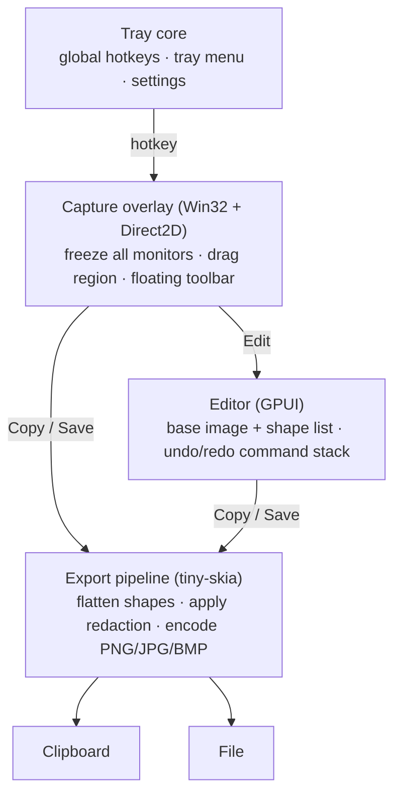
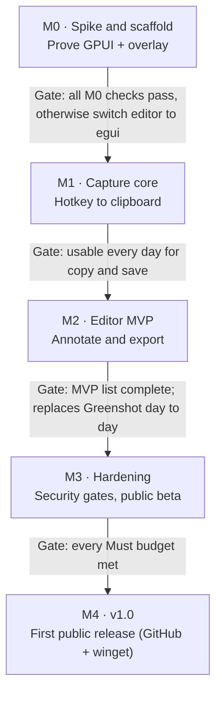

# Cleanshot — Charter & Build Spec

_Last updated: 2026-10-30_

## 0. How to use this file (agents read first)

This file is the source of truth for building Cleanshot. `CLAUDE.md` at the repo root points here; read this file before starting any task.

- **Precedence:** Hard constraints (C-xx) > Feature acceptance criteria (F-xx) > Conventions > everything else. If a task conflicts with a C-rule, stop and ask; never work around it.
- **IDs are stable.** Cite them in commit messages, PR titles, test names and code comments (`// F-21: never overwrite`). Never renumber; retire an ID by marking it *Removed*.
- **Work one milestone at a time** (section 10). One task = one small PR that passes the Definition of Done (section 7).
- **When the spec is silent:** choose the simplest option that satisfies the North Star, implement it, and add a one-line entry to the Decisions log (section 11) with `Status: assumed`. A human confirms or reverts it.
- **When the spec is ambiguous and the choice is hard to reverse** (new dependency, file format, public setting name, anything touching C-rules): ask before building.
- **Never** add a dependency outside the allow-list (section 6), add network or process-launching code, or upgrade the pinned GPUI revision unless the task says so.

## 1. North Star

**Fast, simple, secure: press a key, drag a box, get a clean, annotated image where you need it in under two seconds, from one small file that a corporate security team can approve without exceptions.**

Cleanshot is a Windows 11 screenshot-and-markup tool, a focused, memory-safe replacement for Greenshot's core loop. **Capture** a region, window or screen. **Annotate** it in a small editor. **Deliver** it to the clipboard or a file. That is the whole product.

It exists because Greenshot's extras (upload plugins, external commands, IPC) are where its 2025–26 CVEs lived, and they make it hard to approve in corporate environments. Cleanshot never writes that code.

**The test for every change:** does it make capture → annotate → deliver faster or clearer *without adding attack surface*? If not, it does not ship.

## 2. Hard constraints

These are invariants. Code that violates one is a bug, whatever the task said. Each one marked **[CI]** is enforced automatically (section 7).

### Platform and packaging

| ID | Rule |
| --- | --- |
| C-01 | Windows 11 22H2 (build 22621) or later only. No Windows 10, Linux or macOS code paths, shims or `cfg` branches. |
| C-02 | Ship **one file**: `cleanshot.exe`. Static CRT, all assets embedded. No side-by-side DLLs, no installer, no runtime prerequisites. **[CI]** |
| C-03 | Runs as a standard user. Manifest declares `asInvoker`; never writes `HKLM`, `Program Files` or other machine-wide locations. |
| C-04 | Per-Monitor v2 DPI aware. All capture geometry is in physical pixels. |
| C-05 | Settings live in `cleanshot.toml` next to the exe if one exists (portable mode), otherwise `%APPDATA%\Cleanshot\cleanshot.toml`. Nothing else is persisted. |
| C-06 | Targets `x86_64-pc-windows-msvc`. Keep `aarch64-pc-windows-msvc` building in CI. **[CI]** |

### Security (from Greenshot's CVE history)

| ID | Rule | Why |
| --- | --- | --- |
| C-10 | **No network code.** No HTTP/socket/update clients; no network crates in the tree; binary must not import `ws2_32`, `winhttp`, `wininet`. **[CI]** | Attack surface; privacy |
| C-11 | **No process launching.** No `std::process::Command`, `ShellExecute*`, `CreateProcess*`, `WinExec`. "Show in folder" uses `SHOpenFolderAndSelectItems`. **[CI]** | [CVE-2026-22035](https://vuln.today/cve/CVE-2026-22035), [CVE-2026-25792](https://www.cvelogic.com/cve/CVE-2026-25792) |
| C-12 | **DLLs load from System32 only.** First line of `main`: `SetDefaultDllDirectories(LOAD_LIBRARY_SEARCH_SYSTEM32)`. **[CI]** | DLL planting in Downloads |
| C-13 | **No untrusted deserialisation.** Only input formats are our TOML settings (typed struct, 64 KB cap) and, later, images the user pastes or drops (decoded with size limits). No project file format. | [CVE-2025-59050](https://www.sentinelone.com/vulnerability-database/cve-2025-59050/) |
| C-14 | **No IPC payloads.** Single instance via named mutex; a second launch sends a fixed, payload-free signal ("capture region") only within the same user session. | CVE-2025-59050 (WM_COPYDATA) |
| C-15 | **Safe file names.** Templates use only `{date}`, `{time}`, `{n}`. Reject `..`, reserved names (`CON`, `NUL`, `COM1`…), `:` streams and paths outside the target folder. Never overwrite; append `-2`, `-3`… | CVE-2026-22035 |
| C-16 | `#![forbid(unsafe_code)]` in every crate except `cleanshot-win`. Every `unsafe` there carries a `// SAFETY:` comment. **[CI]** | Memory safety |
| C-17 | Release builds enable ASLR, DEP and Control Flow Guard. **[CI]** | Exploit mitigation |

### Privacy

| ID | Rule |
| --- | --- |
| C-20 | No telemetry, analytics, crash upload or update checks. |
| C-21 | No temp files and no capture history. Pixels stay in memory until the user copies or saves them. |
| C-22 | Redaction is destructive in every output: covered pixels are replaced, not overlaid. |
| C-23 | Logging is off by default; `--log` writes to the settings folder, never logs pixel data or clipboard contents. |

### Scope (never build)

| ID | Out of scope |
| --- | --- |
| C-30 | Uploading or sharing of any kind (Imgur, Jira, Confluence, email, Office, printers, cloud). |
| C-31 | Plugins, scripting, external commands. |
| C-32 | Screen recording, GIFs, OCR, scrolling capture. |
| C-33 | Layers panel or general-purpose image filters. |
| C-34 | Installer, auto-updater, `.greenshot` file import. |

## 3. Feature spec: capture

The capture UI follows macOS Sequoia's Screenshot tool: a dimmed freeze-frame, a floating pill toolbar and a post-capture thumbnail. It uses Cleanshot's own design language (section 4, "Visual design language"), not Windows 11 Fluent styling.

```text
┌──────────────────────────────────────────────────────────────────────┐
│░░░░░░░░░░░░░░░░░░░ frozen screen, dimmed ~40% ░░░░░░░░░░░░░░░░░░░░░░│
│░░░░░░░░░(1)■━━━━━━━━━━━━━━━■━━━━━━━━━━━━━━━■░░░░░░░░░░░░░░░░░░░░░░░░│
│░░░░░░░░░░░░┃                               ┃░░░░░░░░░░░░░░░░░░░░░░░░│
│░░░░░░░░░░░░■     selection: full bright     ■░░░░░░░░░░░░░░░░░░░░░░░│
│░░░░░░░░░░░░┃     accent border, 8 handles  ┃░░░░░░░░░░░░░░░░░░░░░░░░│
│░░░░░░░░░░░░■━━━━━━━━━━━━━━━■━━━━━━━━━━━━━━━■░░░░░░░░░░░░░░░░░░░░░░░░│
│░░░░░░░░░░░░░░░░░░░░░░░░░░░░░░░░░░( W × H px )░░░░░░░░░░░░░░░░░░(3)░│
│░░░(2)╭─────────────────────────────────────────────────────╮ ┌─────┐│
│░░░░░░│ [Region] Window Screen │ Timer Options▾ │ [Copy] Save Edit × │ │thumb││
│░░░░░░╰─────────────────────────────────────────────────────╯ └─────┘│
└──────────────────────────────────────────────────────────────────────┘
(1) Frozen screen dimmed; the selection stays bright, with resize handles and a live size pill
(2) Floating toolbar on the active monitor: mode, timer, options, then Copy · Save · Edit
(3) After capture, a thumbnail floats bottom-right: click to edit, drag into any app, or let it slide away
```

**Flow:** hotkey → grab all monitors into memory *first* → show overlay over the frozen image → select → Copy / Save / Edit. The overlay can never appear in the capture.

| ID | Feature | Milestone | Acceptance criteria |
| --- | --- | --- | --- |
| F-01 | Region capture | M1 | Hotkey shows the overlay on every monitor in < 100 ms (p95). Drag selects. Output pixels equal the screen at physical resolution on mixed-DPI setups (golden test). Esc cancels and writes nothing. |
| F-02 | Freeze-frame overlay | M1 | Screen dimmed ~40%; selection undimmed with a 1.5 px accent border and 8 handles; live `W × H` pill in physical px. One topmost, no-activate window per monitor, drawn with Direct2D; Esc is a hotkey while it is up (D-23). |
| F-03 | Adjust selection | M1 | Handles resize, dragging inside moves, arrows nudge 1 px (Shift: 10 px), Enter commits. |
| F-04 | Loupe | M1 | Shown only while dragging: 8× zoom, pixel grid, cursor coordinates, hex colour under cursor. |
| F-05 | Floating toolbar | M1 | Frosted-glass pill (its background is the frozen capture, blurred and tinted by us; no DWM backdrop needed), centred near the bottom of the cursor's monitor, flips to the top so it never covers the selection. Groups: Region / Window / Screen · Timer · Options · **Copy** (Enter, default) / Save (Ctrl+S) / Edit (E) / × (Esc). Fully keyboard-navigable; every control has an accessible name. |
| F-06 | Last region | M1 | Shift+PrtSc captures the previous rectangle with no overlay and runs the default action. |
| F-07 | Full screen | M1 | Ctrl+PrtSc captures the monitor under the cursor. |
| F-08 | Window capture | M4 | Hover highlights the window under the cursor using DWM extended frame bounds (no shadow); click captures. |
| F-09 | Post-capture thumbnail | M4 | After Copy/Save, a preview slides in bottom-right for ~5 s. Click opens the editor; drag-out delivers a PNG via OLE drag-and-drop; hover shows Save / Dismiss. A no-activate tool window that never steals focus. Can be disabled. |
| F-10 | Timer | M4 | Off / 3 / 5 / 10 s countdown before the freeze. |
| F-11 | Capture panel hotkey | M4 | Ctrl+Shift+5 shows the toolbar before selection (mode, timer, options). |
| F-12 | Options menu | M4 | Save folder, format, show pointer, show thumbnail, remember last selection. Changes persist to settings. |
| F-13 | Motion and contrast | M1 | Fades of 120–150 ms, none when Windows "Animation effects" is off; high-contrast themes use system colours. |

## 4. Feature spec: outputs, editor, app

### Outputs

| ID | Feature | Milestone | Acceptance criteria |
| --- | --- | --- | --- |
| F-20 | Copy | M1 | Clipboard gets `CF_DIBV5` and a registered `PNG` format. Pastes correctly into Outlook, Teams, Word, Paint and Edge (manual checklist). |
| F-21 | Save | M1 | Writes to the configured folder (default: Pictures\Screenshots) using template `Screenshot {date} {time}`. PNG by default; JPG (quality 90) and BMP optional. Obeys C-15. Write is atomic (temp name in the same folder, then rename). |
| F-22 | Save As | M1 | Ctrl+Shift+S opens the native save dialog. |
| F-23 | Edit | M2 | Opens the editor with the capture. The overlay closes first. |
| F-24 | Identical output | M2 | Copy/Save from the overlay and from the editor run the same export code; a golden test proves byte-identical PNG for the same document. |

### Editor

One left toolbar, one contextual property strip (colour, stroke, font size), the canvas. Shapes stay editable objects until export.

| ID | Tool / feature | Key | Milestone | Acceptance criteria |
| --- | --- | --- | --- | --- |
| F-30 | Select, move, resize, delete | V, Del | M2 | Click selects topmost shape; handles resize; Shift constrains. |
| F-31 | Arrow, line | A, L | M2 | Default red, 3 px; Shift snaps to 45°. |
| F-32 | Rectangle, ellipse | R, O | M2 | Outline by default; optional fill. |
| F-33 | Pen (freehand) | P | M2 | Smoothed polyline. |
| F-34 | Text | T | M2 | Multi-line, IME works, Ctrl+A/Backspace behave like a text box. |
| F-35 | Highlighter | H | M2 | Translucent yellow, multiply blend. |
| F-36 | Redact | X | M2 | Pixelate (default) or blur; destructive on export (C-22); a test asserts that original pixels are absent from the output. |
| F-37 | Crop | C | M2 | Non-destructive in the document; applied on export. |
| F-38 | Undo / redo | Ctrl+Z / Ctrl+Y | M2 | Unlimited within the session; every edit is a command. |
| F-39 | Zoom / pan | Ctrl+wheel, Space-drag, Ctrl+0 fit | M2 | Smooth on a 4K image. |
| F-40 | Copy / save from editor | Ctrl+C, Ctrl+S | M2 | Uses F-24's pipeline. |
| F-41 | Numbered step | N | M4 | Auto-increments 1, 2, 3…; renumbers when one is deleted. |
| F-42 | Speech bubble | B | M4 | Text box with a draggable tail. |
| F-43 | Spotlight | S | M4 | Dims everything outside the rectangle. |
| F-44 | Border and drop shadow | — | M4 | Whole-image effects toggled from the property strip. |

### App, tray and settings

| ID | Feature | Milestone | Acceptance criteria |
| --- | --- | --- | --- |
| F-50 | Tray icon | M1 | Menu: Capture region, Capture screen, Settings, Exit. Double-click = capture region. |
| F-51 | Global hotkeys | M1 | Defaults below; remappable in settings; registration failures are shown, not swallowed. |
| F-52 | PrtSc conflict | M1 | Detects Windows 11's "Use the Print screen key to open screen capture" setting at start. While it is on, a bare PrtSc region hotkey is replaced by the fallback Ctrl+Shift+4 for that run, and a tray balloon names the setting's place (Settings > Accessibility > Keyboard). Cleanshot does not open Settings itself (C-11). |
| F-53 | Single instance | M1 | Obeys C-14; a second launch triggers region capture in the first instance. |
| F-54 | Settings file | M1 | Obeys C-05 and C-13; unknown keys ignored; invalid values fall back to defaults with one warning. |
| F-55 | Settings window | M4 | Hotkeys, save folder, format, after-capture default, thumbnail, start with Windows. |
| F-56 | Start with Windows | M4 | Per-user `HKCU\…\Run` entry, only when the user turns it on. |
| F-57 | Admin policy | M4 | Reads `HKLM\SOFTWARE\Policies\Cleanshot` (read-only): lock save folder, disable save (clipboard only), force PNG, hide settings. |
| F-58 | Themes and accessibility | M2 | Follows system light/dark; all controls keyboard-reachable and labelled. |

**Default global hotkeys:** PrtSc (fallback Ctrl+Shift+4) = region · Shift+PrtSc = last region · Ctrl+PrtSc = full screen · Alt+PrtSc = window (M4) · Ctrl+Shift+5 = capture panel (M4).

### Visual design language

Cleanshot has its own clean, calm look modelled on macOS Sequoia, not on Windows 11 Fluent. Windows conventions are used only where users or the OS require them (list below).

**Principles:** content first, chrome recedes. Few surfaces, generous spacing, quiet colour, one accent. Floating panels over the content instead of docked bars wherever practical.

| Token | Value |
| --- | --- |
| Materials | Frosted glass: content behind is blurred (~30 px) and tinted. Dark: `rgba(28,28,30,0.72)`; light: `rgba(246,246,248,0.72)`. Follows system light/dark. |
| Edges | 1 px hairline border (white 12% on dark, black 10% on light) plus a soft shadow (0 8 24, 25% black). No heavy outlines. |
| Corner radii | Panels and toolbars 12 px; buttons, inputs and chips 7 px; capture toolbar is a full pill. |
| Spacing | 4 px grid; 8 px between related controls, 16 px between groups. |
| Typography | Inter (embedded, OFL-1.1) with Segoe UI Variable as fallback. Body 13 px, secondary 11 px, titles 15 px semibold. |
| Icons | Monochrome line icons from Lucide (ISC), 16 px at 1.5 px stroke, embedded as vector paths. |
| Colour | Neutral greys plus one blue accent for the primary action and selection. Annotation colours are separate and user-chosen. |
| Motion | 150–250 ms ease-out fades and slides; none when Windows "Animation effects" is off. |

**Live blur:** in the capture overlay, Cleanshot blurs the frozen capture itself, so it needs no OS support. For standalone windows (editor, settings, thumbnail), use the DWM backdrop if it looks right; otherwise use a solid material colour. Never fake blur with a screenshot of the live desktop.

**Where Windows conventions win (required):**

- Caption buttons (minimise, maximise, close) top-right, with Snap layouts, Alt+F4 and Win+arrow behaviour intact. No macOS traffic lights.
- Ctrl-based shortcuts (never Cmd/⌘ glyphs); Alt opens menus where menus exist.
- Native tray icon and menu, native file dialogs, Windows notifications if any are ever used.
- High-contrast themes, visible keyboard focus, UI Automation accessibility, and system text scaling all take precedence over the visual style.

**Never ship Apple assets.** No SF Pro, SF Symbols, Apple wallpapers or copied Apple UI artwork; their licences restrict them to Apple platforms. Take the *style*, not the assets.

## 5. Architecture

Four layers, one binary. The overlay is native Win32 + Direct2D for latency and DPI control; the editor is GPUI; every output goes through one CPU export pipeline.



Copy and Save from the overlay skip the editor entirely but use the same export code, so output is identical either way.

### Cargo workspace

Crate boundaries are the main guardrail for agents: put code in the crate that owns the concern, and never add OS calls outside `cleanshot-win`.

```text
cleanshot/
├─ Cargo.toml                 # workspace, [profile.release], MIT OR Apache-2.0
├─ .cargo/config.toml         # crt-static, control-flow-guard rustflags
├─ deny.toml                  # cargo-deny: bans, licences, advisories, sources
├─ crates/
│  ├─ cleanshot-app/          # [bin] main, lifecycle, tray, hotkeys, wiring. Thin.
│  ├─ cleanshot-core/         # Document, Shape, Style, Command, undo stack, settings types.
│  │                          #   Pure Rust, no OS, no I/O. Highest test coverage.
│  ├─ cleanshot-render/       # Flatten Document -> RGBA with tiny-skia; redaction; PNG/JPG/BMP encode.
│  │                          #   Golden-image tests live here.
│  ├─ cleanshot-win/          # The ONLY crate allowed `unsafe`: capture, overlay windows (Direct2D),
│  │                          #   clipboard, DPI, DLL hardening, single instance, policy, file save.
│  ├─ cleanshot-editor/       # GPUI editor + settings window. Talks to core via Commands only.
│  └─ cleanshot-fieldtest/    # [bin] probe and field test for a Windows machine. Never shipped;
│                             #   its Win32 calls are cleanshot-win's `field-test` feature.
├─ assets/                    # icons, embedded with include_bytes!
├─ tests/golden/              # reference PNGs for render + DPI tests
├─ docs/CHARTER.md            # this file
└─ docs/decisions/            # one file per decision (ADR-lite)
```

Dependency direction: `app → {editor, win, render, core}`, `fieldtest → {editor, win}`, `editor → {render, core}`, `render → core`, `win → core`. `core` depends on nothing in the workspace. Nothing depends on `fieldtest`, and `app` never turns on `win`'s `field-test` feature (`charter-gates.sh` checks).

### Core types

The types live in `crates/cleanshot-core`; read them there. All coordinates are f32 in base-image physical pixels.

- **Document**: the frozen capture, its shapes in z-order and an optional crop. Changed only through `History`.
- **Shape**: one annotation (arrow, line, rectangle, ellipse, pen, text, highlight, redact), drawn with a `Style`. Step, bubble and spotlight arrive with M4.
- **Command**: one edit (add, remove, replace a shape, set the crop). Every edit is a command (F-38).
- **History**: a document with its edits, undoable and redoable without limit. It issues shape ids (D-26).
- **Settings**: what `cleanshot.toml` holds, read field by field so a bad value keeps its default (F-54, D-30).

### Runtime model

- **UI thread:** the GPUI event loop. Tray, hotkeys and overlay windows live on this thread unless the M0 spike shows they must not. In that case the overlay gets its own Win32 message-loop thread and talks to the UI thread over a channel.
- **Capture:** on hotkey, copy every monitor to memory before creating any window: DXGI Desktop Duplication, or GDI `BitBlt` when duplication is refused (D-28).
- **Worker thread:** encode and file writes, so the UI never blocks; clipboard writes happen on the UI thread (OLE requirement).
- **Export:** `render::flatten(&Document, &TextMasks) -> RgbaImage` is the single source of output pixels (F-24). Text glyph coverage comes from DirectWrite in win as plain masks (core's `TextMasks`), made by the same glyph path GPUI draws on screen; render composites them, so render stays pure Rust.

## 6. Dependency allow-list

Only these direct dependencies are allowed. Adding one means a Decisions-log entry and a `deny.toml` update in the same PR, and the reviewer must approve it explicitly. Prefer a few lines of code in `cleanshot-win` over a new crate.

| Crate | Used by | Purpose | Notes |
| --- | --- | --- | --- |
| `gpui`, `gpui_windows` (git, pinned rev) | editor | UI framework | DirectX 11 + DirectWrite on Windows. `default-features = false`. Started only through the editor's restricted platform (D-15). Fallback: `eframe`/`egui` if M0 fails. Never bump the rev without a task. |
| `futures`, `smallvec` | editor | Types named by GPUI's `Platform` trait | Same versions GPUI already uses; nothing else (D-16). |
| `windows` | win | Win32, DWM, Direct2D, DXGI, OLE, Shell | Enable only the feature modules used. |
| `tiny-skia` | render | Rasterise shapes for export | Pure Rust. |
| `image` (`png`, `jpeg`, `bmp` only) | render, editor | Encode/decode; the editor only builds the bitmap GPUI draws | `default-features = false`. The editor enables no format feature (D-18). |
| `global-hotkey` | app | System-wide hotkeys | Tauri project. Replace with direct `RegisterHotKey` if it conflicts with GPUI's loop. |
| `tray-icon` | app | Tray icon and menu | Tauri project. Same fallback rule. |
| `rfd` | win | Native Save As dialog | Or `IFileSaveDialog` directly. |
| `serde`, `toml` | core | Settings | Typed structs only (C-13). |
| `tracing`, `tracing-subscriber` | app | Opt-in logging | C-23. |
| `thiserror`, `anyhow` | all / app | Errors | `anyhow` only in `cleanshot-app`. |
| `winresource` (build-dep) | app | Embed manifest, icon, version info | |

**Banned outright** (in `deny.toml`): anything that pulls in `hyper`, `reqwest`, `ureq`, `tokio` net features, `openssl`, `native-tls`, `rustls`, and any crate whose licence is not MIT, Apache-2.0, BSD, ISC, Zlib, Unicode or MPL-2.0. Clipboard is implemented directly in `cleanshot-win` rather than through `arboard`, to control the formats written (F-20).

**Embedded assets** (not crates, so not covered by `cargo deny`): Inter font (OFL-1.1) and Lucide icons (ISC). Record every embedded asset and its licence in `THIRD_PARTY_NOTICES.md`; adding one follows the same approval rule as a crate.

## 7. Engineering conventions and Definition of Done

### Build configuration

```toml
# Cargo.toml (workspace)
[workspace.package]
edition = "2024"
license = "MIT OR Apache-2.0"

[profile.release]
lto = "fat"
codegen-units = 1
panic = "abort"
strip = true
opt-level = 3        # switch to "s" only if the size budget is missed

# .cargo/config.toml
[target.'cfg(all(windows, target_env = "msvc"))']
rustflags = ["-C", "target-feature=+crt-static", "-C", "control-flow-guard"]
```

The app manifest (`crates/cleanshot-app/cleanshot.exe.manifest`, embedded by the app's build script) declares `asInvoker`, `PerMonitorV2` DPI awareness, the `supportedOS` GUID that covers Windows 10 and 11 (Windows 11 has no GUID of its own), and Common Controls v6.

### Code rules

- `cargo fmt`; `cargo clippy --all-targets -- -D warnings` with `clippy::pedantic` warnings reviewed, not blanket-allowed.
- No `unwrap()`/`expect()` outside tests and `main` start-up; errors surface to the user as a short toast, never a panic dialog.
- Public functions in `core` and `render` get doc comments and unit tests.
- Name tests after IDs where they prove a criterion: `f21_never_overwrites_existing_file`, `c15_rejects_reserved_names`.

### Tests

| Layer | How |
| --- | --- |
| `core` | Unit and property tests (undo/redo round-trips, command invertibility). |
| `render` | Golden PNGs in `tests/golden/`: each shape, redaction, crop, effects. Fails on any pixel diff; update with an explicit `--bless` flag. |
| `win` | Integration tests on the Windows CI runner: capture of a known window at 100/150/200% DPI, clipboard round-trip, file-name rules. |
| Manual | Release checklist: paste targets (F-20), multi-monitor mixed DPI, a monitor rotated to portrait (D-28 sizes a duplicated output from its desktop bounds, which a rotated output swaps), PrtSc conflict (F-52), high contrast. |

### CI gates (every push to `main` or `ci/**`, `windows-latest`)

Gates 3–5 are `charter-gates.sh`. CI runs it on the release exe it builds and uploads. The fold bar on a Mac or Linux machine also runs it, on a scan-only exe that cargo-xwin builds with the `scan-only` profile. That exe is never shipped and cannot run: off Windows, GPUI's shaders cannot be compiled into it, so it reads them from the build machine's cargo checkout.

1. fmt, clippy, tests (x64), build (ARM64).
2. `cargo deny check` (advisories, bans, licences, sources) and `cargo audit`.
3. **Binary scan**: fail on imports from `ws2_32`, `winhttp`, `wininet`, or on `CreateProcess*` / `ShellExecute*` / `WinExec` (C-10, C-11); fail unless it imports `SetDefaultDllDirectories` (C-12); fail if ASLR, DEP or CFG is not set (C-17); fail if any DLL is imported that is not on the script's system DLL list (C-02); fail if the release exe holds a build-host path (`/Users/`, `/home/`, `C:\Users\`, `\.cargo\`), so nothing about the builder ships.
4. `unsafe` scan: fail if a crate root other than `cleanshot-win`'s lacks `#![forbid(unsafe_code)]`, or `unsafe` appears outside `crates/cleanshot-win` (C-16).
5. Size check of the release exe: fail at 15 MB or above (section 8).

### Definition of Done (every task)

- [ ] Meets the acceptance criteria of every F-ID it touches; tests prove them where automatable.
- [ ] All CI gates green; no new warnings.
- [ ] No C-rule violated; no dependency added outside section 6.
- [ ] Performance budgets in section 8 not regressed (measure if the task touches capture, overlay or export).
- [ ] Decisions log updated for any assumption; this file updated if behaviour changed.
- [ ] Commit message: `F-21: atomic save with collision suffix` (IDs first, imperative, one change).

## 8. Performance budgets

Must budgets are release gates. Measure on the reference machine: a mid-range Windows 11 laptop with integrated graphics and a 1080p + 4K monitor pair at 100% / 150% scaling. Each budget gets a `perf` log line behind `--log` so agents can measure without a profiler.

| ID | Metric | Budget | Priority |
| --- | --- | --- | --- |
| P-01 | Hotkey → overlay visible | < 100 ms p95 | Must |
| P-02 | Release → image on clipboard, 4K region | < 150 ms | Must |
| P-03 | Process start → tray ready | < 300 ms | Must |
| P-04 | Idle memory, tray only | < 25 MB working set | Must |
| P-05 | Idle CPU | ~0%, no polling loops or timers | Must |
| P-06 | Release exe size | < 15 MB (stretch < 10 MB) | Must |
| P-07 | Editor first frame with a 4K image | < 400 ms | Should |
| P-08 | Editor with 200 shapes on 4K | 60 fps | Should |

## 9. Release and distribution

Releases ship as a bare, signed `cleanshot.exe` on GitHub Releases. A winget **portable** manifest points at that same exe, so `winget install` needs no admin and no installer.

### Release workflow (tag `vX.Y.Z` → GitHub Actions)

1. Build x64 (and ARM64, once enabled) on `windows-latest` from the tag; never on a developer machine. A scan-only exe from the fold bar is never released.
2. Run every CI gate (section 7) against the release binary.
3. Code-sign the exe (signing service is an open question; until then, releases are marked pre-release).
4. Publish to GitHub Releases: `cleanshot-X.Y.Z-x64.exe`, `SHA256SUMS`, CycloneDX SBOM, and a GitHub build-provenance attestation.
5. Open or update the winget-pkgs PR with a winget releaser action, such as `winget-releaser` (Komac). These tools update an existing package, so **v1.0.0 is submitted to `microsoft/winget-pkgs` by hand once**.

### winget manifest shape

```yaml
PackageIdentifier: <Publisher>.Cleanshot   # open question
PackageVersion: 1.0.0
InstallerType: portable
Installers:
  - Architecture: x64
    InstallerUrl: https://github.com/<owner>/cleanshot/releases/download/v1.0.0/cleanshot-1.0.0-x64.exe
    InstallerSha256: <sha256>
Commands: [ cleanshot ]
MinimumOSVersion: 10.0.22621.0
License: MIT OR Apache-2.0
```

Notes for agents:

- winget installs portable apps per user and adds a `cleanshot` command alias. Settings still resolve per C-05 (normally `%APPDATA%`), so `winget upgrade` keeps them.
- Validate locally before a PR: `winget validate` on the manifest, then a clean install in Windows Sandbox.
- Repo files: `LICENSE-MIT`, `LICENSE-APACHE`, `SECURITY.md` (private disclosure, 90-day policy, GitHub Security Advisories), `CHANGELOG.md` (Keep a Changelog format).

## 10. Milestones and backlog

Milestones end at gates, not dates. Do them in order, and do not start a milestone's tasks until the previous gate has passed.



### M0 · Spike and scaffold

- [ ] Scaffold the workspace (section 5), licences, `deny.toml`, and CI gates 1–5 running on an empty app. (Gates 1-5 written; first CI run pending a GitHub remote.)
- [ ] Tray-only GPUI app: idle < 1% CPU, opens and closes an editor window on demand.
- [ ] Overlay prototype: frozen capture on 2 monitors at mixed DPI in < 100 ms; pick GDI `BitBlt` vs DXGI Desktop Duplication (latency, HDR correctness) and log the decision.
- [ ] GPUI canvas: 4K image + 200 shapes at 60 fps; text input and IME work in a custom element.
- [x] GPUI dependency audit: the release binary passes the C-10/C-11 import scan and `cargo deny`. GPUI ships an HTTP-client abstraction, so confirm nothing network-capable is linked.
- [ ] Release size < 15 MB; pinned GPUI rev builds reproducibly in CI.
- [ ] **Gate:** record "GPUI" or "egui" in the Decisions log.

### M1 · Capture core

- [x] C-12 DLL hardening and C-14 single instance in `main`.
- [ ] F-01–F-07 and F-13: capture, overlay, selection, loupe, toolbar, last region, full screen.
- [ ] F-20–F-22: copy, save, Save As.
- [ ] F-50–F-54: tray, hotkeys, PrtSc conflict, single instance, settings file.
- [ ] **Gate:** usable every day for copy and save; P-01–P-05 measured.

### M2 · Editor MVP

- [ ] Core document model and command/undo stack (section 5) with unit tests.
- [ ] Render crate: flatten, redaction, encode, golden tests.
- [ ] F-23, F-24, F-30–F-40, F-58.
- [ ] **Gate:** the maintainer replaces Greenshot for two weeks without missing an M1/M2 feature.

### M3 · Hardening and beta

- [ ] Golden DPI matrix (100/150/200%, negative-coordinate monitors) in CI.
- [ ] All P-budgets measured on the reference machine; fixes for any Must miss.
- [ ] Release workflow (section 9) with SBOM, checksums, provenance; `SECURITY.md`.
- [ ] Code signing in place.
- [ ] **Gate:** every Must budget met; public beta as a GitHub pre-release.

### M4 · v1.0

- [ ] F-08–F-12: window capture, thumbnail, timer, capture panel, options menu.
- [ ] F-41–F-44: numbered steps, speech bubble, spotlight, border/shadow.
- [ ] F-55–F-57: settings window, start with Windows, admin policy.
- [ ] One-page security whitepaper for IT reviewers (what the binary does and does not do, with the CI evidence).
- [ ] Tag v1.0.0; first winget-pkgs submission by hand.

**After v1.0 (not scheduled):** ARM64 release, rotate, paste/drop images (decoded under C-13 limits), torn-edge effect, translations.

## 11. Decisions, open questions, risks

### Decisions log (newest first)

Agents append rows with Status `assumed`; a human changes it to `decided` or reverts it.

| ID | Date | Decision | Status | Rationale |
| --- | --- | --- | --- | --- |
| D-52 | 2026-10-31 | The open text box (F-34) has a dashed accent outline 4 screen px outside its text, a caret in the text's colour, and the selection in the accent at 30%. A press counts as inside the box with the same reach as a press on a shape; inside it places the caret, outside it commits the box and then acts as any press (with the text tool, it opens the next box). Picking another tool commits the box, a composition in progress included, as Windows completes one when its field loses focus; GPUI then sends the input method CPS_COMPLETE, and its result reaches no handler, so nothing is typed twice. A drag from a press inside the box selects up to the pointer | assumed | Spec silent. The reach matches shape_at, so a press that would reopen this text never commits it first; committing on the way to the next press keeps one click per action, as in other markup tools |
| D-51 | 2026-10-31 | Exported text uses DirectWrite gamma 1.8 and grayscale enhanced contrast 1.0, fixed, through GPUI's own correction: contrast enhanced for dark text, then alpha corrected with `gpui::get_gamma_correction_ratios(1.8)`. They are what `CreateRenderingParams` returns on a clean windows-latest runner (Windows Server 2025, 96 dpi) | assumed | The screen draws with this machine's gamma, which ClearType Tuner can change; a saved image must not depend on the machine that saved it (docs/decisions/f34-text.md). The values of an untouched Windows install keep the export close to what most users see on screen |
| D-50 | 2026-10-30 | The text tool (T) opens a text box where it is pressed: on a text shape it reopens that text in its own style, anywhere else it starts a new box with its top-left corner at the press, 24 image pixels high per em, in the annotation red. Text is Inter SemiBold only, and a line ends only where the user presses Enter: there is no automatic wrapping | assumed | F-34 names multi-line text but no size, weight or wrapping. Hard breaks only means the screen and the export never have to agree on where a line wraps (docs/decisions/f34-text.md). One weight keeps one embedded font inside P-06. 24 px reads at a glance on a 1080p capture, and reopening in the shape's own style means editing never recolours text |
| D-49 | 2026-10-30 | Screen readers see the editor window as an application named "Cleanshot editor", the canvas as an image named "Screenshot", the toolbar as a toolbar named "Tools" whose buttons are radio buttons named for their tool, with the key as their shortcut and the current tool checked, and the notice as a status. Tab and Shift+Tab move between toolbar buttons, which show an accent focus ring; Enter or Space picks the focused tool. Every editor action already has a key (CHARTER table), so the canvas itself is not a tab stop | assumed | F-58 asks for every control to be keyboard-reachable and named but names no roles. A tool palette with one current choice is a radio group; the canvas is driven by keys and the pointer, not by focus |
| D-48 | 2026-10-30 | Copy and Save from the overlay and from the editor go through one app function, `deliver(Output, &Document, &Settings) -> Result<Delivered, DeliveryError>`, in cleanshot-app. Its types are in core, because the editor may not depend on win (CHARTER 5). The editor reaches it through a callback given to `open`, and makes the notice text itself. `DeliveryError` has one variant per failure the user can act on; a template or crop error is an invariant break | assumed | Orchestrator ruling, shape agreed between the capture and editor seats. One path keeps the overlay and the editor output identical (CHARTER 5, F-24) |
| D-47 | 2026-10-30 | The editor follows the system appearance and redraws when it changes. Dark: the CHARTER 4 material and hairline, text `#F5F5F7`, backdrop `#2C2C2E`, hover white 10%. Light: the CHARTER 4 material and hairline, text `#1D1D1F`, backdrop `#E5E5EA`, hover black 8%. The accent and the text on it are the same in both. Panels are tinted but not yet blurred: GPUI at the pinned rev draws no blur inside a window (its only blurs are shadows and the desktop behind the whole window) | assumed | CHARTER 4 gives the material and edges for each appearance but not text, backdrop or hover. These are the macOS system greys the style is drawn from, and each keeps text legible on its material |
| D-46 | 2026-10-30 | Ctrl+wheel zooms the canvas about the pointer, 1.2 times per wheel line (a touchpad's pixel scroll counts 20 px as a line), between 0.05 and 32 screen pixels per image pixel. Space held with a left drag pans. Ctrl+0 returns to the fitted view of D-41, which is also where every editor opens | assumed | F-39 names the keys but not the steps or limits. Zooming about the pointer keeps what the user is looking at in place; 32x is enough to place a handle on a single pixel of a 4K capture |
| D-45 | 2026-10-30 | The editor's tools sit in one floating panel centred 16 px below the top of the canvas, in the order select, arrow, line, rectangle, ellipse, pen, highlighter, text (F-34), redact, crop, each a 28 px button with a Lucide icon (`mouse-pointer-2`, `move-up-right`, `minus`, `square`, `circle`, `pencil`, `highlighter`, `type`, `square-dashed`, `crop`). The current tool is filled with the accent. Clicks on the panel never reach the canvas | assumed | CHARTER 4 prefers floating panels over docked bars and names Lucide. The order follows the CHARTER feature table. Redact has no Lucide icon of its own, and a dashed square reads as an area that will be hidden |
| D-44 | 2026-10-30 | On the canvas the pointer is clamped to the image, so nothing is drawn outside it and a crop always lies inside. Esc clears the selection; tool keys and Del are ignored while a drag is in progress or with Ctrl, Alt or Win held. A refused edit leaves the document unchanged and says why in a short panel at the foot of the canvas until the next press | assumed | An annotation outside the image would never export, and the crop command refuses an area outside the image. Ignoring keys mid-drag keeps one drag one edit (F-38). The panel is the editor's form of the toast CHARTER 7 asks for |
| D-43 | 2026-10-30 | With the select tool, a press on a handle of the selected shape resizes it, a press on a shape selects and moves it, and a press on empty canvas clears the selection; a drawing tool clears it. The edit is made on release as one command. Shift keeps a move on its longer axis, snaps a dragged line end to 45 degrees from the other end, and squares a box resized by a corner (edge handles are not constrained) | assumed | F-30 says "Shift constrains" without saying how for each case. These follow the drawing rules of D-40, so Shift means the same while drawing and while editing |
| D-42 | 2026-10-30 | A new shape takes its tool's default style: red `#FF3B30` at 3 px for arrow, line, rectangle, ellipse and pen; highlighter yellow `#FFE600` (multiplied, F-35). Rectangles and ellipses start hollow; redaction starts as pixelate. Shift snaps arrows and lines to 45 degrees and makes every box tool (rectangle, ellipse, highlighter, redact, crop) square. A click, or a drag with no length or no area, makes no edit | assumed | F-31 says "red, 3 px" without a shade; this red stays legible on light and dark captures. Treating Shift the same on every box tool gives one rule to learn. A click making nothing keeps stray clicks out of the undo history |
| D-41 | 2026-10-30 | The editor opens centred at 80% of the primary display's visible area (minimum 480 x 320) under the native title bar, titled "Cleanshot". The capture is fitted to the canvas but never drawn larger than one image pixel per device pixel | assumed | F-23 says only "opens the editor". A capture usually comes from the same display, so 80% shows most of it with room to spare. Upscaling a small region blurs it; zoom (F-39) is how the user enlarges it. The native title bar keeps the caption buttons, Snap and Alt+F4 that CHARTER 4 requires |
| D-40 | 2026-10-30 | The pen stores a smoothed path: points within 1 px of the last kept one are dropped, then two rounds of Chaikin corner cutting, keeping the first and last points. Shift snaps a line or arrow to the nearest multiple of 45 degrees (the switch at 22.5 degrees, a diagonal keeping the mean of the two extents) and squares a box on its longer side, toward the drag | assumed | F-33 asks for a smoothed polyline without saying how. Chaikin rounds corners and never overshoots, and two rounds stay cheap on a long stroke. The 45-degree test compares extents instead of taking an angle, so it needs no trigonometry and gives the same answer on every platform |
| D-35 | 2026-10-30 | Last region (F-06) is the last selection copied or saved from the overlay since Cleanshot started, held in memory and never written. Shift+PrtSc captures every monitor and copies that rectangle at once, whatever `after_capture` says, until the F-05 toolbar exists to show without an overlay. With no selection yet it opens the overlay as region capture does | assumed | C-20 rules out keeping capture history on disk, and a rectangle is enough to repeat a capture. F-06 says no overlay; copy is the only default action that needs none today |
| D-34 | 2026-10-30 | Full screen (F-07) captures every monitor as region capture does, then selects the one under the pointer. With `after_capture = "copy"` it copies that monitor at once; with `"toolbar"` it opens the overlay with the monitor already selected, so Enter copies, Ctrl+S saves, and the handles can still trim it | assumed | F-07 does not say what follows the capture. Reusing the overlay keeps one place where a capture is finished, and the F-05 toolbar will sit on that selection when it lands |
| D-33 | 2026-10-30 | F-52 reads `HKCU\Control Panel\Keyboard\PrintScreenKeyForSnippingEnabled` at each start; a missing value counts as on. The fallback is not written to `cleanshot.toml`, so turning the Windows switch off gives PrtSc back at the next start | assumed | Windows 11 ships the switch on and Microsoft's support answers say to create the value as 0 to turn it off, so absence means on. Checking each start follows the user's Windows setting both ways without a file Cleanshot would have to undo (C-20) |
| D-32 | 2026-10-30 | `save_folder` must be a full path (drive or UNC root); a relative one is refused at save time with a message, never resolved. Settings are read once at start; a missing file means every default and is not created | assumed | A relative folder would follow whatever the working folder is when Cleanshot starts, so a save could land anywhere (C-15). Writing the file waits for the first change that needs one (F-52 fallback, the settings window), so a user who never changes anything leaves no file behind (C-20) |
| D-31 | 2026-10-30 | Save names: `{date}` is YYYY-MM-DD and `{time}` is HH.mm.ss (C-15 bans colons). `{n}` is the lowest number from 1 that gives a free name; a template without `{n}` appends -2, -3 to a taken name. The atomic write is a `.partial` file in the target folder, hard-linked to the final name and then removed | assumed | A hard link fails when the name exists, so a file created between the check and the write is never replaced, which a rename cannot promise |
| D-30 | 2026-10-30 | `cleanshot.toml` holds `save_folder` (absent = Pictures\Screenshots), `save_format` (png, jpg, bmp), `after_capture` (toolbar, copy), `show_thumbnail`, `show_pointer`, `remember_last_selection`, `start_with_windows` and a `[hotkeys]` table (`region`, `last_region`, `full_screen`, `window`, `capture_panel`). A hotkey is any of Ctrl, Alt, Shift and Win once each, then one key (A-Z, 0-9, F1-F24, PrtSc), joined by `+`. Defaults: png, toolbar, thumbnail on, the other switches off, and the default global hotkeys under F-51. Reading never fails: unknown keys are ignored, an unusable value keeps its default and is reported, and a file over 64 KB or not TOML gives every default | decided (owner) | The file format and the two defaults the open questions held were the owner's call, made 2026-10-30. Parsed into a TOML table and decoded field by field inside core, so nothing untyped leaves it (C-13) and one bad value cannot cost the rest (F-54) |
| D-28 | 2026-10-30 | Capture with DXGI Desktop Duplication; if any output refuses it, capture every monitor with GDI `BitBlt` instead | decided pending owner | Duplication reads the composed desktop from the GPU and is the method OBS uses for display capture (it has no GDI method). Microsoft documents cases where duplication is refused: a hybrid-GPU laptop (DXGI_ERROR_UNSUPPORTED), a mode or desktop switch such as a UAC prompt (DXGI_ERROR_ACCESS_LOST); `BitBlt` works there, so it stays as the fallback. HDR output (DuplicateOutput1) is a later change |
| D-27 | 2026-10-30 | Redaction replaces every pixel its rectangle touches, in stacking order: shapes under it are redacted with the image, shapes over it stay. Pixelate sets each cell (at most 16 px, spread evenly over the area) to its average; blur pixelates first, then smooths the cells. A one-pixel area is one cell and keeps its value | assumed | A plain blur can be partly reversed; blurring cell averages leaks nothing pixelate does not. Even cells leave no 1-pixel cell that would keep an original pixel (C-22). Stacking order lets a user annotate on top of a redaction |
| D-26 | 2026-10-30 | Commands carry no "before" value: applying an edit computes the edit that reverts it, which undo and redo replay. Only `History` issues `ShapeId`s and never reuses one | assumed | A stored "before" can disagree with the document; a computed one cannot (STANDARDS.md: never store what can be derived). Ids from one place stay unique across undo and redo |
| D-25 | 2026-10-30 | GitHub's `windows-latest` runner is the default Windows test bench; the physical PC covers only what the probe (`cleanshot-fieldtest` in CI) shows the runner cannot do | assumed | Owner's call. Hosted runners are free for the public repo, and every check moved there runs on each push instead of on one PC trip |
| D-24 | 2026-10-30 | CI builds the release exe with `--remap-path-prefix` mapping the runner's home to `~` and its cargo home to `cargo`, passed through `cargo --config`; the gates fail on any build-host path left in the exe | assumed | Rust puts source paths into panic messages, which would ship the builder's user name. Cargo's `trim-paths` is unstable on the pinned 1.99.1, and `.cargo/config.toml` cannot expand environment variables. `--config` joins the flag to the config file's rustflags, so the static CRT and CFG stay |
| D-23 | 2026-10-30 | The overlay never takes focus, so Esc and the other overlay keys are global hotkeys registered while it is up and released when it closes. Its windows are plain topmost popups, not layered: the frozen capture covers each monitor edge to edge, so there is nothing to blend with | assumed | A focused overlay would take the foreground from the app being captured, and its menus and tooltips would close. Layered windows add a CPU copy of every frame for no visible gain on opaque content |
| D-22 | 2026-10-30 | The tray icon, its menu and the global hotkeys are direct Win32 calls (`Shell_NotifyIconW`, `TrackPopupMenu`, `RegisterHotKey`) on a hidden window in `cleanshot-win`, not `tray-icon`, `muda` or `global-hotkey` | assumed | Section 6's fallback. The crates are licence-clean and launch nothing, but add about 13 crates and two `windows-sys` versions beside the `windows` crate GPUI uses, and deliver events through global `Send + Sync` handlers that would need a bridge back to the UI thread. GPUI's loop is a plain `GetMessageW`/`DispatchMessageW`, so a window of our own on that thread gets its messages with no bridge. A shell that refuses the icon (at login the taskbar may not be up) does not stop start-up: the hotkeys work and `TaskbarCreated` adds the icon |
| D-21 | 2026-10-30 | Release exes are built by GitHub Actions on `windows-latest`; builds on the Macs or Linux are scan-only. The repo is public | decided | Owner's call. `gpui_windows` compiles its shaders into the exe only when built on Windows; a cross-built exe would read them from the build machine's disk and cannot render. Public repos get hosted runners for free |
| D-19 | 2026-10-30 | The app's build script writes the manifest into a `.res` file and passes it to the linker, instead of using `winresource` | assumed | `winresource` runs a resource compiler from every `cargo clippy`, which would need `llvm-rc` set up by hand on each Mac and Linux host; `lld-link` here cannot embed a manifest without `mt.exe`. A `.res` file with one manifest entry is about 20 lines and needs no tool |
| D-18 | 2026-10-30 | `image` is a direct dependency of `cleanshot-editor`, pinned to the version GPUI uses, with no format features, to build the bitmap GPUI draws | decided | Owner's call. GPUI's only drawable-bitmap constructor takes `image::Frame` and GPUI does not re-export `image`; no new crate enters the tree |
| D-17 | 2026-10-30 | `rust-toolchain.toml` pins Rust 1.99.1. A toolchain bump is a deliberate commit, like a GPUI rev bump | decided | Owner's call. Every machine and CI runner builds with the same compiler, and a new Rust release cannot turn clippy red without a commit |
| D-16 | 2026-10-30 | `futures` and `smallvec` are direct dependencies of `cleanshot-editor`, pinned to the versions GPUI uses, for the types GPUI's `Platform` trait names | decided | Owner's call. The restricted platform must spell `oneshot::Receiver` and `SmallVec` in its signatures; GPUI re-exports neither; no new crate enters the tree |
| D-15 | 2026-10-30 | Editor toolkit: GPUI (`gpui`, `gpui_windows` at Zed `14b7b0ef3764`), started only through the editor's restricted platform, which forwards to GPUI's Windows platform except for restart, URL and file opening, URL schemes, credentials, toasts and the jump list | decided | Owner's choice. GPUI is the strongest candidate on design, Rust-first code and overhead. As pinned it links `CreateProcessW` and `ShellExecuteW` (C-11); the restricted platform keeps them, and the stubbed methods' credential and registry writes (C-05, C-21), out of the exe. egui/eframe is the fallback; iced, Xilem, Floem, Slint, Vizia, Makepad and Freya fail a licence, C-10 or C-11 rule or lack accessibility |
| D-14 | 2026-10-30 | `deny.toml` ignores three "unmaintained" advisories GPUI pulls in: RUSTSEC-2024-0436 (`paste`), RUSTSEC-2026-0192 (`ttf-parser`), RUSTSEC-2026-0206 (`rustybuzz`). Rechecked on every GPUI rev bump; each is removed once GPUI no longer pulls its crate in | assumed | Owner's call with the GPUI choice. None is a vulnerability, and GPUI's crates are not ours to replace |
| D-13 | 2026-10-30 | Copyright holder in `LICENSE-MIT` is "Cleanshot contributors" | assumed | No legal entity exists yet; contributors keep their copyright |
| D-12 | 2026-10-30 | Visual style: Cleanshot's own macOS Sequoia-inspired design language; Windows 11 conventions only where required | decided | Cleaner look; platform behaviour (caption buttons, shortcuts, accessibility) still feels native |
| D-11 | 2026-10-30 | Start with GPUI for the editor and push it as far as it goes; fallbacks in order: egui, then native Direct2D | decided | Best Windows rendering (DX11) and memory; egui wins on docs and stability; alternatives reviewed 2026-10-30 (iced, Slint, Xilem, Floem, Makepad, Tauri, WinUI 3 rejected) |
| D-10 | 2026-10-30 | Distribution: GitHub Releases + winget (portable manifest) | decided | Per-user install, no admin, upgradable |
| D-09 | 2026-10-30 | Licence: MIT OR Apache-2.0 | decided | Rust norm; enterprise-friendly |
| D-08 | 2026-10-30 | Windows 11 22H2+ only; no cross-platform code | decided | Simpler code; one OS to test; modern DWM APIs available where useful |
| D-07 | 2026-10-30 | Name stays "Cleanshot" | decided | Windows-only; accepted similarity to the macOS app CleanShot X |
| D-06 | 2026-10-30 | Capture UI modelled on macOS Sequoia Screenshot (toolbar + thumbnail) | decided | Clean, modern, one surface |
| D-05 | 2026-10-30 | Native Win32 + Direct2D overlay; GPUI editor gated by M0, egui fallback | decided | Overlay latency/DPI control; GPUI maturity risk |
| D-04 | 2026-10-30 | Freeze-then-select capture; one CPU export pipeline | decided | Overlay never captured; identical output from every path |
| D-03 | 2026-10-30 | Clipboard implemented directly, not via `arboard` | decided | Control of `CF_DIBV5` + PNG formats; fewer deps |
| D-02 | 2026-10-30 | No sharing, upload, plugin or external-command features | decided | Attack surface; source of Greenshot's CVEs |
| D-01 | 2026-10-30 | Single portable exe, no admin, no installer | decided | Corporate usability without IT tickets |

### Open questions

- [ ] winget `PackageIdentifier` / publisher name and the GitHub owner.
- [ ] Code-signing route (signing service and who holds the certificate).
- [ ] ARM64 in the v1.0 release, or after?

### Known risks

- **GPUI churn or a network-capable dependency** → pinned rev, M0 audit, egui fallback. A rev bump rechecks every `Platform` method the restricted platform forwards (D-15), and the CI binary scan confirms it.
- **GPUI and tray/hotkey crates fighting over the Win32 message loop** → M0 spike; direct `RegisterHotKey` / `Shell_NotifyIcon` fallback.
- **SmartScreen and allow-lists blocking an unsigned exe** → sign before the public beta.
- **Windows 11 PrtSc owned by Snipping Tool** → F-52.
- **Licence contamination from Greenshot (GPL-3.0)** → implement from behaviour and docs only; never copy code, icons or strings.

## 12. Sources

- Greenshot: [repository](https://github.com/greenshot/greenshot), [licence and versions](https://www.versio.io/en/product-release-end-of-life-eol-greenshot-greenshot.html), [editor features](https://adminit.ucdavis.edu/node/986)
- Greenshot CVEs: [CVE-2025-59050](https://www.sentinelone.com/vulnerability-database/cve-2025-59050/), [CVE-2026-22035](https://vuln.today/cve/CVE-2026-22035), [CVE-2026-25792](https://www.cvelogic.com/cve/CVE-2026-25792), [CVE list](https://cve.imfht.com/product/greenshot?lang=en)
- GPUI: [Zed Windows renderer (DirectX 11)](https://zed.dev/blog/windows-progress-report), [renderer/memory discussion](https://github.com/zed-industries/zed/pull/46758), [gpui on docs.rs](https://docs.rs/crate/gpui/latest/source/src/elements/div.rs), [gpui-component and size comparison](https://github.com/longbridge/gpui-component), [binary-size discussion](https://github.com/longbridge/gpui-kit/discussions/1132)
- Crates: [global-hotkey](https://openapps.pro/packages/global-hotkey), [tray-icon](https://github.com/tauri-apps/tray-icon)
- winget: [portable manifest example](https://github.com/pepabo/xpoint-cli/pull/39), [winget-releaser workflow and first manual submission](https://raw.githubusercontent.com/mgpeter/spec-watcher/main/docs/publishing-winget.md)

**Prior art (reference, not dependencies):**

- [RustShot](https://github.com/CodyKoInABox/rustshot) (MIT): a native Windows Rust screenshot tool; its published overlay latency and memory figures are a good benchmark to beat.
